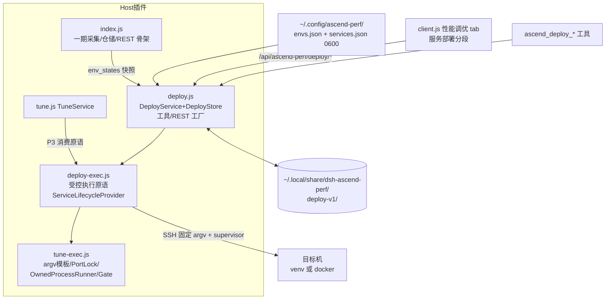
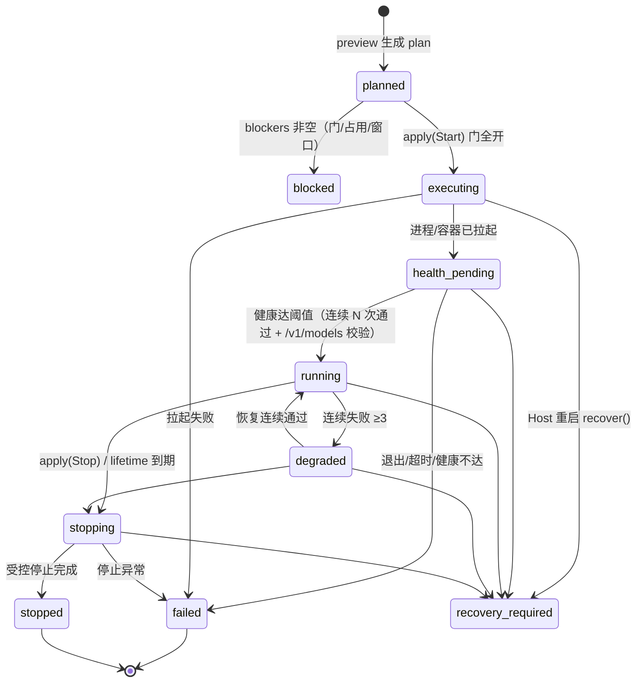

# 昇腾性能工作台：推理服务部署集成技术方案

> 任务 t21；版本 1.0；日期 2026-11-07。本文是待实现的部署集成契约，不代表部署执行器已交付或真机部署已验证。本轮只交付方案；不改代码、不连接 NPU、不启停任何远端服务。

## 1. 依据、目标与边界

复用依据：[一期技术设计](./tech-design.md)、[界面设计](./ui-design.md)、[二期调优技术方案](./tuning-design.md)、[调优界面设计](./tuning-ui-design.md)、[实现与验证记录](./verification.md)、[共享环境只读报告](./real-env-report.md)。实现现状以代码为准。

### 1.1 定位：部署编排 + 服务状态面板，不是部署系统

用户诉求是"把推理服务部署到对应机器"并集成进插件。本方案将其收敛为：把用户在 `services.json` 声明的服务资产编译成**受控命令序列**，经 **dry-run 预览 → 用户显式确认 → 三重授权门**后在目标环境执行，并提供服务状态、健康与日志尾部的只读视图。与二期调优的关系是**双向复用**：

- 部署模块复用 `tune-exec.js` 的全部受控执行原语（argv 编译、端口锁、自有进程管理、SSH 固定外层、realExecutionGate 语义）；
- 部署模块作为调优的**启停原语提供方**（`ServiceLifecycleProvider`，§8），三期调优真实执行时 trial 的服务启停走该原语，不再直接 spawn。

| 维度 | 决策 |
|---|---|
| 做 | 单服务单环境受控启停（Start/Stop）、健康轮询、状态面板、部署向导、审计、demo 全流程 |
| 不做 | 多机编排、镜像构建/推送、K8s/Compose、生产流量切换、自动安装依赖、系统服务（systemd）管理、重启策略/自愈调度、服务资产在 UI 内编辑 |
| 环境形态 | venv 直启 与 docker 容器两种模板（真实环境负载在 36 个容器内，见 real-env-report，docker 为一等公民） |
| 默认状态 | 一切启停默认 dry-run；真实执行三重门（§7.1）默认全关，fail-closed 交付 |
| 与一期只读承诺 | 观测采集路径保持只读不变；插件边界从"只读观测"演进为"观测（只读）＋调优（demo）＋部署（编排，真实执行默认关闭）"，README 口径随 P1 更新 |

### 1.2 现状接口核对（实现依据）

| 已核对接口 | 现状与部署集成影响 |
|---|---|
| `tune-exec.js` 原语 | `buildServeArgv`/`buildBenchArgv`/`PortLock`/`OwnedProcessRunner`/`realExecutionGate`/`LocalExecutor`/`SshExecutor.sshArgv`/`probeLocalPort` 与三个 `assert*` 校验器全部可复用；部署不重写执行原语 |
| `envs.json`（t17） | 环境注册表与占用判定（chip 级观察→环境档位 idle/partial/busy/unknown）是部署目标与预检的数据源；部署的 per-env 扩展字段挂在此文件 |
| `tune.js` 模式 | schema 常量、`writeJsonAtomic`、quarantine、幂等键、blocked 收据、事件流、工具/REST 工厂模式直接平移为 `deploy.js` |
| REST 骨架 | `/api/ascend-perf/*` prefix + fail-closed 鉴权（AUTH_UNAVAILABLE/AUTH_ERROR/401）+ `{path,method,handler}` 数组，部署路由按同一模式追加 |
| client.js | keyed slot `sidebar.right.pane.tab`（`ascend-perf-tune`，"性能调优"）；部署 UI 并入该 tab，不新增 sidebar tab |
| tuning-design §5 | 执行器准则（§5.1 dry-run 不连远端）、EffectManifest/AuthorizationGrant（§5.2）、supervisor 七步（§5.3）、模板防注入（§5.4）、进程组租约（§5.5）全部继承为部署执行约束 |

## 2. 总体结构与模块边界

新增两个 Host 文件，模式分别对齐 `tune.js` 与 `tune-exec.js`：



- `deploy.js`：services.json 读写与校验、部署计划编译（preview）、deploy record 状态机、审计、工具与 REST 工厂。纯模块，注入依赖，不直接访问 `ctx`。
- `deploy-exec.js`：`ServiceLifecycleProvider`（demo/local/ssh 三形态）、docker/venv 命令编译器、占用预检策略、审计写入器。`import` 自 `tune-exec.js`，不复制其逻辑。
- `index.js` 仅增加装配：`new DeployService({ dataDir, config, benchSource: envStateReader })` + 工具/路由注册 + configDir 透传。观测采集路径零改动。
- 数据目录 `dataDir/deploy-v1/`，与 `tuning-v1/` 并列：`deploys/<id>/`（record+events.jsonl）、`audit.jsonl`、`locks/`、`quarantine/`、`demo/`（演示分仓，不混真实）。0700/0600 原子写，损坏 → quarantine，全部沿用 TuneStore 约定。

## 3. services.json 资产契约

与 `envs.json` 同目录（默认 `~/.config/ascend-perf/services.json`，0600，目录 0700，原子写 tmp+rename）。读取失败不覆盖原文件，报 `SERVICES_CONFIG_READ_FAILED`（同 envs.json 容错模式）。文件不存在视为空列表（首次使用给出创建指引），不自动播种。文件含内网拓扑与资产路径，虽无凭据仍按 0600 保护；凭据一律不落此文件（SSH 走既有 `~/.ssh`，HF/云 token 不进入部署链路，对齐 tuning-design §5.4）。

### 3.1 结构（schema `dsh-ascend-perf/services-v1`）

```json
{
  "version": 1,
  "services": [
    {
      "id": "svc-qwen3-8b-a",
      "name": "Qwen3-8B @ A机",
      "env_id": "env-ascend-a",
      "enabled": true,
      "runtime": {
        "kind": "docker",
        "docker": {
          "image": "registry.internal/vllm-ascend:v0.9.1-cann81",
          "shm_size_mb": 32768,
          "mounts": ["/usr/local/dcmi", "/usr/local/bin/npu-smi", "/usr/local/Ascend/driver"],
          "extra_env": { "HF_HUB_OFFLINE": "1" }
        }
      },
      "model": {
        "path": "/data/models/Qwen/Qwen3-8B",
        "served_model_name": "qwen3-8b",
        "dtype": "float16",
        "quantization": "none",
        "tensor_parallel": 4,
        "device_ids": [0, 1, 2, 3]
      },
      "params": {
        "port": 18080,
        "max_num_seqs": 256,
        "max_num_batched_tokens": 8192,
        "gpu_memory_utilization": 0.9,
        "max_model_len": 16384
      },
      "health": {
        "http_path": "/health",
        "model_path": "/v1/models",
        "interval_s": 5,
        "startup_timeout_s": 900,
        "healthy_threshold": 3
      },
      "max_lifetime_s": 43200
    }
  ]
}
```

venv 形态的 `runtime`：

```json
{ "kind": "venv", "venv": { "python_abs": "/opt/venv-npu/bin/python", "vllm_abs": "/opt/venv-npu/bin/vllm" } }
```

### 3.2 字段与校验规则

| 字段 | 规则 | 校验器 |
|---|---|---|
| `version` | 必须 `1`；未知版本整文件拒绝（防止静默误读） | 常量比较 |
| `services[].id` | `svc-` 前缀 + `[a-z0-9-]`，全局唯一，≤64 字符 | `assertSafeToken` |
| `services[].name` | 非空 ≤120；仅展示 | `assertSafeToken` 放宽 |
| `services[].env_id` | `env-` 前缀；**跨文件引用**：preview 时对 envs.json 当前内容解析，缺失 → blocker `ENV_UNKNOWN`（配置读取失败不级联炸预览） | `assertSafeToken` |
| `runtime.kind` | `docker` \| `venv`，二选一；对应子对象必填且另一侧必须缺席 | 枚举 |
| `docker.image` | 非空；`registry/repo:tag` 形态（不得含 shell 元字符），≤256 | `assertSafeToken` |
| `docker.mounts[]`、`extra_env` 键值 | 绝对路径、键 `[A-Z_][A-Z0-9_]*`；值经 `assertSafeToken`（作为单元素 argv/env 传递，永不拼接 shell） | 同上 |
| `venv.python_abs` / `venv.vllm_abs` | 绝对路径，`/` 开头，无控制符 | `assertSafeToken` |
| `model.path` | 绝对路径（目标机视角），无控制符/换行 | `assertSafeToken` |
| `model.served_model_name` | 非空 ≤128 | `assertSafeToken` |
| `model.dtype` | `float16`\|`bfloat16`\|`float32`（与 tune fixed 同枚举） | 枚举 |
| `model.quantization` | `none` 或运行时 profile 认可的标识；`none` 时不加 `--quantization` | `assertSafeToken` |
| `model.tensor_parallel` | 1–8；**必须等于 `device_ids.length`**（与 tune-spec fixed 同规则） | `assertIntInRange` + 联合校验 |
| `model.device_ids[]` | 0–63 唯一升序；逻辑 ID，运行时由 profile 映射为容器可见设备，**禁默认写 `CUDA_VISIBLE_DEVICES`/`ASCEND_RT_VISIBLE_DEVICES` 之外的环境变量**（映射由模板完成） | `assertIntInRange` |
| `params.port` | 1024–65535 | `assertIntInRange` |
| `params.max_num_seqs` | 1–1024；`max_num_batched_tokens` 128–131072；`gpu_memory_utilization` 0.1–0.95；`max_model_len` 256–131072（与 `buildServeArgv` 同界） | `assertIntInRange`/`assertFiniteInRange` |
| `health.http_path`/`model_path` | 以 `/` 开头路径，无控制符；默认 `/health`、`/v1/models` | `assertSafeToken` |
| `health.interval_s` | 2–60，默认 5；`startup_timeout_s` 30–3600，默认 900；`healthy_threshold` 1–10，默认 3 | `assertIntInRange` |
| `max_lifetime_s` | 900–259200（15 分钟–72 小时），默认 43200（12h）；**硬上限 72h，配置更大值直接校验失败** | `assertIntInRange` |
| 未知字段 | 一律 `UNKNOWN_FIELD` 拒绝（rejectUnknown，同 tune-spec） | 白名单 |

条目数量上限 32（与 envs ≤16 同量级；部署面板可扫读）。`enabled:false` 的服务出现在资产列表但 preview/apply 直接 `SERVICE_DISABLED`。

### 3.3 与调优资产的关系（单源原则）

`tune.js` 的 `TUNE_ASSETS` 目前是内置 demo 注册表。P3 起 `model_asset_id` 解析顺序：内置 demo 条目优先 → 其余形如 `svc-` 前缀的资产 ID 解析到 `services.json` 条目（`model.*` 与 `params.*` 恰好覆盖 tune-spec 的 `fixed` 所需字段，`env_id` 给出 target）。也就是 **services.json 是真实模型资产的唯一注册源**，调优不再另建资产文件；映射细节在 P3 任务中按本节契约实现。

## 4. 部署计划与命令编译

preview 是**纯本地计算**：不连远端、不扫端口、不探测 URL（继承 tuning-design §5.1）。产物为 deploy plan（schema `dsh-ascend-perf/deploy-plan-v1`），TTL 1 小时（绑定占用证据与窗口，短于调优 plan 的 24h）。

### 4.1 deploy plan 结构

```js
{
  schema: 'dsh-ascend-perf/deploy-plan-v1',
  deploy_plan_id: 'dp-<rand>',
  plan_hash: 'sha256:…',          // canonicalJson({service_id, env_id, params, template_id, template_hash, occupancy_evidence, window})
  service_id, env_id, runtime_kind,
  commands: {
    start:  { template_id: 'serve-venv-v1' | 'serve-docker-v1',
              argv_redacted: [ '…<asset:svc-qwen3-8b-a>…' ], argv_sha256 },
    health: { template_id: 'health-loopback-v1', http_path, model_path, interval_s, startup_timeout_s, healthy_threshold },
    stop:   { template_id: 'stop-venv-v1' | 'stop-docker-v1', grace_ms: 30000 }
  },
  effect_manifest: { target_id: env_id, ports: [port], device_ids, container_prefix?, start_service: true,
                     health_requests: 'bounded', stop_owned_processes: true, cleanup_owned_files: [...],
                     max_duration_s: max_lifetime_s, compiled_template_hashes: {…} },
  occupancy: { policy: 'deny_unless_idle', evidence: { snapshot_id, captured_at, tier } | { state: 'missing'|'stale'|'demo-idle' } },
  window: { mode: 'always' } | { mode: 'schedule', matched: true|false, schedule_ref } | null,
  blockers: [ { code, message, hint } ],
  expires_at: '<+1h>'
}
```

- `argv_redacted`：模型路径/venv 路径/镜像替换为 `<asset:svc-…>` 占位（同调优 `commands_preview` 口径），真实 argv **不落 plan**；apply 时按 services.json 当前内容重编译并比对 `argv_sha256`，不一致 → `DEPLOY_HASH_MISMATCH`（资产被改后旧计划作废，必须重新预览确认）。
- `blockers` 非空时 apply 直接拒绝（blocked 收据，同 tune）：真实门未开（`REAL_DEPLOYMENT_DISABLED`/`AUTH_BRIDGE_UNAVAILABLE`）、`ENV_OCCUPIED`/`OCCUPANCY_UNKNOWN`、`MAINTENANCE_WINDOW_CLOSED`、`PORT_BUSY`（本地形态探测）。demo 服务无真实门 blocker。

### 4.2 命令模板（防注入约束）

全部模板输出 **argv 数组**（无 shell 拼接）；用户/文件提供的值只作为单元素插入。模板带 `template_hash`（编译器内置常量内容 hash）参与 plan_hash。

**serve-venv-v1**（本地或 SSH 目标机直启）＝ `buildServeArgv`（复用，参数来自 service 条目）：`pythonAbs -m vllm.entrypoints.openai.api_server --host 127.0.0.1 --port <port> --served-model-name <name> --tensor-parallel-size <tp> [--quantization <q>] --dtype <dtype> --max-num-seqs … --max-num-batched-tokens … --gpu-memory-utilization … --max-model-len … <model_path>`。界与开关逻辑与 tune-exec 完全一致。

**serve-docker-v1**（固定骨架，昇腾驱动挂载约定）：

```
docker run --rm --detach --name dsw-apf-<service_id>-<deploy_seq>
  --device /dev/davinci<i>        # 逐个映射 device_ids 映射后的物理设备
  --device /dev/davinci_manager --device /dev/devmm_svm --device /dev/hisi_hdc
  -v /usr/local/dcmi:/usr/local/dcmi -v /usr/local/bin/npu-smi:/usr/local/bin/npu-smi
  -v /usr/local/Ascend/driver:/usr/local/Ascend/driver       # = docker.mounts
  --shm-size <shm_size_mb>m
  -e ASCEND_VISIBLE_DEVICES=<mapped_ids>                      # 由 profile 从逻辑 device_ids 映射
  -e <extra_env …>
  -p 127.0.0.1:<port>:<port>                                   # 仅回环发布，不用 --network host
  <image> --host 127.0.0.1 --port <port> <…同 serve-venv-v1 的 vllm 参数…> <model_path>
```

- 容器名前缀 **`dsw-apf-`** 是 ownership 边界：停止/清理只作用于该前缀且 ledger 记录在案的自有容器，绝不匹配其他容器。
- `-p 127.0.0.1:port:port`：端口语义确定、暴露面最小；服务只绑回环，压测与健康检查都在目标机 loopback 上。
- device_ids 逻辑→物理映射由运行时 profile 提供（demo/ssh 各自 profile 常量），编译期只保留逻辑 ID，profile 缺失 → blocker。

**stop-venv-v1**：SIGTERM 自有 pgid → grace（默认 30s）→ SIGKILL（仅当 `{owner_token,pid,pgid,uid,start_ticks}` 身份仍匹配，对齐 §5.5；PID 复用不误杀）。
**stop-docker-v1**：`docker stop --time <grace_s> dsw-apf-<…>`（自有名）→ `docker rm` 仅对 `--rm` 未生效残留；仍校验名字前缀 + ledger。
**health-loopback-v1**：由目标机侧 supervisor 执行（§6.3），Host 不跨网访问端口。

**SSH 传输**＝ `SshExecutor.sshArgv` 固定外层（`ssh -T -o BatchMode=yes -o StrictHostKeyChecking=yes -o ClearAllForwardings=yes -o ConnectTimeout=5 …`），remote command 是编译器**内置常量**的 Python supervisor 引导（`python -I -c '<常量代码>'`，内容 hash 固定，对齐 tuning-design §5.4）：数据（编译产物、端口、租约参数）经 stdin 帧传入，远端在 supervisor 内再次编译/展开 argv 后 `Popen(shell=False, start_new_session=True)`。alias 校验拒绝 `@`/`:`/前导 `-`。远端日志写 sandbox 内轮转文件（1 MiB × 3）。

## 5. 部署动作状态机

### 5.1 用户流程（部署向导对应步骤）

选环境（envs.json 只读列表）→ 选服务（services.json 只读列表）→ 填参数（模板默认值 + 白名单覆盖）→ **命令预览**（dry-run，只生成不执行）→ **用户显式确认**（危险弹窗，见 §10）→ 受控执行 → 健康轮询 → 面板呈现"我部署的服务"与"别人占用"打标。

参数覆盖白名单（preview `overrides` 仅接受）：`params.port`、`params.max_num_seqs`、`params.max_num_batched_tokens`、`params.gpu_memory_utilization`、`params.max_model_len`、`model.dtype`、`model.quantization`、`model.tensor_parallel`+`model.device_ids`（联动）。其余字段一律 `UNKNOWN_FIELD` 拒绝；覆盖值走 §3.2 同一校验器。

### 5.2 deploy record 状态机（schema `dsh-ascend-perf/deploy-v1`）



- `cleanup_state` 子状态（同 tune）：`pending | verified | unknown`；`stopped/failed` 终态要求清理已核实（进程消失/容器不在/端口释放），否则停在 `stopping` 并标 `cleanup_state:unknown`，面板显示"清理未知，需人工核实"。
- 幂等：apply(Start) 幂等键 `deploy_plan_id + confirmation_token`；同一 service 在同 env 已有活跃 record 时再次 Start → 直接返回现有 record（不重复拉起）；apply(Stop) 只作用于 `mine-*` record，否则 `NOT_OWNED_SERVICE`。
- `max_lifetime_s`：到点自动走 stopping（审计 `lifetime_expiry`），面板提前 30 分钟警示；用户可显式续期一次（重新 preview+confirm，上限仍 72h）。
- Host 重启 `recover()`：活跃态一律 → `recovery_required`，**不自动重启**。远端因 supervisor 心跳丢失（§6.4）预期已自行收尾；本地形态可对 ledger 中 `{pid,start_ticks}` 仍匹配的自有进程发起一次受控 stop（同样过门 + 审计）；SSH 形态只提供"核实/标记已处理"人工动作。

## 6. 受控执行设计（apply 全链路）

### 6.1 执行前置（顺序固定，任一失败即拒）

1. **门 1–3 评估**（§7.1）：`deploy.enableRealExecution` 配置、per-env `deploy.allowRealExecution` + 维护窗口、confirmation_token（绑定 `deploy_plan_hash`，TTL 10 分钟，单次使用；无授权桥 → `AUTH_BRIDGE_UNAVAILABLE`）。
2. **argv 重编译 + hash 比对**：与 plan 的 `argv_sha256` 不符 → `DEPLOY_HASH_MISMATCH`。plan 过期 → `DEPLOY_PLAN_EXPIRED`。
3. **端口锁**：本地形态 `PortLock.acquire(port)`（探测即释放，占用 → `PORT_BUSY`，**绝不杀占用者**）；SSH 形态由远端 supervisor 在拉起前同规则探测并回传结果。本插件内 `held` 集合协调与调优互斥。
4. **占用预检（TOCTOU 防护）**：apply **强制重新只读采集**目标 env（npu-smi `info`+`usages`，与「刷新全部」同一只读路径，绝不引入新探测命令）→ 环境档位必须 `idle` 且目标 device_ids 对应 chip 逐一空闲；档位 `partial/busy` → `ENV_OCCUPIED`（返回占用进程 top3 供用户辨认）；档位或 chip `unknown` → `OCCUPANCY_UNKNOWN` 拒绝（**fail-closed：看不清就不动手**）。demo env 用合成 idle 证据。
   - preview 阶段不做上述采集，只读 `env_states` 缓存快照（>10 分钟视为过期 → blocker `OCCUPANCY_UNKNOWN` + 提示先「刷新全部」），严格遵循 §5.1"dry-run 不为预检连远端"。

### 6.2 拉起（executing → health_pending）

- 本地：`OwnedProcessRunner`（只持自有 handle；vLLM 进程由常量引导代码以 `start_new_session=True` 启动，stdout/stderr 重定向 sandbox 日志文件）。
- SSH：supervisor 引导（§4.2），同一文件内拉起。
- docker：supervisor 执行 `docker run --detach`，记录 `container_id`、名字、`port` 进 lease。

### 6.3 健康轮询（health_pending → running / degraded）

健康检查**全部发生在目标机 loopback**：supervisor 以 `interval_s` 周期 GET `127.0.0.1:<port><http_path>`（2s 超时），`startup_timeout_s` 内通过 `healthy_threshold` 次后，再校验 `<model_path>`（`/v1/models`）包含 `served_model_name`（防止"端口活着但服务不对"）。结果以 JSONL 帧回传 Host，Host 只汇总状态，**从不跨网访问服务端口**（不扩攻击面，也不依赖目标机防火墙放行）。连续失败 ≥3 → `degraded`；`startup_timeout_s` 内未达标 → `failed`（进入清理）。

### 6.4 租约与自愈（对齐 tuning-design §5.5）

supervisor 持 `{owner_token, pid, pgid, uid, start_ticks, container?}` ledger；Host 每 5s 心跳帧。supervisor **20s 无心跳 / stdin EOF / grant·lifetime 截止** → 自行按 stop 模板收尾（SIGTERM→grace→SIGKILL 或 docker stop，身份匹配才动手），结果写 sandbox 内审计尾巴。含义：**Host 崩溃/休眠不留孤儿服务**——共享环境优先 fail-safe；代价是服务存活与 Host 会话绑定，长驻需求由 `max_lifetime_s` + 续期承接（决策记录 DR-6）。

### 6.5 停止与清理

apply(Stop) → stopping：stop 模板 → 轮询确认（进程消失/容器移除/端口释放/自有文件已删，只删 manifest 内自有产物，拒 symlink 逃逸）→ `cleanup_state:verified` → stopped。失败重试一次后 `cleanup_unknown` 并提示人工命令（只展示，不代执行）。

## 7. 安全边界

### 7.1 三重门（同构 realExecutionGate，不造第二套授权）

| 门 | 内容 | 缺失时错误码 |
|---|---|---|
| 门 1 配置硬开关 | 插件配置 `deploy.enableRealExecution`，默认 `false`（地位同 `tuning.enableRealExecutors`） | `REAL_DEPLOYMENT_DISABLED` |
| 门 2 per-env 授权与窗口 | envs.json 每环境可选扩展 `deploy: { allowRealExecution: false, maintenanceWindow: { mode: "always"\|"schedule", schedule: [{ days: [1..7], start: "22:00", end: "06:00", timeZone: "Asia/Shanghai" }] } } }`；缺省 `allowRealExecution:false`；`mode:"schedule"` 时 apply 时刻必须落在某区间（RFC3339 带时区；`start>end` 视为跨午夜；窗口只约束"允许操作的时段"，**不代替确认**） | `REAL_DEPLOYMENT_DISABLED` / `MAINTENANCE_WINDOW_CLOSED` |
| 门 3 显式确认 | preview 返回 `confirmation_challenge{deploy_plan_id, plan_hash, challenge_nonce}`；用户在 UI 危险弹窗确认后 Host 签发 `confirmation_token`（绑定 plan_hash + nonce，TTL 10 分钟，单次使用）。当前无授权桥：demo apply 放行，真实 apply 一律 `AUTH_BRIDGE_UNAVAILABLE`（fail-closed 交付）。P3 授权桥就绪后 confirmation 升级为完整 `AuthorizationGrant`（§5.2 字段原样），grant 的 `allowed_actions ⊇ start_service/stop_service` 且 `plan_hash` 匹配 | `CONFIRMATION_REQUIRED` / `CONFIRMATION_INVALID` / `AUTH_BRIDGE_UNAVAILABLE` |

demo 形态（demo env + demo service）三重门直通（同 realExecutionGate 对 demo 的豁免），保证无 NPU 演示全流程。

### 7.2 审计日志（`deploy-v1/audit.jsonl`，只增）

每行：

```json
{ "ts": "RFC3339", "seq": 123,
  "principal": { "kind": "host-session", "ref": "<会话标识哈希>", "origin": "tool|rest|ui" },
  "action": "preview|apply_start|apply_stop|health_fail|lifetime_expiry|cleanup|recover",
  "env_id": "env-ascend-a", "service_id": "svc-qwen3-8b-a", "deploy_id": "dep-…",
  "plan_hash": "sha256:…", "argv_sha256": "…", "exit_code": 0,
  "outcome": "ok|blocked|failed", "detail": "≤256 字符截断" }
```

- **谁**：当前 Host 无用户身份体系，`principal` 诚实记录会话标识哈希与来源，不伪造个人归因（局限在文档与 README 声明）。
- **何时/哪台机/什么命令/结果**：`ts`+`env_id`+`plan_hash`/`argv_sha256`（真实 argv 不落盘，hash + redacted 预览可溯源）+ `outcome`/`exit_code`。
- seq 单调递增，追加写，不修改不删除；demo 记录 `detail` 前缀 `demo:` 以便区分。

### 7.3 fail-closed 清单（共享环境硬约束）

一切启停默认 dry-run；显式确认前不执行任何远端写操作；**绝不杀/抢非自有进程与容器**（ownership 边界 = owner_token ledger + `dsw-apf-` 前缀）；占用未知即拒绝；无授权桥即拒绝真实 apply；审计先于动作落盘（`apply_start` 在 spawn 前写入）；观测采集路径保持只读零改动；token/密钥不进配置文件、不进日志、不传 supervisor。

## 8. ServiceLifecycleProvider 启停原语契约（P2 交付，P3 调优消费）

`deploy-exec.js` 导出 `createServiceLifecycleProvider({ config, envs, spawn, sshArgv, portLock, auditSink, demo })`，三形态同接口（demo/local/ssh）。这是调优三期接入真实执行的唯一启停通道：

```ts
startService(request) → Promise<{
  service_lease_id, owner_token,
  transport: 'local' | 'ssh' | 'demo',
  pid?, pgid?, container?: { id, name },
  port, bind: '127.0.0.1',
  started_at, heartbeat_interval_ms: 5000,
  health: { state: 'pending' | 'healthy' | 'unhealthy', checked_at, detail }
}>
stopService({ service_lease_id, grace_ms = 30000, reason }) → Promise<{ stopped: boolean, cleanup_state: 'verified' | 'unknown', exit_code? }>
serviceStatus({ service_lease_id }) → { state, health, uptime_s, last_heartbeat_at }
listLeases({ env_id? }) → Lease[]
```

`request = { env_id, service_id?, purpose: 'deploy' | 'tune-trial', command_plan: { template_id, argv_sha256 }, ports, device_ids, max_lifetime_s, grant? , health_plan }`（调优 trial 传 `purpose:'tune-trial'` + `grant`；`service_id` 可空表示临时实验服务，不属于 services.json 资产）。

**契约不变式**：

1. 每次调用独立评估三重门（demo 豁免）并写审计；grant 的 `plan_hash` 必须与 `command_plan.argv_sha256` 同源匹配，否则 `CONFIRMATION_INVALID`。
2. lease 即 tuning-design §5.5 的 ownership ledger；`stopService` 只作用于本 provider 签发的 lease（`NOT_OWNED_SERVICE`）。
3. `startService` 内部完成 §6.1 全部前置（门、hash、端口锁、占用预检）；不满足即抛结构化错误，不留半启动状态（失败自动清理）。
4. TuneService（P3）trial 的 `starting/health_check/cleaning` 阶段改为调用 provider，**删除直接 spawn 路径**；`realExecutionGate` 语义保留在 provider 内部，工具面不新增授权 mint/revoke。
5. 心跳与自愈（§6.4）对 `purpose:'tune-trial'` 同样生效（调优作业本就有界，与 72h 上限无冲突）。

## 9. 工具面与 REST 契约

### 9.1 三个新工具（独立于 tune 工具族）

| 工具 | 输入（信封 `deployEnvelope`，口径同 `tuneEnvelope`） | 输出要点 |
|---|---|---|
| `ascend_deploy_preview` | `{ service_id, overrides? }`；只读、永不执行 | deploy plan（redacted argv、effect_manifest、占用证据、窗口判定、blockers、confirmation_challenge） |
| `ascend_deploy_apply` | `{ action: 'Start' \| 'Stop' }`；Start 需 `{ deploy_plan_id, plan_hash, confirmation_token }`，Stop 需 `{ deploy_id }` | 受控执行收据 `{ deploy_id, state, cleanup_state, audit_ref, blockers? }`；demo 形态标注 `source:'demo'` |
| `ascend_deploy_status` | `{ deploy_id?, env_id?, tail_lines? ≤200 }` | 服务×环境视图（打标，§10.2）、deploy records、健康、日志尾部 |

选独立三工具而非并入 `ascend_tune_run` 的 action：部署是长驻生命周期（Start/Stop/健康/续期），调优是有界作业（Start/Pause/Stop 作业）；action 语义混合会让授权边界与审计语义模糊。工具族命名与 tune 对称（preview/apply/status vs plan/run/status）。

### 9.2 REST（挂 `/api/ascend-perf` prefix，fail-closed 鉴权同现有实现）

| 路由 | 方法 | 说明 |
|---|---|---|
| `/deploy/services` | GET | 资产列表 × 环境状态摘要（打标），含 services.json 路径（只读 ConfigBar 口径） |
| `/deploy/preview` | POST | 同工具；返回 confirmation_challenge |
| `/deploy/apply` | POST | 同工具；`action:'Start'\|'Stop'` |
| `/deploy/status` | GET / POST | 同工具；GET 支持 `deploy_id`/`env_id`/`tail` 参数 |
| `/deploy/logs` | GET | `deploy_id` + `tail_bytes ≤ 16384`；只读日志尾部 |

鉴权失败矩阵沿用：桥不可用 → 503 `AUTH_UNAVAILABLE`；异常 → 500 `AUTH_ERROR`；拒绝 → 401。405/404 由既有路由骨架处理。

### 9.3 错误码总表（新增，风格对齐一期）

`SERVICES_CONFIG_READ_FAILED` / `SERVICE_UNKNOWN` / `SERVICE_DISABLED` / `ENV_UNKNOWN` / `PORT_BUSY` / `ENV_OCCUPIED` / `OCCUPANCY_UNKNOWN` / `HEALTH_TIMEOUT` / `DEPLOY_PLAN_EXPIRED` / `DEPLOY_HASH_MISMATCH` / `CONFIRMATION_REQUIRED` / `CONFIRMATION_INVALID` / `MAINTENANCE_WINDOW_CLOSED` / `REAL_DEPLOYMENT_DISABLED` / `AUTH_BRIDGE_UNAVAILABLE` / `NOT_OWNED_SERVICE` / `CLEANUP_UNKNOWN` / `RECOVERY_REQUIRED`。

## 10. UI 信息架构与数据契约（细节归设计师任务）

约束（硬边界）：**不新增 sidebar tab、不新增页面路由**；并入「性能调优」tab，内部增加二级分段「调优作业 | 服务部署」（具体形态由设计师在 tuning-ui-design.md 体系内定稿）；token/组件全部复用 ui-design.md §14 与 tuning-ui-design.md §11 体系，不新增硬编码色；**资产配置出页面**——services.json 只在页面只读展示路径（ConfigBar 模式），UI 零资产编辑。

### 10.1 服务部署分段结构

服务列表（主体）+ 部署向导（四步：选环境与服务 → 参数覆盖 → 命令预览 → 确认执行）+ 只读日志抽屉（尾部 ≤16KiB，手动刷新，不自动滚动，Esc 关闭焦点归还，对齐 §11.4 日志抽屉规范）。

### 10.2 打标规则（"我部署的" vs "别人占用"）

`owned_by_plugin` = deploy-v1 存在该 service 的活跃 deploy record（owner_token 属本 Host 实例）。列表状态：

| 打标 | 判定 | 视觉（对齐 §11.2） |
|---|---|---|
| `mine-running` | 活跃 record 且 health=healthy | 成功色 + 静态图标 |
| `mine-degraded` | 活跃 record 且 degraded | 警告色 |
| `mine-stopped` | record 终态 | 中性 + 停止图标 |
| `external-occupied` | 无活跃 record 但环境档位 ≠idle（占用来自观测快照 top3 进程） | 警告/危险 + 文案"外部占用 · 非本插件部署"，附 ChipStrip |
| `env-idle` | 环境空闲、服务未部署 | 成功描边，可发起部署 |
| `unknown` | 占用未知/连接失败 | 中性虚线 +「数据过期」角标（同 §14 连接态降级） |

demo record 走业务蓝虚线 + DEMO chip（同调优 demo 规范）。排序 mine-degraded → mine-running → external-occupied → env-idle → mine-stopped → unknown。

### 10.3 数据契约（`/deploy/services` 返回项）

`{ service_id, name, enabled, env: { id, name, mode, occupancy, top_processes, conn }, state, health, owned_by_plugin, deploy_id?, started_at?, port, served_model_name, params_summary, max_lifetime_s, lifetime_expires_at, last_event }`。危险动作（apply/Stop/续期）一律走危险确认弹窗（`role="alertdialog"`，宽 480–560，确认输入 + Esc 取消，焦点先到"取消"，对齐 §11.3–11.5）；lifetime 到期前 30 分钟警示条（`role="status"`）。

## 11. 测试计划

全部离线（demo 形态 + fixture），不连 NPU/远端：

1. **services.json 校验**：合法样例通过；未知字段/`version≠1`/`tp≠len(device_ids)`/port 越界/路径控制符/`max_lifetime_s>72h` 各自拒绝；读取失败不覆盖原文件；文件缺失=空列表。
2. **命令编译**：`serve-venv-v1`/`serve-docker-v1` argv 快照断言（golden fixtures）；注入用例（模型路径含空格/引号/`$()` — 断言值仅作单元素出现，模板骨架不变）；redaction（`<asset:svc-…>`）；`overrides` 白名单外字段拒绝。
3. **门 fail-closed**：无授权桥真实 apply → `AUTH_BRIDGE_UNAVAILABLE`；`enableRealExecution=false` → `REAL_DEPLOYMENT_DISABLED`；窗口外 fixture → `MAINTENANCE_WINDOW_CLOSED`；token 过期/重放/plan_hash 不匹配 → `CONFIRMATION_INVALID`/`DEPLOY_HASH_MISMATCH`；demo apply 放行。
4. **占用预检**：busy/partial fixture → `ENV_OCCUPIED`（含 top3 回显）；unknown/stale → `OCCUPANCY_UNKNOWN`；idle fixture 放行；preview 不触发采集（断言无 spawn 调用）。
5. **状态机**：拉起失败→failed+清理；健康超时→`HEALTH_TIMEOUT`→failed；degraded 往返；Stop 幂等；`NOT_OWNED_SERVICE`；Host 重启 recover→`recovery_required`；lifetime 到期自动停止 + 审计 `lifetime_expiry`。
6. **审计**：追加、seq 单调、`apply_start` 先于 spawn、detail 截断 256、敏感字段不落盘、demo 前缀。
7. **REST**：401/503/500 fail-closed 矩阵；405/404；`/deploy/logs` 尾部 16KiB 上限。
8. **回归**：`node --check index.js client.js deploy.js deploy-exec.js` + `node test/run-tests.mjs`（一期+调优既有项全绿，新增项计入总数）。

## 12. 分阶段落地

| 阶段 | 范围 | 验收 |
|---|---|---|
| **P1 资产 + dry-run 预览** | services.json 读取/校验/容错；deploy plan 编译（两模板）；`ascend_deploy_preview` 工具 + preview/services REST；UI 服务部署分段（只读列表 + 预览向导，无执行按钮生效态）；demo preview；README 口径更新（只读→编排演进） | §11 的 1/2/3(部分)/7/8 项；无 NPU 全流程可演示"预览命令" |
| **P2 受控启停原语 + 服务面板** | deploy-exec.js provider（demo 全实现；local/ssh 真实形态实现但门关闭交付）；DeployStore/状态机/审计/恢复；`ascend_deploy_apply/status` + apply/status/logs REST；服务面板打标 + 部署向导确认执行 + 日志抽屉；demo deploy 全流程（合成 record+日志尾部，分仓不混真实） | §11 全项；demo Start→healthy→Stop→cleanup verified 全链路演示 |
| **P3 接入调优真实执行** | TuneService 消费 provider（删除直接 spawn 路径）；`model_asset_id` → services.json 映射（§3.3）；授权桥 + 维护窗口打通后 `enableRealExecution` 真实路径（**本轮不启用**，启用前置条件写入 README：独占设备与端口声明、预装版本确认的运行时、非 root 身份、可写 sandbox、可信授权桥） | 联调 demo 回归全绿；真实执行仍默认关闭 |

## 13. 决策记录

| # | 决策 | 理由与代价 |
|---|---|---|
| DR-1 | 部署编排而非部署系统 | 不做多机编排/镜像构建/生产流量；插件价值在受控、可审计、与观测/调优同框；功能面上限低是接受的代价 |
| DR-2 | services.json 为真实资产唯一注册源 | 调优 P3 直接解析 `svc-` 条目，避免两处资产漂移；文件多一份需维护 |
| DR-3 | 独立三工具（preview/apply/status） | 长驻生命周期与有界调优作业语义不同，action 混合会模糊授权与审计边界；工具面多 3 个 |
| DR-4 | 三重门复用 realExecutionGate 语义 | 不造第二套授权模型，审计与 blocker 口径一致；部署门配置与调优门配置彼此独立（可分环境放开） |
| DR-5 | preview 只读缓存、apply 强制重采集占用 | 遵循 §5.1"dry-run 不为预检连远端"，同时封 TOCTOU：确认时刻必须最新证据；apply 慢一点是代价 |
| DR-6 | supervisor 心跳租约（20s 自愈） | Host 崩溃不留孤儿服务，共享环境 fail-safe 优先；代价是服务存活绑定 Host 会话，长驻靠 max_lifetime+续期承接 |
| DR-7 | max_lifetime_s 默认 12h、硬上限 72h、到期自动受控停止 | 共享环境保护优先于"永远在线"；与"部署服务长期跑"有张力，靠显式续期缓解 |
| DR-8 | 健康检查在目标机 loopback 由 supervisor 执行、帧回传 | Host 不跨网访问服务端口，不依赖防火墙放行、不扩攻击面；多一层 supervisor 逻辑 |
| DR-9 | docker 用 `-p 127.0.0.1:port:port` 而非 `--network host` | 端口语义确定、暴露面最小；昇腾驱动挂载模板化一次写死 |
| DR-10 | 容器名 `dsw-apf-` 前缀 = ownership 边界 | 停止/清理只作用于前缀+ledger 匹配的自有容器，杜绝误伤他人容器 |
| DR-11 | 审计 principal 记会话标识而非"用户" | 当前无用户身份体系，诚实记录局限优于伪造归因；后续有身份体系再升级字段 |
| DR-12 | 资产配置出页面 | 与 ui-design §14 一致，UI 零资产编辑降低误改面；资产管理成本转移到文件（有校验与错误提示兜底） |
| DR-13 | Host 重启后 recovery_required 不自动重启 | 无法在断链后证明远端身份前擅自操作违背 ownership 原则；本地仅允许 pid+start_ticks 匹配的受控 stop |

---

实施次序即 P1→P2→P3。本方案交付后：开发者按 §3–§9、§11 实现（P1 先行），设计师按 §10 在 tuning-ui-design.md 体系内定稿服务部署分段界面，审查者按 §11 测试计划与 §7.3 fail-closed 清单验收。共享昇腾环境的只读边界在 P1/P2 全程不变；P3 真实执行的启用永远以授权桥、维护窗口与三重门齐备为前置，不由本插件单方面打开。
