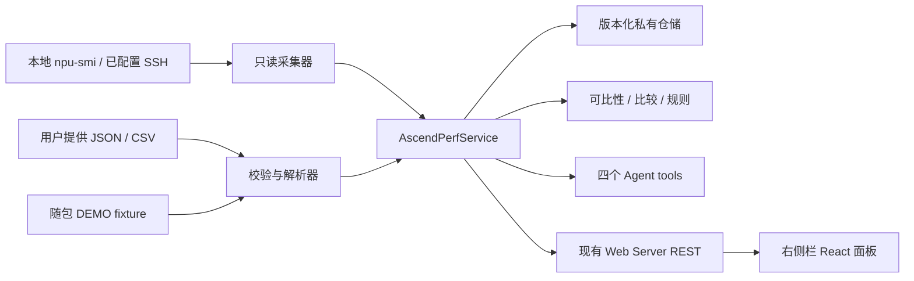

# 昇腾性能工作台 MVP 技术方案

设计契约 v1；2026-11-07；包名 `dsh-ascend-perf`；基准 DSH 版本 `0.2.1-rc.2`。本文供 UI、开发、自测与独立审查使用，所列实现与验收命令为下一阶段要求，不表示功能已经实现或安装通过。

## 1. 目标、依据与架构决策

承接 [市场分析](./market-analysis.md)：连接设备状态、已有性能产物、基准摘要和两次运行比较，形成“看证据 → 检查可比性 → 判断变化 → 排查建议”的闭环。Host 业务逻辑只实现一次，面板和 Agent 工具消费同一数据与结论。MVP 不运行自动调优、压测或 msprof 采集。

### 1.1 已核实的接口与证据限制

- Host Inspect 已核实 `tools.register(definition: ToolDefinition): () => void`、`subprocess.resolveExecutable(...)` / `spawn(spec)`、`webServer.register(route)`、`connection.requestRejection(request)`。本方案在现有 Web Server 注册受认证 REST 路由，不新建监听端口。
- Client 实时 `Slots.listSubTree` 两次超时，不能确认当前页面挂载状态。已读取安装包 `@deepseek-ai/dsh-client-ui-sidebar-right` 的公开声明 `client/index.d.ts`、`service.d.ts`、`tab-registry.d.ts`、`contract/slots.d.ts`，确认 `ctx.sidebarRightTabs.register()`、`ctx.sidebarRight.openTab()` 与 keyed slot `sidebar.right.pane.tab`。实施时必须补页面挂载与释放验证，不能把声明核对写成 UI 实测。
- 已读取 [真实环境报告](./real-env-report.md)、[info 原文](./samples/npu-smi-info.txt)、[逐卡 usages 原文](./samples/npu-smi-usages-all.txt) 与 [usages 错误样例](./samples/npu-smi-usages-error.txt)。`npu-smi 26.1.1` 样例为8卡、16chip；裸 `info -t usages` 返回 exit 215，实际可用形式为 `info -t usages -i N`。
- [建议快照](./fixtures/npu-snapshot.sample.json) 为 draft-0.1，只作为输入参考；本文正式契约为 `dsh-ascend-perf/v1`。开发者须显式适配，不可直接当 v1 仓储读取。
- msprof `op_summary_*.csv` 子集依据 [昇腾官方字段说明（CANN 7.0 alpha003）](https://www.hiascend.com/doc_center/source/zh/CANNCommunityEdition/700alpha003/developmenttools/devtool/atlasprofiling_16_0200.html)：`Op Name`、`OP Type`、`Task Type`、`Task Duration(us)`。Task Duration 包含调度、加速器执行与结束响应，不能称纯核执行时间。当前尚无真实 profile 文件，不宣称覆盖所有 CANN 导出版本。

### 1.2 决策记录

| 决策 | 选择 / 理由 | 约束 |
| --- | --- | --- |
| ADR-1 | 一个 Host + Client bundle，用户一次安装得到工具与面板 | 必须验证 tgz 内容与卸载 |
| ADR-2 | 单一 `AscendPerfService` 管解析、仓储、比较、规则 | UI 不另算结论 |
| ADR-3 | 静态只读命令 + 内容导入，减少共享环境影响 | 不支持任意远程命令 / 容器探测 |
| ADR-4 | 有界 JSON 仓储，原子替换；不引入数据库 | 单 Host 单写进程，多实例用不同 dataDir |
| ADR-5 | REST + 显式开启的低频刷新，首版无 SSE | 用 captured_at / stale 表达时效 |
| ADR-6 | 确定性规则 + 字段证据；不调用外部 AI | 只给排查假设，不保证根因或收益 |
| ADR-7 | 已有 msprof CSV 仅做热点排行 | 不把耗时合计当 wall time |



待验收目标：无 NPU 可完成5分钟演示；单输入≤1 MiB / 10,000行；最多200个run；工具摘要≤64 KiB；采集默认总预算15秒。以上不是已测结果。

## 2. 包结构、加载、安装与卸载

### 2.1 目录与 manifest

目标包布局（开发者阶段创建实现文件）：

```text
dsh-ascend-perf/
  package.json
  cordis.patch.yml
  icon.svg
  locale/{zh,en}.json
  src/
    host/{index,service,collector,ssh,store,compare,insights,rest,tools}.ts
    parsers/{npu-smi,vllm-json,benchmark-csv,msprof-csv}.ts
    shared/{contracts,validation,metrics}.ts
    client/{index,api,Panel,components}.tsx
  dist/{index.js,client.js}
  fixtures/
  test/
  README.md
  docs/
```

manifest 元数据契约（非实现代码）：

```json
{
  "name": "dsh-ascend-perf",
  "version": "0.1.0",
  "type": "module",
  "exports": {
    ".": "./dist/index.js",
    "./client": "./dist/client.js",
    "./locale/*.json": "./locale/*.json",
    "./icon": "./icon.svg"
  },
  "files": ["dist", "cordis.patch.yml", "locale", "icon.svg", "fixtures", "README.md", "docs"],
  "engines": {"node": ">=22", "dsh": "0.2.1-rc.2"},
  "dsh": {
    "bundle": {"patch": "./cordis.patch.yml"},
    "client": {
      "platform": "web",
      "immediately": true,
      "inject": ["@deepseek-ai/dsh-client-ui-sidebar-right"]
    }
  }
}
```

`dsh.client.inject` 是 Client 模块包 ID；Client 插件内部 `inject` 是 `slots/sidebarRightTabs/sidebarRight/locale` 等 service key，两者不可混用。浏览器产物使用 DSH Client 模块格式，`window.__ModuleLoader__.load` 的 id 等于包名，factory 内从 builtin `require('react')` 取 React，不打包第二份 React、不依赖 CDN。非 baseline runtime import 必须补 `dsh.client.external` 并验证。版本范围在实际安装测试后再扩宽，不能盲目声明所有 DSH 兼容。

`cordis.patch.yml`：

```yaml
- insert:
    - id: ascend-perf
      name: dsh-ascend-perf
      config:
        demoMode: false
```

Host 使用具名 `apply(ctx,config)` 和导出的 `Config` schema，`ctx.effect` 管理工具、路由、业务服务与退出清理，不同时再以 default Service 重复注册。Host 必需 `tools/subprocess`；`webServer/connection` 为可选 Web 能力，CLI-only 中工具可用并提示 `WEB_UI_UNAVAILABLE`。卸载取消自己的请求/短命采集子进程，移除路由、工具、Client tab/slot、定时器，排空写队列；不能关闭共享 DSH / SSH agent / 容器服务。

### 2.2 locale、icon 与依赖

`locale/zh.json`、`locale/en.json` 均含 `meta.title/meta.description`；标题分别“昇腾性能工作台”/“Ascend Performance Workbench”。UI namespace=`ascendPerf`，正文 key 见第9节。原创或已授权 SVG 作为包内 `./icon` 导出，≤256 KiB；不使用外部图片/字体。容器与控件继承 DSH `--dsw-alias-*` 主题变量，明暗主题均验收。

运行时使用 Node 标准库、Cordis/DSH 现有依赖与宿主 React。不引入 Python、CANN SDK、数据库、ssh2、原生扩展或重型图表库。CSV须正确支持引号/转义/BOM/CRLF，可采用一个轻量纯 JS 库并记录许可与包体；构建工具和 TypeScript 仅为开发依赖，测试优先 Node 内置 test runner。

### 2.3 打包、安装、卸载

1. 构建自测后运行 `npm pack --dry-run --json`，核对 exports 目标、patch、locale、icon、fixture 全部入包，排除凭据、真实地址、临时日志、dataDir。
2. `npm pack` 生成 tgz，通过 DSH 插件管理界面或 `plugin_manager.install_bundle` 安装实际文件/spec；先 list 获取精确标识。不手改 profile package/patch。安装行为由开发/集成阶段在明确测试 profile 执行。
3. 检查回执 `applied/nextStep`，按其要求重载。验证四工具、guide入口、locale、demo和真实包内路径。未确认现有 watcher 不承诺 HMR。
4. 卸载使用管理界面或 `remove_bundle` 精确 bundle 标识。默认保留用户数据，给出确切 dataDir 与备份说明；不在卸载时递归删除配置目录。

本文未执行安装或 profile 变更；当前会话审批禁用，不调用需要审批的管理操作。

## 3. 通用契约与数值约定

以下 TypeScript 仅定义接口。API 请求与规范化写入对象严格校验，拒绝额外字段；vLLM/msprof 原始格式允许其自身的其他字段，但只读取已声明映射，未知字段名放入有界 provenance.ignored_fields，不保存任意原值、不参与比较。时间对外 ISO8601 UTC；缺少时区不猜测。

```ts
type Kind = 'snapshot' | 'run' | 'compare' | 'insight';
type Status = 'ok' | 'degraded' | 'error' | 'empty';
type MetricKey = 'request_throughput_rps' | 'output_throughput_tps' | 'total_throughput_tps'
  | 'ttft_p50_ms' | 'ttft_p99_ms' | 'tpot_p50_ms' | 'tpot_p99_ms'
  | 'itl_p50_ms' | 'itl_p99_ms' | 'success_rate_pct';
interface Notice {
  code:string; field:string|null; message:string;
  args:Record<string,string|number|boolean|null>;
}
interface Source {
  mode:'local'|'ssh'|'import'|'demo'; is_demo:boolean;
  evidence_kind:'captured'|'synthetic'|'unverified_import';
  host:string|null; path:string|null; source_ref:string;
  collected_at:string|null; sha256:string|null;
}
interface ApiError {code:string; message:string; retryable:boolean; details:Record<string,unknown>;}
interface Result<T,K extends Kind> {
  schema:'dsh-ascend-perf/v1'; kind:K; status:Status; readonly:true;
  source:Source; warnings:Notice[]; data:T|null; error:ApiError|null;
}
interface Metric {
  value:number|null; unit:'req/s'|'token/s'|'ms'|'%';
  direction:'higher'|'lower'|'neutral'; missing_reason:string|null;
}
```

- `readonly:true` 指设备/远端操作只读，导入仍写 Host 私有仓储，清理删除指定私有记录，不能声称磁盘无写入。error信封为 `status=error,data=null,error!=null`；部分结果degraded，完整ok，可解释无数据empty。
- `source.host` 只放别名或local，不返回IP/用户/端口/凭据；path最多安全basename，仅作来源标签，绝非可读取路径；source_ref为hash或fixture ID。默认导入真实性unverified_import，不凭内容冒充实测。DEMO历史采集仍保留原时刻，不能当当前值。
- 数值必须有限，百分比0–100；缺失为null+missing_reason，不以0填充。延迟ms；吞吐req/s、output token/s、total token/s分开。TPOT显示单位ms/token，其存储unit=ms，字段说明保留每token语义。
- 当前 npu-smi 的 MB 按 MiB（2²⁰ bytes）解释，snapshot标memory_unit=MiB，UI注原表头MB；其他工具明确十进制时必须显式换算并记录来源单位。
- 仓储保存未舍入数值，阈值计算不使用显示值。message为中文fallback，UI按code+args本地化，纯文本渲染。对比/洞察组合来源用mode=import、source_ref引用输入IDs，is_demo为任一输入demo；不伪造新的采集来源。

## 4. NPU 状态：只读命令、schema 与降级

### 4.1 触发和静态 argv

激活插件/打开面板/读列表不自动连目标，先显示缓存。只有用户刷新或Agent调用status才采集。默认target=local；SSH须人工配置且enabled；demoMode=true时所有状态入口强制fixture、绝不spawn。目标只允许local/ssh/demo，不接受临时host/password/command。

| command_id | 固定 argv（首项为已解析程序） | 行为 |
| --- | --- | --- |
| info | `[npuSmi,'info']` | 版本、卡/chip、health/temp/power/HBM/AICore/进程 |
| usages | `[npuSmi,'info','-t','usages','-i',String(card_id)]` | 按info实际枚举的卡号补充，不执行裸usages |

card_id仅0–255整数，最多32卡；补充最多2路并发，与info共享timeout总预算。不扫描额外卡号；剩余预算不足保留info并警告。`ctx.subprocess.resolveExecutable(config.npuSmiPath)`解析本地bare name或绝对路径，直接spawn argv、不用shell/source/sudo。不运行docker/ps/端口扫描；t6广泛环境报告仅作为已有离线材料，不扩成插件在线命令列表。

`spawn`完整提供cwd（Host有效目录）、stdin ignore、stdout/stderr有界collect、graceMs=500、组合调用取消与deadline信号。timeout默认15000ms，1000–60000；每流256KiB，整次1MiB；lossy输出不能当完整解析。超时/超限回收并等待**自己拥有的**npu-smi/ssh child，不终止业务PID。相同target single-flight；缓存10秒，refresh=true可绕过，最短1秒节流。

### 4.2 可选 SSH

使用本机OpenSSH，认证交给已有SSH agent / ~/.ssh/config；插件不读私钥、密码、env凭据文件，不新增known_hosts。当前DSH的ctx.ssh是另一类单会话通道，不是任意目标ssh.exec管理器，不假设该方法存在。

只配置一个hostAlias，正则 `^[A-Za-z0-9][A-Za-z0-9_.-]{0,63}$`，拒绝以-开头及空白/控制字符，用户/地址/端口留在既有SSH配置。固定本地argv：

```text
ssh -T -o BatchMode=yes -o StrictHostKeyChecking=yes -o ConnectTimeout=5
    -o ConnectionAttempts=1 -o ClearAllForwardings=yes <alias> <remote_command>
```

无端口转发、无交互提示、无自动接受新主机密钥。remote_command只由固定npu-smi程序+常量参数+已验证card_id构成。远端路径只允许bare `npu-smi`或匹配 `^/[A-Za-z0-9_./-]+$` 且无`..`路径段的绝对路径；每个token做POSIX单引号转义再拼接，因为OpenSSH远端仍经shell解释。工具/Config不接受额外ssh args或ProxyCommand。用户既有SSH配置自身代理行为属于已配通道，插件不读取/修改配置正文。

exit255→SSH_UNAVAILABLE；可依据脱敏stderr模式细分SSH_AUTH_FAILED / SSH_HOST_KEY_FAILED / SSH_TIMEOUT。认证失败不可解释为无NPU；失败不回退其他主机或本地，不自动循环重试。不存在ssh客户端→SSH_CLIENT_NOT_FOUND。

### 4.3 Snapshot schema

```ts
interface ProcessInfo {
  pid:number; name:string; memory_mb:number|null; chip_id:number|null; container_pid:number|null;
}
interface ChipSnapshot {
  chip_id:number; phy_id:number|null; bus_id:string|null;
  health:'ok'|'warning'|'critical'|'unknown'; health_raw:string|null;
  temp_c:number|null; power_w:number|null; aicore_pct:number|null; npu_util_pct:number|null;
  hbm_used_mb:number|null; hbm_total_mb:number|null;
  hbm_usage_rate_pct:number|null; hbm_reported_usage_rate_pct:number|null;
  processes:ProcessInfo[]; processes_state:'observed'|'none_reported'|'unknown';
  missing_reasons:Record<string,string>;
}
interface NpuCard {card_id:number; model:string|null; chips:ChipSnapshot[]; processes:ProcessInfo[];}
interface Snapshot {
  snapshot_id:string; captured_at:string;
  availability:'available'|'no_device'|'command_missing'|'unreachable'|'unknown';
  host:{alias:string; arch:string|null}; software:{npu_smi:string|null; cann:string|null};
  npu:{card_count:number; chip_count:number; memory_unit:'MiB'; cards:NpuCard[]};
  runtime:null; storage:null;
  collection:{duration_ms:number; command_ids:string[]; stale:boolean; partial:boolean};
}
```

arch/cann不由两类命令提供就null，不能猜。runtime/storage保留为空，在线不采；展示t6容器/磁盘须后续独立离线适配，不能把旧报告灌成当前值。

解析按表头识别与`|`分列，不按空格数/固定行号。每chip两行配对：首行NPU/Name/Health/Power/Temp，次行Chip/Phy-ID/Bus-Id/AICore/Memory/HBM。主键(card_id,chip_id)；card_count唯一NPU数量，chip_count芯片总数，真实样例断言8/16。Health OK→ok，明确异常按映射表保留raw，未知文本unknown；不能凭英文子串猜健康。

`-`/NA/N/A→null；chip1功率不能复制chip0，也不把口径不明读数求成整机功率。HBM精确used/total优先info，ratio=used/total×100；usages整数比例另存reported，不将4.78%覆盖为4%。只有整数比例不反推精确used。usages的Chip ID在块尾，须缓冲到块尾再归属，不能配到下一chip。

进程表未提供→unknown；明确No running processes found→none_reported+空数组，仅表示该输出未报告，不能证明容器内无服务或设备独占。解析PID、名称、显存、可选容器PID；已知chip的记录只放对应chip.processes，chip未知的只放card.processes，禁止两处重复计数。名称≤128字符、最多256进程，超限警告。不读进程命令行或环境，更不发送kill。

### 4.4 降级矩阵

| 情况 | 结果 | 呈现 |
| --- | --- | --- |
| info/usages完整 | ok/available | 值+captured_at |
| info有效，补充失败 | degraded/available | 保留info、USAGES_INCOMPLETE |
| 明确无设备输出 | empty/no_device | 空态、导入/demo入口 |
| 本地命令不存在 | empty/command_missing | 配置路径提示，不安装驱动 |
| info非零/无识别行 | degraded/unknown | COMMAND_FAILED/UNSUPPORTED_OUTPUT，不冒充no_device |
| SSH失败 | degraded/unreachable | 连接错误、手动重试，不自动转demo |
| 刷新失败但有旧快照 | degraded+stale=true | 保留原captured_at，“上次成功采集” |
| 无缓存且取消/超限 | error,data=null | CANCELLED/OUTPUT_TOO_LARGE |
| 显式demo或demoMode | ok,mode=demo | 持续DEMO，无spawn/网络 |

## 5. 基准与已有 profiling 产物导入

### 5.1 输入与 Run schema

入口接收UTF-8**内容**，不接受URL、任意Host路径、目录、压缩包。UI用浏览器文件选择读取；Agent先用已有受控文件工具读再提交，避免插件绕过文件权限。上限1MiB、JSON最多200对象、CSV最多10,000行/128列/每字段64KiB。默认整批reject；显式skip可跳坏记录但返回行号/原因/计数，全部坏仍失败。不会向推理服务发请求。

```ts
interface Workload {
  model:string|null; cards:number|null; input_len:number|null; output_len:number|null;
  concurrency:number|null; request_rate_rps:number|null;
  request_rate_mode:'finite'|'unbounded'|'unknown'; dataset:string|null; precision:string|null;
}
interface RunEnv {
  hardware:string|null; cann:string|null; framework:string|null; framework_version:string|null;
  backend:string|null; tensor_parallel:number|null; notes:string|null;
}
interface Hotspot {
  op_name:string; op_type:string|null; task_type:string|null; calls:number;
  total_duration_us:number; mean_duration_us:number; share_pct:number; source_rows:number[];
}
interface Run {
  run_id:string; label:string; created_at:string; timestamp:string|null;
  timestamp_source:'input'|'override'|'unknown'; source:Source; env:RunEnv; workload:Workload;
  metrics:Record<MetricKey,Metric>; hotspots:Hotspot[]; snapshot_id:string|null;
  provenance:{format:string; parser_version:'1'; accepted_rows:number; rejected_rows:number;
    total_hotspot_duration_us:number|null; field_sources:Record<string,string>;
    missing_reasons:Record<string,string>; ignored_fields:string[]};
}
```

Host生成UUID，不把输入ID当文件名。label 1–80字符、禁控制字符。上下文缺失可保存展示，但影响可比性；snapshot_id只接受用户显式绑定且存在的快照，不能自动按时间凑关联。

### 5.2 vLLM bench serve JSON 映射

接受结果对象或对象数组，按下表明确字段适配，不宣称所有版本兼容。

| 标准字段 | 输入字段 / 优先顺序 | 规则 |
| --- | --- | --- |
| model | model_id，其次model | 冲突warning，优先model_id |
| cards | metadata.workload.cards | 不从world_size/TP推断物理卡 |
| input_len/output_len | metadata.workload，源显式random_input_len/random_output_len | 不从总token/请求数猜nominal长度 |
| concurrency | max_concurrency，其次metadata.workload.concurrency | 正整数；不等于request_rate |
| request_rate_rps | request_rate | 有限非负数；字符串inf/Infinity→unbounded+null |
| request_throughput_rps | request_throughput | 缺失且completed/duration有效、duration>0才推导 |
| output_throughput_tps | output_throughput | 缺失可由total_output_tokens/duration推导 |
| total_throughput_tps | total_token_throughput | 缺失可由(total_input_tokens+total_output_tokens)/duration推导 |
| ttft_p50_ms / ttft_p99_ms | median_ttft_ms（alias p50_ttft_ms）/p99_ttft_ms | mean不代替分位数 |
| tpot_p50_ms / tpot_p99_ms | median_tpot_ms（alias p50_tpot_ms）/p99_tpot_ms | ITL与TPOT不互补 |
| itl_p50_ms / itl_p99_ms | median_itl_ms（alias p50_itl_ms）/p99_itl_ms | 不平均p99、不造分位数 |
| success_rate_pct | completed/num_prompts×100 | num_prompts>0且0≤completed≤num_prompts；只有completed不推断100% |
| timestamp | RFC3339 timestamp/date | 无时区→null+warning；epoch仅显式timestamp_s/_ms字段允许 |
| env | metadata.env声明字段 | 不在线补环境、不由模型名猜硬件 |

metadata只补源缺失，冲突报METADATA_CONFLICT，不能覆盖成可比。两p50 alias冲突拒绝记录。直接值与推导值同时存在时取直接值，偏差>1%警告DERIVED_METRIC_MISMATCH并保留依据。field_sources逐字段记输入路径或公式。

源无model/cards/长度可保留null；变长请求统计不得冒充固定长度。裸Infinity/NaN不是标准JSON，返回PARSE_ERROR，提示转成标准字符串标记；禁止eval或全局正则替换内容。p50>p99、负耗时、非法比例拒绝对应记录。

### 5.3 标准 Benchmark CSV

一行一个run，逗号、引号、双引号转义、CRLF、BOM均支持。以下表头单位固定，至少一个有效性能指标列，否则不算benchmark：

```text
label,timestamp,model,cards,input_len,output_len,concurrency,request_rate_rps,request_rate_mode,
request_throughput_rps,output_throughput_tps,total_throughput_tps,
ttft_p50_ms,ttft_p99_ms,tpot_p50_ms,tpot_p99_ms,itl_p50_ms,itl_p99_ms,success_rate_pct,
hardware,cann,framework,framework_version,backend,tensor_parallel,dataset,precision,is_demo
```

空/N/A→null，0保留真实观测；卡数、并发、长度为正整数。unbounded要求rate为空。success_rate_pct=百分数，0.99不自动当99%。未知列warning后忽略；重复表头、单位含糊、列数不一致为错误。缺label生成“文件名 #行号”。

### 5.4 msprof op_summary CSV 热点

format=`msprof-op-summary-csv`，只读已有内容。必需`Op Name`、`Task Duration(us)`，可选`OP Type`、`Task Type`；去BOM/trim后精确匹配，不猜无单位Duration。每行一task、耗时有限非负；按(op_name,op_type,task_type)分组计算calls/sum/mean/share_pct，share分母为所有有效task耗时合计。排序total_duration_us降序、op_name升序，返回Top50、完整分母与行号。

创建profile-only Run，workload/env由metadata声明，benchmark metrics全missing。Task Duration合计不是运行时间，share是**任务耗时合计占比**，不能等同wall time占比、利用率或可优化收益。首版不向既有run原位追加热点，不自动拼接benchmark；二期再引入显式related_run_id/窗口。

真实profile尚未提供，首版可用“官方公开表头+合成CSV”验证，标synthetic；真实npu-smi样本可验证设备解析，但不替代profile兼容验收。

### 5.5 坏行、幂等与诊断

bad_row_policy默认reject，任一坏行整批不写；skip只提交有效记录，返回accepted/rejected、最多20条行号诊断、omitted_count，JSON语法错误不能skip。sha256(content+canonical_metadata+format+is_demo+label)为导入幂等key，相同输入返回旧run_id+deduplicated=true。原文本默认不落盘，仅保留hash/来源标签/标准字段，避免保存请求文本、端点或敏感路径。无有效记录→NO_VALID_ROWS。

## 6. 持久化、损坏恢复与清理

默认dataDir=`~/.local/share/dsh-ascend-perf`，展开home后绝对路径，不随cwd漂移；同OS用户多个profile默认共享，需隔离时显式设置不同dataDir。目录0700、文件0600。不写包目录、共享模型目录。

权威状态`store.json`、上次完整备份`store.json.bak`、损坏隔离`quarantine/`。不默认落原始输入/比较/洞察。`StoreState={schema:'dsh-ascend-perf/store-v1',revision,updated_at,runs:Run[],snapshots:Result<Snapshot,'snapshot'>[],import_keys}`，快照保存完整信封以保留来源。成功/部分有效采集可写入最近快照；失败不覆盖最后成功结果。最多200runs/5MiB，超限STORE_LIMIT，不静默删基线。snapshots最多20个，其中被run.snapshot_id引用的固定保留，其他按最旧优先轮换；20个均被引用时仍返回新采集结果但不保存，警告SNAPSHOT_RETENTION_FULL。包内demo为虚拟catalog，默认不落用户仓储。

写流程：同dataDir队列→独占锁→读校验revision→同目录UUID临时文件→flush→原子保存有效旧版bak→rename新状态→尽可能fsync目录→释放锁。单次导入一次事务，reject零写入；取消发生提交前可退出，提交后须返回已写IDs，UI断连也不造成再次导入重复。临时/lock文件名不含用户片段。

锁含owner PID/时间；第二进程STORE_BUSY。仅确认同Host owner PID已不存在才恢复，不能按age直接删别人的锁；不支持跨主机网络FS。单写限制与并发失败须测试，禁止last-write-wins。

主文件损坏→保留隔离副本→校验bak→可恢复则degraded+STORE_RECOVERED。两份都坏保留原物，STORE_CORRUPT，不能自动重置；未知更高schema→SCHEMA_UNSUPPORTED，只读停止。v1无自动版本迁移，draft样例必须显式适配。

删除由import(action=delete_runs,run_ids)或面板选中删除，只动指定记录及幂等索引，不删源文件；不存在ID幂等返回missing_ids。reset_store需confirm=`RESET_LOCAL_PERF_DATA`，这是防误操作文本确认而非授权提升，只清仓储中的用户记录，保留bak/quarantine。卸载保留数据。拒绝dataDir/store/lock符号链接跳转，校验realpath/lstat；不对dataDir任意递归删除。

## 7. 基线 / 候选、5%回归与导出

### 7.1 可比性

baseline/candidate ID不同且方向明确。demo与真实不能混比。严格匹配核心model、cards、input_len、output_len、concurrency、request_rate_mode与finite时rate；model仅trim、不自动等同不同仓库/量化名。dataset/precision/hardware两边都有且不同也不匹配。CANN/framework/backend/TP差异列为环境变化（可能是实验变量），不自动禁止，也不归因某项。

核心全已知且相同→matched/comparable=true；已知冲突→mismatch；核心未知→unknown。mismatch/unknown仍展示原值与描述性差值，不能输出性能改善/回归大结论；分别not_comparable/inconclusive。不提供忽略全部条件的强制通过开关。profile-only因缺benchmark指标→inconclusive。

### 7.2 schema 与计算

```ts
type Verdict = 'regressed'|'improved'|'stable'|'missing'|'zero_baseline'|'descriptive';
type Conclusion = 'regressed'|'improved'|'stable'|'inconclusive'|'not_comparable';
interface MetricComparison {
  key:MetricKey; unit:Metric['unit']; direction:Metric['direction'];
  baseline:number|null; candidate:number|null; delta_abs:number|null; delta_pct:number|null;
  adverse_delta_pct:number|null; verdict:Verdict; threshold:number; missing_reason:string|null;
}
interface Comparison {
  baseline_run_id:string; candidate_run_id:string; comparable:boolean;
  comparability:'matched'|'mismatch'|'unknown'; comparability_issues:Notice[];
  metrics:MetricComparison[]; primary_metrics:MetricKey[]; incomplete:boolean;
  summary:{conclusion:Conclusion; code:string; args:Record<string,unknown>; message:string};
  computed_at:string; algorithm_version:'1'; threshold_pct:number;
}
```

`delta_abs=candidate-baseline`；baseline非零时`delta_pct=100*(candidate-baseline)/abs(baseline)`。延迟越低越好，adverse=delta_pct；吞吐/成功率越高越好，adverse=-delta_pct。regressionThreshold默认5，0.1–50，指相对百分比；成功率仍按相对变化，delta_abs另以百分点呈现。

adverse≥threshold→regressed；adverse≤-threshold→improved；其余stable。恰好5%触发，未舍入值计算。缺任一值→missing，差值null；baseline=0→delta_pct/adverse=null、zero_baseline（两边0也不造百分比），有两值仍可显示绝对差。不可比则共有值verdict=descriptive，缺失/零基线状态优先保留。

主要指标固定output_throughput_tps、ttft_p99_ms、tpot_p99_ms、success_rate_pct。总判定：mismatch→not_comparable；unknown→inconclusive；matched且任一有效主要指标回归→regressed；否则主要项缺失/零基线→inconclusive；完整且至少一项improved且无回归→improved；全部stable→stable。主要项不完整时incomplete=true，即使已有回归也标覆盖不足。次要项异常仍可见，不隐藏。单次比较不称统计显著或稳定收益。

复算样例：output 100→94，delta=-6%、adverse=+6%回归；TTFT 100→105为+5%回归；100→104.99稳定；0→2仅绝对差2、百分比null。

### 7.3 导出

compare(action=export)支持json/markdown/csv，返回`{filename,mime,content,sha256}`，浏览器下载或Agent用已有文件工具保存。不接受output_path、不写远端，≤64KiB，超限EXPORT_TOO_LARGE。JSON含schema、输入ID/上下文/来源摘要、阈值、算法版本、时间、缺失/可比性、is_demo；Markdown含基线→候选方向、结论、原值/差值/%/方向与限制；CSV每指标一行。文本单元格以`= + - @`开头须防公式注入，数值按数值处理；正确转义引号/换行。所有格式保留DEMO/未验证来源标识，不带原始敏感路径/stderr。

## 8. 洞察：规则、证据与建议

```ts
interface Evidence {ref:string; field:string; value:string|number|null; unit:string|null; collected_at:string|null;}
interface Insight {
  id:string; severity:'info'|'notice'|'warning'|'critical'; rule_id:string;
  code:string; args:Record<string,unknown>; title:string; evidence:Evidence[];
  suggestion:string; confidence:'observed'|'heuristic'; created_at:string;
}
interface InsightReport {
  insights:Insight[]; skipped_rules:{rule_id:string;reason:string}[];
  rule_version:'1'; input_refs:string[]; omitted_count:number;
}
```

全部Host计算，evidence引用具体ID、字段、原值、时间。前置不足写skipped_rules，不造提示；只提交run_id不偷偷采集。最多20条，critical→warning→notice→info，再按rule_id排序，演示结果继承DEMO。

| rule_id / 等级 | 触发条件 | 证据 | 建议与限制 |
| --- | --- | --- | --- |
| HBM_PRESSURE / warning | 任一chip精确used/total≥90%；只有reported时注明整数精度 | chip/used/total/ratio/time | 采样时HBM占用高，检查已有任务和配置；不称KV满或OOM |
| TTFT_REGRESSION / warning | matched，TTFT p99 adverse≥5%，TPOT可判断且未回归 | 两run TTFT/TPOT、workload、阈值 | 首token变化突出，核对排队/prefill输入和既有日志；不断言算子瓶颈 |
| TPOT_REGRESSION / warning | matched，TPOT p99 adverse≥5% | TPOT原值/差值、输出长度/并发、可选ITL | 检查decode/调度与长度，ITL不代替TPOT，不改参数 |
| CONCURRENCY_SATURATION / notice | ≥3run除并发外核心workload/env一致；最高相邻并发≥2倍、output增幅<5%、TTFT增幅≥20%、成功率均≥99% | 三点并发/吞吐/延迟/成功率 | 提示并发收益趋缓，建议隔离实验验证；无三点不生成 |
| SUCCESS_LOW / critical | 成功率<99% | 比例及分子分母（若有）、时间 | 优先看已有错误；不能剔除失败后称加速 |
| TEMP_HIGH / warning | 任chip≥85°C | 温度/chip/time | 超过工作台观察线，核对设备官方阈值；不称已降频 |
| POWER_CHANGE / notice | 同目标同chip两快照≤60秒、前值>0、功率变化绝对比例≥30% | 两功率/温度/AICore/time | 仅提示读数变化，无limit/频率不称撞功耗墙 |
| HOTSPOT_CONCENTRATION / info | 合计>0，第一项share≥30% | op/calls/sum/share/分母 | 任务耗时合计较集中，建议官方工具深入，不等同优化收益 |

90%/99%/85°C/30%都是产品启发式默认观察线，不是全型号通用安全阈值；返回实际阈值，未来配置须版本化。TTFT/TPOT规则用本次比较threshold_pct，不硬编码另一个5%。历史/stale快照提示必须写采集时刻。只有用户显式snapshot_id绑定且处于run timestamp±60秒内才允许联述，仍是相关观察；timestamp未知不联述，不把当前空闲状态解释成历史压测状态。

## 9. 业务方法、Agent tools 与 Client

### 9.1 同一服务、固定四工具

领域方法`status(input,signal)`、`import(input,signal)`、`compare(input,signal)`、`insight(input,signal)`。REST/工具只校验、传递上下文、投影输出，不重复业务逻辑。list/get/delete/load_demo归import，export归compare；tab切换/展开是纯视图，不建工具。

ToolDefinition需name/description/parameters/output.schema/output.render/execute；render给简短中文摘要，value保留结构化Result。输入严格object+oneOf/enum，无command/URL/env/key/output_path。status/compare/insight只读可concurrency-safe；import写操作不可，服务内部仍single-flight/串行锁。status工具timeout取config.timeout+5000毫秒（默认20秒，最大65秒），确保高于采集与收尾预算；其他工具默认20秒。

```ts
ascend_status(input:{target?:'local'|'ssh'|'demo'; refresh?:boolean})
  :Promise<Result<Snapshot,'snapshot'>>;

ascend_perf_import(input:
  | {action:'import'; format:'vllm-json'|'benchmark-csv'|'msprof-op-summary-csv';
     content:string; filename?:string; label?:string; metadata?:ImportMetadata;
     bad_row_policy?:'reject'|'skip'}
  | {action:'list'; limit?:number; cursor?:string; include_demo?:boolean}
  | {action:'get'; run_id:string}
  | {action:'load_demo'}
  | {action:'delete_runs'; run_ids:string[]}
  | {action:'reset_store'; confirm:'RESET_LOCAL_PERF_DATA'}
):Promise<Result<ImportData,'run'>>;

ascend_perf_compare(input:
  | {action?:'compare'; baseline_run_id:string; candidate_run_id:string; threshold_pct?:number}
  | {action:'export'; baseline_run_id:string; candidate_run_id:string;
     threshold_pct?:number; format:'json'|'markdown'|'csv'}
):Promise<Result<Comparison|ExportData,'compare'>>;

ascend_perf_insight(input:{run_ids?:string[]; snapshot_id?:string;
  baseline_run_id?:string; candidate_run_id?:string})
  :Promise<Result<InsightReport,'insight'>>;
```

`ImportMetadata={workload?:Partial<Workload>,env?:Partial<RunEnv>,timestamp?:string,snapshot_id?:string,is_demo?:boolean}`，仅允许已声明字段；metadata补缺不覆盖冲突，is_demo只能提升标识，不能把原demo改false。所有ID为标准UUID或固定demo-*，禁路径分隔符。

`ImportData`为action-tagged union，固定返回形状：

- import/load_demo：`{action,runs:Run[],run_ids:string[],accepted_rows,rejected_rows,diagnostics:Notice[],deduplicated,omitted_count,snapshot:Result<Snapshot,'snapshot'>|null}`。import时snapshot=null；load_demo返回演示设备信封，供UI直接显示。最多返回10个完整run，更多通过get取，摘要≤64KiB；热点最多50项、行号最多20个并标省略数。
- list：`{action:'list',items:RunSummary[],next_cursor:string|null,total:number}`，limit默认20最大50；summary有ID/label/time/source/workload/四主要指标，无原文/热点。
- get：`{action:'get',run:Run}`，截断必有warning；delete：`{action:'delete_runs',deleted_ids,missing_ids}`，最多50ID；reset：`{action:'reset_store',removed_run_count,revision}`。
- `ExportData={filename:string,mime:string,content:string,sha256:string}`。

load_demo返回确定性虚拟catalog（demo-baseline/demo-candidate/demo-improved及设备样例），不spawn/网络、不改用户仓储。insight至少指定一个输入，run_ids≤20，baseline/candidate须成对；引用不存在明确报错。run热点截断不改变总分母。

模型可见描述：status“读取本地或已配置SSH昇腾设备快照，demo可离线查看”；import“导入已有vLLM/基准/msprof数据，管理本地run或加载演示”；compare“检查可比性并比较/导出基线候选变化”；insight“对已保存证据生成规则提示，不采集负载或改服务”。不塞长篇产品介绍到工具描述。

### 9.2 错误码

| code | 含义 / 行为 |
| --- | --- |
| INVALID_ARGUMENT / METADATA_CONFLICT | 输入形状/范围/上下文冲突，不重试 |
| INPUT_TOO_LARGE / OUTPUT_TOO_LARGE | 输入/采集输出超限 |
| PARSE_ERROR / UNSUPPORTED_FORMAT / UNSUPPORTED_OUTPUT | 格式/版本不支持 |
| NO_VALID_ROWS | skip后无有效记录 |
| COMMAND_NOT_FOUND / COMMAND_FAILED / NO_DEVICE | 命令缺失/非零/明确无设备 |
| TIMEOUT / CANCELLED | 有界结束自有child，手动重试 |
| SSH_DISABLED / SSH_CLIENT_NOT_FOUND / SSH_UNAVAILABLE | 未启用/缺客户端/通道失败 |
| SSH_AUTH_FAILED / SSH_HOST_KEY_FAILED / SSH_TIMEOUT | 认证/主机验证/连接超时，不绕过 |
| RUN_NOT_FOUND / SNAPSHOT_NOT_FOUND | 引用失效 |
| STORE_BUSY / STORE_IO / STORE_LIMIT | 锁/磁盘/配额，BUSY可手动重试 |
| STORE_CORRUPT / SCHEMA_UNSUPPORTED | 损坏/未知版本，保护原物 |
| EXPORT_TOO_LARGE | 导出超限 |
| UNAUTHORIZED / FORBIDDEN | DSH认证或Host/Origin失败 |

预期无设备/缺命令可在empty/degraded的warnings.code中返回，否则error.code。details只含command_id、exit_code、row、field，不泄漏原始stderr/主机配置。不能以200+空对象吞错。

### 9.3 REST 与刷新

`ctx.webServer.register({kind:'prefix',path:'/api/ascend-perf/',handler})`注册现有server，每次先`ctx.connection.requestRejection(req)`，401/403立即拒绝。POST仅JSON、限body，禁止通配CORS；GET只读，不触发采集。

| 路由 | 对应业务 |
| --- | --- |
| GET /api/ascend-perf/state | 脱敏config能力、最后缓存snapshot含source，不采集 |
| GET /api/ascend-perf/runs?limit=&cursor=&include_demo= | import(list) |
| GET /api/ascend-perf/run?id= | import(get) |
| POST /api/ascend-perf/status | status |
| POST /api/ascend-perf/import | import相关actions |
| POST /api/ascend-perf/compare | compare/export |
| POST /api/ascend-perf/insight | insight |

精确分派子路径/method，未知404、非法method405；错误映射400/401/403/404/409/413/422/500/504并保留Result。预期empty/degraded可200。Client同源fetch、credentials=same-origin、AbortController，不在URL传token；响应Cache-Control=no-store。Inspect只用于开发发现，不能当业务接口。

首版无SSE。刷新开关默认关闭，显式开启后仅tab.visible且document可见时10秒一次；前一请求完再排下一次，隐藏/卸载取消请求/计时，失败退避30秒，SSH认证类错误停止自动重试。state/list永不spawn。

### 9.4 右侧栏接入与组件树

两阶段注册：`ctx.effect`内`ctx.sidebarRightTabs.register`，definition id=dsh-ascend-perf、kind=ascend-perf、multiple=false、keepMounted=false，locale title thunk，guide入口order=70。打开调用`ctx.sidebarRight.openTab('ascend-perf')`，不替换guide。再在`ctx.slots.inject('sidebar.right.pane.tab',...)`作用域注册keyed slot，key同definition.id；从注入tabInfo hook读visible/signal/actions，以bindCommands({refresh})绑定并释放。可选title slot响应语言切换。

```text
AscendPerfPanel
  SourceBar：来源/时间/DEMO/刷新
  StatusBanner：空/错误/部分/stale
  DeviceOverview → CardList → ChipRow / ProcessDisclosure
  RunLibrary → ImportDialog / RunSummary / HotspotTable
  CompareWorkspace → BaselineCandidatePicker / MetricDeltaTable / ExportAction
  InsightList → EvidenceDisclosure
```

这是技术组件边界；视觉、布局、交互由独立UI设计文档负责。初次空态显示导入/演示；无NPU解释可用性；SSH失败给重试；缺值显示—+原因；可比性未知不显示改善/回归大结论；损坏仓储不能自动reset。真实刷新失败不自动切demo。DEMO在源条、run、比较/导出持续标记。

### 9.5 locale key

两语言至少同集键：

```text
meta.title, meta.description,
panel.title, panel.guideDescription,
action.refresh, action.import, action.loadDemo, action.compare, action.export,
action.delete, action.cancel, action.retry,
source.local, source.ssh, source.import, source.demo, source.historical,
state.empty, state.noDevice, state.commandMissing, state.connectFailed,
state.partial, state.stale, state.storeCorrupt, state.loading,
metric.outputThroughput, metric.requestThroughput, metric.totalThroughput,
metric.ttftP50, metric.ttftP99, metric.tpotP50, metric.tpotP99, metric.itlP50, metric.itlP99,
metric.successRate, metric.missing,
compare.baseline, compare.candidate, compare.regressed, compare.improved,
compare.stable, compare.inconclusive, compare.notComparable, compare.zeroBaseline,
insight.evidence, insight.suggestion,
warning.<Notice.code>, error.<ApiError.code>, rule.<rule_id>.title, rule.<rule_id>.suggestion
```

meta.*为包公共metadata，可镜像UI namespace。动态message不当locale key；以code+args定位，fallback纯文本。日期数字按locale显示，内部UTC/未舍入值；UI验收覆盖窄栏、滚动、键盘、焦点返回、文字/色彩双重等级。

## 10. Config schema 与默认值

导出Cordis Config schema，禁额外键，激活前一次校验。UI仅读脱敏能力摘要，不提供任意修改Config的Agent工具；SSH启用/目标管理是人的配置行为。

| key | 类型 / 默认 | 约束 |
| --- | --- | --- |
| npuSmiPath | string / npu-smi | bare name或绝对路径，resolveExecutable；禁相对带分隔符路径/控制符/shell片段 |
| ssh.enabled | boolean / false | 默认不连远程 |
| ssh.hostAlias | string或null / null | enabled时必填，安全别名≤64字符 |
| ssh.npuSmiPath | string / npu-smi | 仅该bare名或安全绝对路径 |
| timeout | integer / 15000 | ms，1000–60000，整次总预算 |
| regressionThreshold | number / 5 | 相对百分比，0.1–50；compare可单次覆盖，不改配置 |
| demoMode | boolean / false | true强制fixture禁spawn；false仍可显式demo |
| dataDir | string / ~/.local/share/dsh-ascend-perf | 展开后绝对私有根，不可为/、包目录、符号链接 |

npuSmi缺失不导致插件加载失败；Config非法则拒绝激活，不能半注册。dataDir创建后realpath/lstat确认根与目标均未跳转，不跟随store/lock链接。默认上限/规则线写入schema描述和README，未来变更需版本兼容。

## 11. 安全与共享环境边界

- 白名单决定允许命令，不能只靠排除rm的黑名单。入口无任意command/env/cwd/ssh参数。本地argv与SSH远端shell分别校验。
- 不写远端、不启动benchmark、不启停/重启共享推理/容器服务、不进入容器、不读业务日志/密钥/模型内容、不装依赖、不改驱动/CANN、不调频/调参。环境是否空闲不改变边界。
- 不读npu.env、私钥、token、SSH配置正文，已有agent负责认证；不禁host-key验证、不增known_hosts、不转发。人工首连初始化在插件外完成。
- 外部表格/JSON是不可信数据：大小/深度/字段/单元格有界，不eval、不执行字段内容、模型名不进shell/path、纯文本渲染、防CSV公式。导入无URL抓取/任意Host路径入口，避免SSRF与越权读取。
- 仓储私有根、UUID文件名、配额、原子写、锁、路径校验；磁盘满/损坏明确失败。仅删仓储记录，不递归清目录。
- 日志仅request_id/operation/target_alias/duration/count/code；不存stdout/stderr全文、不打印Config。错误摘要脱敏IP/用户/端口/路径/token，≤512字符。
- REST继承现有DSH认证/Host/Origin，无新端口/宽CORS。数据默认留Host；工具结果进入用户当前会话，不自动调用外部分析。
- 取消/卸载只回收自有短命child与资源，不按processes[]终止业务PID，不全局close/stop共享服务。

## 12. fixture、测试与验收命令

### 12.1 fixture清单

| fixture组 | 来源与关键断言 |
| --- | --- |
| npu-info-26.1.1/usages-per-card | t6真实：8卡16chip、chip1 power=null、精确HBM比率、AICore=0是真0 |
| npu-usages-error-215 | t6真实：帮助文本不可当有效数据，info可保留降级 |
| npu-processes/spacing/missing-columns | 合成：PID/容器PID、空格、none_reported与unknown区别 |
| no-device/command-missing/permission/timeout/huge | fake subprocess，不依赖硬件/SSH |
| demo-baseline/candidate/improved | 合成：同workload完整四主要指标，同时覆盖改善和回归 |
| vllm-basic/sparse/aliases/bad-json | 映射/推导/只completed不造成功率/mean不造p99 |
| benchmark-csv | 引号/换行/BOM/CRLF/空值/坏行/skip/单位 |
| msprof-op-summary-csv | 官方表头合成：分组/排序/分母，不能当wall time；真实profile待补 |
| compare-zero/missing/mismatch/unknown/mixed | 5%边界/方向/缺值/环境差异/主要项覆盖 |
| insight-positive/insufficient | 每条规则正例与缺证据不触发，三点并发与时间窗口 |
| store-corrupt/backup/newer/locked | 原子失败恢复/版本拒写/并发明确失败 |
| injection/traversal/formula/auth | SSH注入/HTML文本/CSV公式/路径/HTTP认证 |

新造fixture标synthetic，不冒用t6日期称实测。真实样本脱敏SHA256、来源与期望断言写fixture manifest，绝不打包SSH地址/用户/端口/env文件。

### 12.2 验证范围

单元覆盖解析/归一化/schema/可比性/delta/规则/导出，数值可人工复算。仓储用测试专属临时目录验证坏主/bak、磁盘失败、锁、未知schema、重启幂等、reject零写入。传输分别经tool/HTTP做同一操作，忽略请求时间后结果相同；state/list零spawn。fake subprocess断言只出现两类固定argv，demo零网络/零spawn，取消只收自有child。

UI在明确隔离profile安装tgz后验收guide、右栏、窄屏、zh/en、空/错/partial/stale/demo、基线方向/导出、关闭停轮询；工具与UI值/结论一致。重复加载卸载无重复tool/route/tab/timer，写队列/child排空，保留共享服务与用户数据。开发者不能批准自己的实现，须独立审查。

### 12.3 开发者需提供的脚本契约

以下命令是待实现要求，文档阶段未运行，也不声称已存在：

```bash
npm ci
npm run typecheck
npm test
npm run build
npm run check:fixtures
npm run check:package
npm pack --dry-run --json
npm pack
```

test仅fixture/fake transport，不真实SSH/NPU/benchmark；check:fixtures核对来源hash、8/16拓扑与期望数值；check:package核对exports/locale/icon/tgz清单与凭据误包。随后按第2节隔离profile安装，记录DSH版本/回执/四工具列表/界面截图/五分钟demo/卸载释放。源码导入成功不能代替tgz安装成功。

Client或测试profile不可用时明确“安装/UI未验收”，不得启停共享GUI来绕过。真实链路只运行已授权静态只读命令；真实profile兼容结果需另补。最终记录将fixture验证、打包安装、UI挂载与实机验证分开。

## 13. 实施次序、首版边界与二期

实施顺序：shared contracts/fixture/解析器→仓储/领域服务→比较规则→工具/REST等价适配→Client→打包/安装/独立审查。设计师只做UI/交互，开发者按方案实现并自测，审查者只审不改。字段更名/范围降级必须同步技术/UI/市场三份文档，不靠UI补算。

必须交付：四工具、只读本地采集/可解释失败、配置SSH能力开关与固定命令、benchmark与已有op_summary子集导入、持久化恢复、可比性与5%回归、证据规则、右侧栏、持续DEMO、中英locale、tgz安装卸载与自测。SSH未实连只能记fixture验证；真实profile未提供只能记表头适配验证，不补造实机结果。

不做：自动调优、改训练/模型代码、安装升级驱动/CANN、启停共享服务/容器、发benchmark负载、msprof采集、远程写、全量容器/磁盘体检、完整时间线、CANN二进制解析、跨硬件排名、无重复测量的统计显著性、AI一键根因或收益承诺。

二期预留parser_version/algorithm_version/rule_version/schema；未来新增采集器仍输出同类数据。实验引擎需独立ExperimentPlan（workload、正确性、变量范围、重复次数、预算、人工授权/停止），不把command塞进status/import。自动调优须有可复现实验、正确性、重复基线/噪声估计、人工触发/回滚后再设计；首版不暴露空工具或虚假按钮。

当前证据只确认市场结构、Host接口、安装包Client声明与npu-smi历史输出；后续所有未完成链路在交付说明中保留限制。
