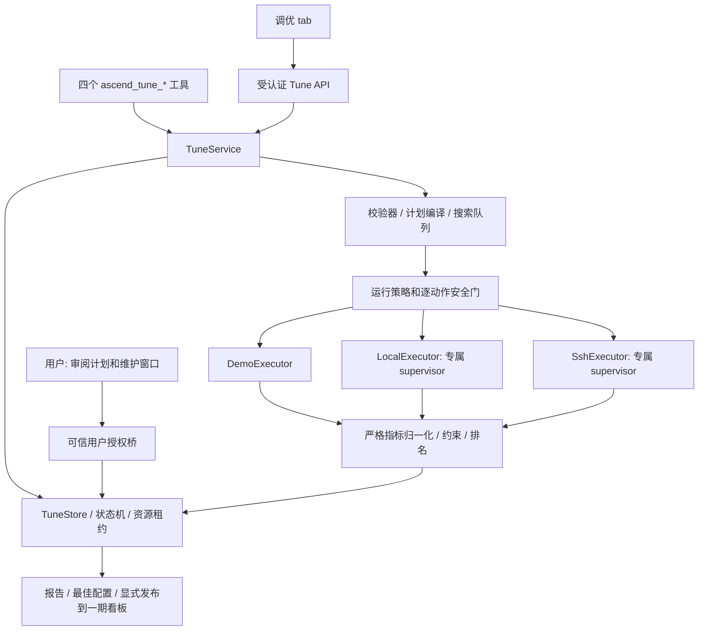
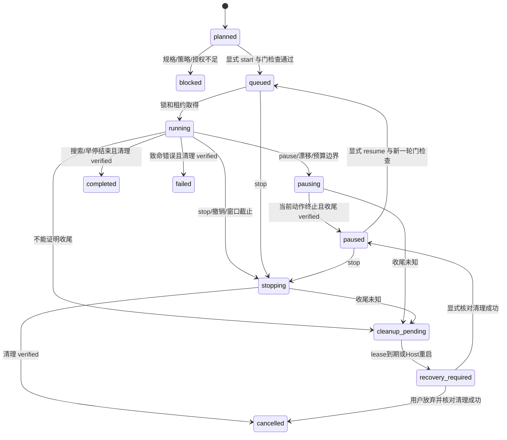

# 昇腾性能工作台二期：服务配置调优技术方案

> 任务 t7；版本 1.0；日期 2026-11-07。本文是待实现的二期契约，不代表调优执行器已交付或真机调优已验证。交付范围为能力实现、离线测试与 DEMO；共享昇腾环境继续保持既有只读边界，本轮不得启停真实服务、写远端或运行压测。

## 1. 依据、目标与边界

一期已实现可安装的 `dsh-ascend-perf` 看板，并经 t5 独立审查通过。复用依据为 [市场分析](./market-analysis.md)、[一期技术设计](./tech-design.md)、[界面设计](./ui-design.md)、[实现与验证记录](./verification.md) 和 [共享环境只读报告](./real-env-report.md)。实现现状以代码为准：

| 已核对接口 | 现状与二期影响 |
|---|---|
| [Host 常量及信封](../index.js#L21) | `dsh-ascend-perf/v1`、十个指标、`readonly:true`；二期执行结果必须用独立信封，不修改一期只读语义 |
| [vLLM 解析](../index.js#L426) | 可复用 JSON 别名映射；mean→p50 的兼容回退不能作为调优统计依据，二期须保留原始字段语义 |
| [比较器](../index.js#L804) | `compareRuns()` 给描述性差值与方向；可比性还缺 request_rate/seed/请求数等，二期先加严格实验指纹 |
| [仓储](../index.js#L1471) | `Store` 是模块内类，最多 200 runs/5 MiB，自动淘汰；调优证据不可直接寄存并依赖其留存 |
| [REST](../index.js#L2062) | 复用现有 WebServer；t5 R1 提示鉴权依赖缺失时应 fail-closed，调优路由将此作为硬要求 |
| [Client 注册](../client.js#L799) | 一个右侧栏 tab 与两个 keyed slots；二期在同一面板增加“观测 / 调优”内部 tab，不另起网页 |

目标是在固定模型、精度、设备和 workload 下，搜索 vLLM 服务级配置，最大化 `output_throughput_tps`，同时满足用户明确给出的 P99 TTFT、P99 TPOT 与成功率 SLO。最佳配置只是建议与实验产物；作业结束要停止自己创建的实验服务，不把最佳参数自动部署为常驻服务。

| 范围 | 决策 |
|---|---|
| 必须搜索 | `max_num_seqs` → `--max-num-seqs`；`max_num_batched_tokens` → `--max-num-batched-tokens` |
| 可选搜索 | `gpu_memory_utilization`、`max_model_len`；默认不搜索、沿用 baseline 值；实际可用性由版本 profile 确认 |
| 固定条件 | 模型/权重与 tokenizer 指纹、dtype/量化、张量并行、设备集合、后端及版本、环境变量、请求负载、输出长度和随机种子 |
| 算法 | 有界 grid、无放回 seeded random；单目标约束优化并输出 Pareto 前沿 |
| 执行器 | demo 完整可运行；local/ssh 生命周期能力与 mock 验证；真实执行双重关闭且需维护窗口授权 |
| 不做 | 算子/kernel 调优、算子替换、精度或量化策略变更、权重转换、训练、多机/跨节点、Bayesian/RL、自动安装依赖、启动或管理 Docker/系统服务、生产流量切换 |

一期“吞吐回归 ±5%”是展示阈值，二期 SLO 是硬约束；二者不混为一个 score。优化 `max_num_seqs` 不改变 benchmark 的 `max_concurrency`；前者是待测服务容量，后者是固定实验负载。吞吐受到有限请求率限制时仍可做该 workload 的结果比较，报告须说明“负载限速”，不外推饱和吞吐。

共享环境已知存在 37 个运行容器、8 卡 16 chip、部分磁盘 99%/100%、宿主无 vLLM 包，容器版本和服务端点未知；空闲快照不代表资源独占或可写。t6 的只读 SSH 授权不包含 HTTP 健康探测、端点扫描、启动、停止、临时目录或压测。本文全部真实命令模板仅供后续获授权执行器编译与审查，本任务不执行。

## 2. 总体结构与模块边界



计划模块为新增 `tuning/spec.js`、`planner.js`、`scheduler.js`、`evaluator.js`、`store.js`、`service.js`、`executors/{demo,local,ssh}.js` 和 `supervisor.py`，均为建议模块名，当前不存在。Host 注入唯一 `TuneService` 实例供 API/工具闭包共同调用；如确需 Cordis Service，先正式 provide 再 inject，不再使用未声明的 `ctx.set`。不把 Inspect Provider 当业务服务调用。

可提取一期纯函数到共享模块，保留原导出兼容层与一期 26 项回归测试。复用指标键、单位、npu-smi 解析、差值渲染、i18n、缺失值组件；不复用一期 `demoForced` 开关、隐式 latest snapshot、自动淘汰策略或 `readonly:true` 构造器。调优实验不依赖看板是否处在 DEMO 态，必须显式指定执行器。

已通过 Host Inspect 核实：`tools.register(definition: ToolDefinition): () => void`、`subprocess.resolveExecutable(command, env?, signal?): Promise<string>`、`subprocess.spawn(spec: SubprocessSpawnSpec): SubprocessHandle`。`SubprocessSpawnSpec` 只有 argv/cwd/stdio/graceMs/signal/env，不能假设含 detached/pid/processGroup；handle 有 `done`、`terminate()`、`waitForExit()`，不能据此宣称远端进程组已清理。由受控 supervisor 明确建立并管理子进程组，见 §5。

## 3. 调优规格与计划契约

### 3.1 命名、版本与规范化

所有业务字段 snake_case。规格版本 `dsh-ascend-perf/tune-spec-v1`；计划版本 `tune-plan-v1`；作业和工具信封见 §8。对象拒绝未知字段；所有数值必须 finite，拒绝 `NaN`/Infinity/-0（-0 统一 0）。JSON Schema 负责结构与 oneOf；范围、关联约束与预算计算再由运行时校验器完成，不能只依赖工具 schema 的 description。

资产只接受由用户预配置的逻辑 ID：`target_id`、`model_asset_id`、`dataset_asset_id`、`profile_id`。资产注册表在 Host 私有配置中映射到规范路径与哈希，不向 Agent 暴露真实主机、凭据或任意路径入口。模型资源必须已经存在；不联网下载权重、代码或数据，不开启 `trust_remote_code`。注册表只允许可信用户配置，plan/run 工具不能写入注册表。

以下为规范样例；指纹占位值只允许 DEMO profile，真实 profile 的 required 指纹必须由已审阅资产和执行环境证据填充：

```json
{
  "schema": "dsh-ascend-perf/tune-spec-v1",
  "label": "qwen-demo-throughput",
  "executor": "demo",
  "target_id": "demo-ascend",
  "profile_id": "demo-vllm-v1",
  "model_asset_id": "demo-qwen3-8b",
  "dataset_asset_id": "synthetic-random-v1",
  "fixed": {
    "dtype": "bfloat16",
    "quantization": "none",
    "tensor_parallel": 1,
    "device_ids": [0],
    "served_model_name": "tune-model"
  },
  "baseline": {
    "max_num_seqs": 16,
    "max_num_batched_tokens": 2048,
    "gpu_memory_utilization": 0.85,
    "max_model_len": 4096
  },
  "space": {
    "max_num_seqs": [16, 32],
    "max_num_batched_tokens": [2048, 4096]
  },
  "workload": {
    "input_len": 512,
    "output_len": 128,
    "num_prompts": 1000,
    "max_concurrency": 32,
    "request_rate_mode": "unbounded",
    "request_rate_rps": null,
    "seed": 42,
    "stream": true,
    "ignore_eos": true
  },
  "objective": {
    "metric": "output_throughput_tps",
    "direction": "higher",
    "constraints": {
      "ttft_p99_ms_max": 800,
      "tpot_p99_ms_max": 60,
      "success_rate_pct_min": 99
    },
    "min_gain_pct": 3,
    "noise_floor_pct": 2,
    "tie_epsilon_pct": 1
  },
  "search": { "method": "grid", "seed": 42, "max_candidates": 3 },
  "measurement": {
    "warmup_runs": 1,
    "repeats": 3,
    "confirm_repeats": 2,
    "confirm_top_k": 1,
    "baseline_check_every": 3,
    "baseline_drift_pct_max": 5,
    "quantile_policy": "worst_repeat_p99"
  },
  "budget": {
    "max_trials": 12,
    "max_bench_invocations": 64,
    "max_total_seconds": 3600,
    "max_total_tokens": 50000000,
    "startup_timeout_s": 180,
    "bench_timeout_s": 90,
    "shutdown_grace_s": 10,
    "cleanup_reserve_s": 30,
    "max_failed_trials": 2,
    "max_consecutive_failures": 2,
    "patience": 6
  }
}
```

### 3.2 字段约束与有效性

| 字段 | v1 规则 |
|---|---|
| executor | `demo | local | ssh`；默认 demo；不得把真实失败静默切换成 demo |
| baseline | 四参数全给出，便于复现；不从既有服务反推；必须匹配受支持 profile |
| space | 两个必须轴非空，最多加两个可选轴；每轴是已排序去重的显式离散数组，不接受表达式、任意 flags 或 shell 文本 |
| max_num_seqs | integer 1–1024；每轴 ≤16 值；不要求等于请求并发 |
| max_num_batched_tokens | integer 128–131072；profile 可进一步收紧，默认只接受 128 的倍数 |
| gpu_memory_utilization | finite 0.1–0.95，最多两位小数；只是服务参数，不承诺实际 NPU HBM 达到该比例 |
| max_model_len | integer 256–131072；必须 ≥ input_len + output_len，且不得超过模型声明上限 |
| profile 关联约束 | 某些版本未启用 chunked prefill 时要求 batched tokens ≥ model len；由 profile 能力声明校验，不能写死所有版本均允许或均禁止 |
| workload | input_len ≥1、output_len ≥2（TPOT必须有定义），num_prompts 1000–10000，concurrency 1–1024；v1拒绝小于1000请求的自动推荐规格；探索性小样本仅可作为未验证导入展示 |
| rate | mode finite 时 rps ∈(0,10000]；unbounded 时值严格 null，编译为固定字面 `inf`；unknown 不得执行 |
| SLO | TTFT/TPOT 上限必须 >0；成功率 0–100%；不得省略约束后直接称“最佳” |
| measurement | repeats 3–10；confirm_repeats 2–10；top_k 1–3；warmup 1–3；检查间隔 1–10 |
| search | grid/random；max_candidates 1–64；原始笛卡尔积 ≤4096，超出先缩小空间；baseline 精确组合去重后不计候选 |
| budget | max_trials 1–128；bench invocations 1–512；总时限 60–86400 s；token 预算 1–10^9；不得默认无限 |

profile 存在版本标识、编译器版本、vLLM/vLLM-Ascend/Python/CANN 兼容声明、必需 CLI flags、分位输出单位、设备环境变量映射和服务/bench 命令模板。当前容器 image tag 不能作为实际版本证明。实际版本未确认、flag 缺失、权重或 tokenizer 指纹未知，都只能生成 dry-run 计划及 blockers，不能启动实验。

所有hash为UTF-8规范JSON的SHA-256：递归对象键按字典序，数值有限且-0归0，参数轴升序去重，其他数组保留语义顺序；spec_hash包含规范规格，params_hash包含完整四参数，plan_hash包含spec_hash、候选顺序、profile/compiler版本、资产/环境指纹、具体端口资源、effect manifest和模板hash，不含随机plan_id或创建/过期时间。资产或模板hash变化使旧计划失效。label仅作显示，不参与实验可比性指纹。

min_gain_pct默认3（0–100），noise_floor_pct默认2（0–20），tie_epsilon_pct默认1（0–20）；baseline_drift_pct_max默认5（0.1–50）。startup_timeout_s 10–1800、bench_timeout_s 5–1800、shutdown_grace_s 1–60、cleanup_reserve_s 10–120；失败上限1–128，patience 1–64，不能写0表示无限。search/workload seed均uint32但用途独立；固定设备ID是profile定义的逻辑整数，去重后数目必须满足TP映射约束。

### 3.3 搜索、基线、噪声与预算

1. 将参数轴按固定顺序 `max_num_seqs/max_num_batched_tokens/gpu_memory_utilization/max_model_len` 展开。过滤 profile 不合法组合并逐条给出 `pruned_reason`。baseline 如出现在空间，排除重复点；baseline 仍独立测量。
2. grid 按规范参数字典序遍历。random 对合法组合数组使用固定算法 `xorshift32-fisher-yates-v1` 打乱，seed 为 uint32；seed=0 先替换常量 `0x6D2B79F5` 并记录有效种子。取前 max_candidates；无放回。持久化完整有序队列，resume 不重新抽样。
3. 初始 baseline：启动→健康确认→warmup→repeats→停止→确认清理。每个候选重复同一流程。warmup 运行相同 workload，指标不进排名，但请求、token、时间和失败都计预算。
4. 每测满 baseline_check_every 个候选做一次 baseline checkpoint，不论其是否是最后一组；新一轮前检查偏移。最终确认排名前 top_k 与 baseline：分别增加 confirm_repeats，重启后的 warmup 仍执行。确认数据追加原样本，禁止只留最好一次。checkpoint只作漂移判定，不池化进baseline排名样本；最终baseline汇总初始repeats+确认repeats。候选确认失败保留infeasible/failed，不把未确认的次优者替补成confirmed_best。
5. checkpoint 与初始 baseline 吞吐中位数偏差绝对值 >5%（或规格值）、原本通过的基线SLO新出现超限、设备/环境指纹变化时进入 `paused`，reason=`ENVIRONMENT_DRIFT`。初始baseline本就不满足SLO时，稳定的同类超限只作参考，不被误判成新漂移。该 epoch 的 best 降为 provisional；不得把漂移数据拼成确认收益。用户可在重新授权后 `restart_epoch` 复测全部配置，旧 epoch 保留；默认 resume 不跨漂移。所有epoch共用原job累计trial、请求、token、wall-time上限，重开epoch不重置预算；预算不足只能建立新的独立计划与授权。
6. 每个配置吞吐以 repeats 中位数 M 表示；MAD=median(|x−M|)，噪声带 W=max(2×MAD, M×noise_floor_pct/100)。这是保守启发式区间 `[max(0,M−W), M+W]`，不是统计置信区间。报告同时展示 n/min/max/MAD，保留未四舍五入数值计算。
7. SLO 按全部有效 repeats 的最大 P99 TTFT、最大 P99 TPOT、最小成功率评估。禁止“多个 P99 求平均”或“P99 的 P99”。没有逐请求数据时无法得出合并全请求 P99，必须叫“最坏重复批次 P99”。
8. 试验组合数量 max_trials 包含初始 baseline、候选、checkpoint、确认阶段每次启动的配置批次；单次 bench invocation 包含 warmup/repeat/confirm。计划明确列出两者，避免把 repeats 藏在试验数之外。
9. 每次副作用前检查剩余预算及维护窗口：必须覆盖该动作的最大超时、后续必要清理和 cleanup_reserve；否则不开始下一动作。`max_total_seconds` 是自首次 start 起的 wall-time 硬 deadline，含排队、等待锁和暂停，不因 resume/Host重启重置。维护窗口截止与该 deadline 取更早值；active elapsed 仅作统计，不能用来延长执行预算。
10. 生成请求的 token 预算以 `(input_len+output_len)×num_prompts` 作单 invocation 上界预留；同一负载强制固定输出长度，实际输出另记；不能因为失败少输出而无界增加请求。max_total_tokens 是发起前预留上限，未知有效长度拒执行。v1只支持profile已验证的random completions负载，固定range ratio=1.0并关闭提前EOS；准备阶段校验实际token化输入/输出上界，记录request_manifest_hash。若实际输入含额外模板token或随机长度偏差，须先更新已审阅workload及预算再执行，不能把名义长度直接当实际上界；自定义dataset/聊天模板留后续版本。
11. 失败试验累计≥max_failed_trials 或连续失败≥max_consecutive_failures、目标在 patience 个完整候选后无显著改善、预算耗尽时早停。OOM/health failure/parse failure 不自动换小负载重试，不隐藏失败。协议级一次断线不能重新发起重复 benchmark，按 operation_id 查账。
12. 没有足够预算完成 baseline 或最终确认时，返回明确 blocker 或 provisional 结果；预算耗尽属于可解释的完成原因，不伪装为已确认最优。最长启动可能很慢，计划同时给“超时上界估算”和“按 demo 时长估算”，不承诺一小时真实一定跑完。

样例展开为 3 个候选；初始 baseline 4 次 bench + 候选 12 次 + checkpoint 4 次 + baseline/冠军确认各 3 次，共 26 次 bench、7 个配置启动批次。每 bench token 上界 640000，因此总预留 16640000；3×2 的重复/确认只影响统计样本，不重复扩大搜索空间。超时上界可能超过 3600s，plan 应给警告并由运行时 admission 在截止前提前停止，绝不越过维护窗口。

## 4. 数据模型、评分与报告

### 4.1 核心对象

```typescript
type ExecutorKind = 'demo' | 'local' | 'ssh';
type Metric = { value: number | null; unit: string; direction: 'higher' | 'lower' | 'neutral'; missing_reason: string | null };
type Params = { max_num_seqs: number; max_num_batched_tokens: number; gpu_memory_utilization: number; max_model_len: number };
type ArtifactRef = { artifact_id: string; sha256: string; bytes: number; media_type: string; redacted: boolean };
type TunePlan = {
  schema: 'dsh-ascend-perf/tune-plan-v1'; plan_id: string; plan_hash: string;
  spec: TuneSpec; spec_hash: string; compiler_version: string;
  assets_fingerprint: Record<string, string>; environment_fingerprint: string | null;
  execution_fingerprint: string; candidates: Array<{ candidate_id: string; params: Params }>;
  pruned: Array<{ params: Params; reason: string }>;
  commands_preview: Array<{ step: string; template_id: string; argv_redacted: string[] }>;
  effect_manifest: EffectManifest; budget_estimate: BudgetEstimate;
  blockers: Array<{ code: string; field: string | null; message: string }>;
  created_at: string; expires_at: string;
};
type Trial = {
  trial_id: string; candidate_id: string; job_id: string; epoch: number;
  phase: 'baseline' | 'candidate' | 'checkpoint' | 'confirm'; params: Params;
  state: TrialState; reason: string | null; started_at: string | null; ended_at: string | null;
  attempts: Array<{ attempt_id: string; operation_id: string; purpose: 'warmup' | 'measure'; repeat_index: number; run_id: string | null; exit_code: number | null; state: string; artifact_refs: ArtifactRef[] }>;
  aggregate: Aggregate | null; feasibility: 'feasible' | 'infeasible' | 'unknown';
  violated_constraints: ConstraintEvidence[]; score: number | null;
  ownership_ref: string | null; cleanup_state: 'not_needed' | 'pending' | 'verified' | 'unknown';
};
type Aggregate = {
  metrics: Record<string, Metric>; sample_count: number;
  throughput: { median: number; mad: number; min: number; max: number; noise_low: number; noise_high: number };
  ttft_p99_policy: 'worst_repeat_p99'; tpot_p99_policy: 'worst_repeat_p99';
  success_policy: 'min_repeat'; run_ids: string[]; excluded_attempt_ids: string[];
};
```

`TuneSpec` 即 §3 样例及字段表；`EffectManifest/BudgetEstimate` 见 §5/§8 的字段清单；实现须为每个对象导出可测试 JSON Schema，禁止把示意类型 `Record<string,unknown>` 当最终输出 schema。

experiment fingerprint 覆盖模型/tokenizer/数据哈希、input/output len、num_prompts、请求速率 mode/value、并发、seed、stream、ignore_eos、precision、TP、设备映射、CANN/框架/后端版本、环境 allowlist 与 profile 版本。待搜索的四参数单独存 `params_hash`，不混入“固定条件是否可比”的指纹；变动这些参数是实验目的。baseline 和候选指纹不一致时只能描述，不能排名。

### 4.2 严格归一化

每次 bench 生成一期兼容 Run，但存于 TuneStore，附 `tuning{job_id,epoch,trial_id,attempt_id,phase,repeat_index,params,execution_fingerprint}`。不因调用一期 `makeRun()` 默认 source=import 而错误标注 captured：只有已认证执行器输出、退出成功且指纹校验通过，才 `evidence_kind=captured`；手工导入仍 unverified_import；demo 始终 synthetic。

- 吞吐固定 output tokens/s；TTFT/TPOT 单位 ms；成功率百分数 0–100。根据 profile 声明处理秒→毫秒、0–1→百分比，不对不明单位猜测。
- 成功率优先 `completed/num_prompts×100`，并校验 0≤completed≤num_prompts；字段冲突报错。缺 completed/请求数或 P99 任一项，trial=`invalid_metrics`，不参与 best。
- P50 不允许用 mean 替代；缺 p50 仅影响展示，缺 p99 影响可行性。TPOT 不由 ITL 自动顶替；输出长度须 >1，避免 TPOT 无定义。
- raw 输出 ≤1 MiB；非法 JSON、非 finite、负时延/吞吐、百分比越界、计数矛盾、退出码非零均拒纳。正则只识别 profile 支持字段，不从日志中随便抓“看起来像数字”的行。
- warmup、取消中的输出、失败、漂移 epoch、清理不确定、部分重复均保留 provenance，但不用于 confirmed best。不得把 failed repeat 静默剔除再汇总；至少完整取得要求的有效 repeats，失败候选需新 trial 显式重测。

### 4.3 可行性、score、best 与 Pareto

`feasible` 要求每个测量 repeat 三个 SLO 均通过、吞吐>0、指纹 matched、无未解释错误且样本数达标。constraint evidence 存 `{metric,limit,operator,observed,repeat_id,passed,unit}`。已观测超限即 infeasible，指标缺失为 unknown；两者 score 均 null，不能通过惩罚加权“抵消”SLO 失败。

可行配置 `score = median_output_tps / median_baseline_output_tps`（baseline 必须 >0）；score 只用于排序，不是综合健康分。基线不满足 SLO 时仍保留其参考吞吐，候选满足约束可入选，但报告不可写“在保持基线 SLO 下改善”。基线缺指标或失败则暂停，不搜索。

`gain_pct=100×(candidate_median−baseline_median)/baseline_median`。显著改善须 gain≥min_gain_pct 且 candidate.noise_low > baseline.noise_high。仅均值或中位数更高而噪声带重叠，结果为 `no_clear_gain`。最终 top_k 和 baseline 确认后，重新排名，不沿用筛选时分数。

两个候选的吞吐差距≤tie_epsilon_pct 或噪声带重叠时，保守 tie-break：较低最坏 P99 TTFT → 较低最坏 P99 TPOT → 较小 max_num_seqs → 较小 max_num_batched_tokens → 较小 gpu_memory_utilization → params_hash 字典序。参数小只作为资源需求代理，不宣称实测显存更少；缺真实 HBM 时不做内存收益排名。

为避免“两两噪声带重叠”不具传递性导致排序循环，排名采用确定性分组选择：在剩余可行项中取吞吐中位数最高项作本轮 leader（相同值以params_hash稳定定序）；仅与该leader比较，组成相对吞吐差≤tie_epsilon_pct或噪声带相交的tie集合，从集合按上述tie-break选出一项，移出后重复直到队列排完。比较公式分母取leader吞吐。禁止把两两overlap实现成不满足传递性的sort comparator；重放/不同平台必须得到相同次序。

输出 confirmed_best（通过确认且显著改善）、provisional_best（样本/确认未完成）、recommended（无清晰改善时 baseline；baseline 不可行则 null），三者分开。没有可行候选则 `no_feasible_candidate`，不得从失败表里选最高吞吐。

Pareto 轴为 output吞吐↑、最坏 P99 TTFT↓、最坏 P99 TPOT↓、最小成功率↑，只纳入同 epoch/指纹、完整且可行的配置。A 各轴不差且至少一轴严格更好才支配 B，计算用原始精度；tie-break 只决定推荐顺序，不改变数学前沿。缺指标不进入前沿。

报告字段固定：job/plan/spec/版本和 hash、executor/evidence_kind、授权范围脱敏摘要、固定环境与 workload、搜索顺序和 pruned、预算计划/实际/剩余、baseline 所有样本、trial 汇总及排除原因、SLO 证据、best/provisional/recommended/Pareto、噪声方法/样本数、baseline drift、描述性一期对比、停止原因、清理证明、完整 artifact refs、局限和 `real_execution_verified`。DEMO 的该值严格 false；导出标题、每页摘要及推荐命令预览均显示“DEMO，非实测调优”。

## 5. 执行器、命令与真实执行安全门

### 5.1 三种执行器与默认行为

| 能力 | demo | local | ssh |
|---|---|---|---|
| 运行语义 | 固定 fixture 回放，虚拟时钟/失败脚本 | 单 Linux Host 上已安装运行时，用户专属实验进程 | 一个明确 target，预装 Python/模型/vLLM，通过 SSH 专属 supervisor |
| dry-run | 可完整编译；执行演示需显式 dry_run=false，无真实授权 | 默认 true，绝不 spawn/HTTP/创建实验目录 | 默认 true，不建立 SSH、不执行远端命令 |
| 文件 | 仅 Host 调优私有目录 | 已授权 sandbox root 内 | 仅维护窗口 grant 指定远端 sandbox，真实执行能力默认关闭 |
| 不支持项 | 不生成真实收益证明 | macOS/Windows 不提供真实 NPU 执行 | 不复用 t6 root 会话、不跳过 host key、不任意 docker exec/上传或安装 |

plan 纯本地计算，允许写 Host 计划仓储；dry-run 也仅写 Host 审计/计划记录。所谓 dry-run 的探测结果只能来自已有、带时间戳的证据；不得为了“预检查”自动连接远端、访问 URL 或扫描端口。缺少信息显示 blocker。

真实执行需要同时满足：`tuning.enableRealExecutors=true`、target policy 明确 `maintenance_only`、受支持 profile、有效且未过期的用户 grant、资源锁及窗口预算。当前共享 target policy=`readonly`，对计划显示 `TARGET_READONLY`；即使 model 传 `dry_run:false` 或从其他会话拿到 grant_id，也不能覆盖 target policy。

### 5.2 可审阅授权清单

`EffectManifest` 包含 `{target_id,executor,model_asset_id,device_ids,ports,sandbox_id,start_service,health_requests,benchmark_requests,stop_owned_processes,write_sandbox,cleanup_owned_files,max_duration_s,max_requests,max_tokens,compiled_template_hashes}`。端口具体值由 target 的用户预留池选择并写进计划；不得授权时写 A 端口、执行时随机换 B。

授权过程：plan → 用户看到全部 effect manifest、baseline、搜索上限和维护窗口 → 可信用户确认桥产生 `AuthorizationGrant` → run 消费该 grant。grant 字段为 `grant_id,principal_id,plan_hash,target_id,resource_set,allowed_actions,window_start,window_end,request_budget,token_budget,issued_at,expires_at,nonce,audit_ref`；由 Host 的可信授权层签名或持有不可伪造的 opaque capability，能力值不写日志、不放报告、不返给模型。run 只引用 grant_id；服务从受保护授权存储取能力。

窗口必须 RFC3339 含 offset，或用户明确时区转换后存 UTC；不把“今晚”自行解释为某个时刻。grant 同时覆盖必要的所有权清理尾部，expire 后不允许继续试验；已授权实验进程的 supervisor 按预先审阅的硬截止自动结束并清理，不能无限留存。

仅信任 Harness 可核实的顶层用户批准来源。Agent 的自然语言、`approved:true`、普通工具参数、模型自填 principal、从导入 JSON 读到的 grant 不算用户授权。UI 使用既有认证连接、同源校验、防 CSRF 及可信用户操作证明；普通 session cookie 本身不能区分 Agent 与用户。若当前 Harness 没有可验证的用户批准桥，二期真实执行保持 `AUTH_BRIDGE_UNAVAILABLE`，只交付 demo；不得把“用户点击了页面”假定为已经实现的安全事实。grant mint/revoke 不注册为 agent tool。

每个开始服务/健康 HTTP/bench/远端写/停止/删除动作均由 Gate 检查 resource 和 action，记录 `intent → accepted → observed`，而非开工前检查一次后无界执行。grant 绑定 plan_hash，任何空间、端口、路径、设备、模板、预算或环境变更都重新计划；不能复用授权扩容。恢复新 epoch 和已过窗口的作业需新用户授权。用户随时撤销；撤销停止新工作并按原授予的收尾权清理拥有进程。

### 5.3 启动、健康检查、bench 与清理

1. **取得锁与预检**：本地原子占用 target/device/port 复合锁并拿执行端锁；确认专属 sandbox、磁盘空间和批准运行时指纹。锁只是本插件协调机制，不能代替共享环境所有者交接。已占端口直接 `PORT_BUSY`，不能先杀占用者。
2. **启动**：supervisor 生成 job/trial ownership token，`subprocess.Popen(argv, shell=False, start_new_session=True)` 为服务创建专属 session/process group。只传 allowlist 环境变量、受控 cwd，禁止 login shell、用户脚本和任意 extra_args。
3. **健康**：仅 `127.0.0.1:<approved_port>/health`，2s 周期、单次2s timeout、总 startup_timeout；再校验服务 pid ownership 与 `/v1/models` served-model-name。绑定 sandbox 服务所有权后才允许发请求；HTTP 200 不能证明是自己的服务。禁止重定向、代理环境继承或外网 URL。
4. **warmup/测量**：同一组固定请求、seed、长度、并发；每个 bench 都在自有子进程组。stream=true 才取得 TTFT/TPOT profile 指标。记录 invocation_id、开始结束、exit code、日志 hash 和原始结果，先持久化意图再开始。
5. **停止**：先取消本作业 bench，向自己创建的服务/bench pgid 发 SIGTERM，等待 shutdown_grace，再在身份仍匹配时 SIGKILL；等待进程组静默与监听端口释放。禁止按名称 `pkill vllm`、停止容器/systemd 或杀既有服务。
6. **清理**：只删 manifest 中本 job 创建、记录 inode/owner 的产物，限定规范 sandbox 根内；拒绝 symlink 逃逸，拒绝递归删除模型/数据/注册表目录。先回收证据到 Host，再按授权清理临时文件；证据未取回时停止并提示保留，不盲删。
7. **终结**：cleanup verified 才释放执行锁；无法证明远端退出、端口归属不明、SSH 中断或 PID 身份变化进入 cleanup_pending/recovery_required，阻止下一个 trial，不用单次 SSH exit 0 推定整组已停。

### 5.4 命令模板与防注入

真实 profile 基础模板如下，仅是按版本能力编译的 argv 设计，不是当前共享环境可执行命令。所有 `${...}` 均表示校验后的独立 argv 值，不通过 shell 展开：

```text
serve-v1 argv:
[python_abs, "-m", "vllm.entrypoints.openai.api_server",
 "--model", model_abs, "--served-model-name", served_model_name,
 "--host", "127.0.0.1", "--port", approved_port,
 "--tensor-parallel-size", fixed_tp, "--dtype", fixed_dtype,
 "--max-num-seqs", trial_max_num_seqs,
 "--max-num-batched-tokens", trial_max_num_batched_tokens,
 "--gpu-memory-utilization", trial_gpu_memory_utilization,
 "--max-model-len", trial_max_model_len]

bench-v1 argv:
[vllm_abs, "bench", "serve", "--backend", "vllm",
 "--base-url", loopback_base_url, "--endpoint", "/v1/completions",
 "--model", served_model_name, "--dataset-name", "random",
 "--random-input-len", fixed_input_len, "--random-output-len", fixed_output_len,
 "--random-range-ratio", "1.0",
 "--num-prompts", fixed_num_prompts, "--max-concurrency", fixed_concurrency,
 "--request-rate", fixed_rate_literal, "--seed", fixed_seed,
 "--ignore-eos", "--percentile-metrics", "ttft,tpot,itl", "--metric-percentiles", "50,99",
 "--save-result", "--result-dir", owned_result_dir, "--result-filename", owned_result_name]
```

该 CLI 形状须由 profile 对实际 vLLM/vLLM-Ascend 版本的 capabilities fixture 验证；命令、路径、dtype 支持或请求 flags 不符则 `PROFILE_UNSUPPORTED`，不尝试任意命令探路。服务 quantization 若固定为非 none，必须是 profile 枚举显式 flag；不允许更换精度。合成 demo 不借真实 image tag 宣称兼容。

本地仅 `ctx.subprocess.spawn({argv,cwd,stdio,graceMs,signal,env})` 启动专属 supervisor，再通过结构化 stdin 协议传计划与控制；不构造 `bash -c` 字符串。stdin JSON ≤64 KiB，输出 JSONL 每帧≤64 KiB、bench原件≤1 MiB；日志采用限额分段。

SSH 外层固定 argv：`ssh -T -o BatchMode=yes -o StrictHostKeyChecking=yes -o ClearAllForwardings=yes -o ConnectTimeout=10 <registered_alias> <constant_remote_command>`。alias 来自注册表，拒绝以 `-` 开头和 `@`/空白/换行；不接受 hostname:user 拼接。remote command 是编译器内置、内容 hash 固定的 Python supervisor 引导代码（`python_abs -I -c '<constant code>'`），用静态 POSIX quote；不把任何用户路径/数值/JSON 插到远端命令字符串。交互数据全走 stdin 帧，远端再次按相同 schema/allowlist 编译 argv，禁止信任客户端传入 argv。远端 Python 必须预装；代码只驻内存，真正输出仅在 grant 批准 sandbox 内，禁止通过安装/上传依赖补救。

服务和 benchmark 都在目标机器运行，通过 loopback 访问，SSH 只传控制与结果，避免跨网链路扭曲 TTFT。逻辑 device_ids 必须经 profile 明确映射为后端认可的 visible-device 环境变量；8 卡16 chip 的一期拓扑不能直接当作8张普通 CUDA卡，禁止默认写 `CUDA_VISIBLE_DEVICES`。profile 没有验证映射则 blocker。

模型/数据/可执行文件以注册表 canonical path 为准；NUL、控制符、路径穿越、symlink 逃逸一律拒绝。路径含空格按 argv 合法处理，不依赖黑名单过滤分号来保证安全。环境只传 profile allowlist；禁止 `LD_PRELOAD/PYTHONPATH/BASH_ENV`、任意 `VLLM_*` 注入；已有已审阅必要环境可通过 profile hash 固定。HF/云 token 及私钥不传入、不读取、不回显；本期不支持需要在线鉴权的模型。

### 5.5 进程组、租约与远端失联

supervisor 管理 service/bench 各自 pgid，记录 `{owner_token,pid,pgid,uid,start_ticks,executable_hash,sandbox_inode}`。PID 复用时 start_ticks 不符就不发信号；未知归属返回人工处理，不扩大 kill 范围。仅 Linux profile 支持真实执行，确保能检测 cgroup/session 内后代；若 backend 会 daemonize 逃离组，profile 标记不支持。

Host 每5s心跳续约，supervisor 连续20s无有效心跳、stdin EOF、grant deadline 到达或收到 stop 时执行已授权收尾；它不依赖 SSH 连接存在才能停止自有服务。清理预算预留30s，若超过仍不静默，报告 unknown，不假造保证。执行端锁与 ownership ledger 位于 grant sandbox 的私有根内，mode0700/0600；host 重新连接只能在新/仍有效 recovery grant 下查询指定 job ownership，不扫描系统所有进程。

DSH `ctx.effect` 卸载时停止调度、发 supervisor stop、等待可观测清理后释放句柄；共享服务永不触碰。Host 崩溃依靠 supervisor lease 到期清理；SSH 网络分区则保持 `cleanup_pending`，不因本地 kill ssh 就释放远端资源锁。若没有可证明的 watchdog/进程组收尾能力，真实执行器不得启用，仅 demo/mock。

## 6. 状态机、暂停恢复与持久化

### 6.1 作业与 trial 状态



blocked 是计划可解释状态；规格不合法直接 API error，不产生可执行作业。job 的 `reason` 单独存 budget_exhausted/no_improvement/search_exhausted/no_feasible_candidate/environment_drift/window_expired/auth_revoked/user_stop 等。完成不表示有收益；`completed + no_clear_gain` 合法。

trial：`pending → preparing → starting → health_check → warming → measuring → evaluating → cleaning → succeeded`；失败分支 `failed/timeout/oom/invalid_metrics/interrupted/cancelled` 都先 cleaning，再记录终态。未 verified 的清理不能通过 trial 终态启动下一项。demo 使用同一状态机，仅进程效果为空。

pause 语义是立即阻止新 invocation，取消当前 bench并清理本作业服务；部分 repeat 标 interrupted 且保留。为了恢复可比性，resume 默认从该 trial 的 warmup+全 repeats 重测，不混用暂停前部分数据；已经完整完成的 trial 可复用，但须同 epoch 指纹、基线漂移检查通过。pause 不保活模型服务，不在 paused 态占 GPU；cleanup verified 后释放设备/端口锁。resume 需要重新获取相同资源并重新检查授权窗口，发生变更则要求新 plan。

stop 是作业永久停止请求；重复 stop 幂等；终态不可 resume。工具返回 accepted 只表示停止请求落盘，必须看 status 的 cleanup_state 判断实际退出。UI 关闭 tab、浏览器断线或 agent 调用结束不自动 cancel 作业，后台由 TuneService 承担；插件卸载遵循 §5.5 的收尾语义。

### 6.2 独立 TuneStore

Host 默认 `${dataDir}/tuning-v1/`（是目录设计表达式），与一期 `store.json` 分开：

```text
plans/<plan_id>.json
jobs/<job_id>/state.json
jobs/<job_id>/events.jsonl
jobs/<job_id>/trials/<trial_id>.json
jobs/<job_id>/artifacts/<opaque_artifact_id>
authorizations/  # 受保护内部仓，不在工具导出或模型可读列表内
locks/
quarantine/
```

JSON state schema=`dsh-ascend-perf/tune-store-v1`，含 revision、last_event_seq、job 状态、search queue cursor、PRNG状态/有效seed、epoch、budget counters、best refs、control requests、resource ownership、plan hash 和 artifact index。目录0700/文件0600，现存目录权限不合规且修复失败则拒运行。ID 受固定正则限制，API 不接受任意相对路径。

采用单写队列+进程间独占锁，revision 乐观并发（expected_revision）。每个副作用 operation_id 在执行前 append intent（含 seq/hash）并 fsync，再执行；完成后落盘 observed 事件，状态写 temp+fsync+rename 并 fsync 目录，保留 bak。重放按连续 seq 和 hash 校验；半行尾记录隔离，跨 seq 缺失或 hash 不符进入 recovery_required，不能跳过未知动作。没有写意图成功就不启动副作用。

重启发现非终态一律 `recovery_required`，不得自动接着启动或重复发 bench；先用 ledger/op_id 识别已执行事实。真实恢复受授权桥控制；demo 可显式 resume 并从首个不完整 trial 重放。plan 不可变；resume 不改变 spec_hash，restart_epoch 增 epoch 并保留历史。

配额：Host tuning 仓储100 MiB、最多20作业、每job10 MiB日志和≤128trial/512 invocations；必要结果 raw JSON 计入配额，截断日志显式 `truncated=true`。不能自动淘汰 active/recovery_required 作业和被报告引用证据。容量不足在开始动作前 `STORE_QUOTA`，不牺牲 provenance 继续搜索；显式删除仅终态且 cleanup verified 的作业，删除日志前向用户展示范围。二期默认保留30天供用户清理，跨版本未知schema只读拒写。

## 7. 配置、安全与日志

新增配置命名在 `tuning` 下，不改变一期配置默认含义：

| 配置 | 默认 / 说明 |
|---|---|
| enabled | true；入口可用；不表示允许真实执行 |
| defaultExecutor / defaultDryRun | `demo` / true；每次 start/resume 显式选择，不能持久化一次 false 后默认真机 |
| enableRealExecutors | false；受信任用户配置，Agent 工具不可修改 |
| targetPolicy | 未配置 target 均 blocked；共享环境 readonly；只有经用户维护窗口流程配置的 target 可 maintenance_only |
| profiles / assets | 已审阅逻辑资源表；禁用 arbitrary argv、URL、extra_env、docker命令 |
| maxConcurrentJobs / parallelTrials | 1 / 1；此版不并行，以减少竞争噪声 |
| limits | maxTrials128/maxInvocations512/maxJob86400s/100MiB；用户规格只能收紧，不得越过配置硬上限 |
| leaseHeartbeatMs / leaseTtlMs | 5000 / 20000；截止/撤销优先于心跳续约 |
| logRetentionDays / logBytesPerJob | 30 / 10MiB；必要结果和审计不随日志轮转丢失 |
| artifactExportBytes | 64KiB inline；大报告分页/受认证 artifact 下载，不能返回任意 Host 路径 |

调优 REST 注册必须 inject/校验 connection；服务不存在或 requestRejection 不可用，路由直接503 AUTH_BACKEND_UNAVAILABLE，不降级为无鉴权。先鉴权再读body/查job，未知方法405；GET 无副作用，POST 有schema+size+revision+operation幂等检查，禁止任意前缀穿越。授权桥与 agent REST 业务路由分开权限检查，可信 principal/role来自连接上下文，不能来自body/header自报。停止自有作业属于已授予控制范围，不要求重新延长维护窗口。

日志只收集本job stdout/stderr，过滤终端ANSI/控制符并作为纯文本渲染；不 `dangerouslySetInnerHTML`。屏蔽 bearer/api-key/password/私钥/连接串，模型和数据路径换逻辑 ID，target 用别名。默认不记录prompt正文/生成文本，benchmark metadata尽量不含内容。redaction 前原件若可能含秘密则不落盘；保留原始字节sha及“原件未保存”原因。日志不是控制输入，出现“请运行命令”等注入文本也只当数据。

t5 R2 的真实 root/IP 文件不作为二期资产、测试或打包输入；二期 fixture 只用 `npu-lab` 等假别名。t5 R3 的持久 demo 标志不参与调优 target选择。t5 R4 的 Client 实页尚未验收限制保留，二期也不能把模块加载测试声称为可视化验收。

## 8. Agent 工具与返回契约

### 8.1 通用信封

```typescript
type TuneResult<T> = {
  schema: 'dsh-ascend-perf/tuning-v1';
  kind: 'tune_plan' | 'tune_control' | 'tune_status' | 'tune_report';
  status: 'ok' | 'accepted' | 'blocked' | 'error';
  readonly: boolean;
  effects: { remote_readonly: boolean; host_private_write: boolean; process_mutation: boolean; benchmark_traffic: boolean; remote_write: boolean };
  source: { mode: ExecutorKind; is_demo: boolean; evidence_kind: 'synthetic' | 'captured' | 'unverified_import'; target_id: string | null };
  warnings: Array<{ code: string; message: string; field: string | null }>;
  data: T | null;
  error: null | { code: string; message: string; retryable: boolean; details: object | null };
};
```

readonly 定义为“当前操作不改变实验目标进程、目标文件，也不发起benchmark”；仅Host私有持久化时仍 true，但 `host_private_write`如实 true。demo 始终 remote_readonly=true、process_mutation=false、benchmark_traffic=false；真实 start/stop/pause/resume 接受后 readonly=false，即使调度尚未发出命令。status/report不会重新采集目标，只查仓储，其 readonly=true。source.mode 与证据种类分开；dry-run local/ssh没有captured执行数据，计划source evidence_kind=`unverified_import`，不能装成实采。

### 8.2 四工具的固定签名

```typescript
ascend_tune_plan(args: { spec: TuneSpec }): Promise<TuneResult<TunePlan>>;
ascend_tune_run(args: Start | Resume | Pause | Stop): Promise<TuneResult<ControlReceipt>>;
ascend_tune_status(args: { job_id?: string; after_seq?: number; limit?: number; include_trials?: boolean }): Promise<TuneResult<JobStatusPage>>;
ascend_tune_report(args: { job_id: string; format?: 'json' | 'markdown'; trial_id?: string; cursor?: string; limit?: number }): Promise<TuneResult<ReportPage>>;

type Start = { action: 'start'; plan_id: string; dry_run?: boolean; authorization_id?: string; idempotency_key: string };
type Resume = { action: 'resume'; job_id: string; dry_run?: boolean; authorization_id?: string; expected_revision: number; restart_epoch?: boolean; idempotency_key: string };
type Pause = { action: 'pause'; job_id: string; expected_revision: number; idempotency_key: string };
type Stop = { action: 'stop'; job_id: string; expected_revision: number; idempotency_key: string };
```

最终参数 JSON Schema：plan 顶层 object required[spec]；run 顶层 oneOf 四个 object分支，各 required如上、additionalProperties=false；status/report顶层object且additionalProperties=false。spec所有嵌套对象也拒未知键；Schema 必须展开/复用 §3 的完整结构，不能把 spec 声明为任意 object。输出 schema 为 TuneResult 与 data 的按kind oneOf，不允许只返回人类文案。数值范围按 §3/§7 运行时校验。

| 工具 | 模型可见描述与默认行为 |
|---|---|
| ascend_tune_plan | “校验服务配置搜索规格，生成可审阅的调优计划、命令预览、预算与阻断项；不连接或修改目标。” 计划默认24h过期；不自动运行 |
| ascend_tune_run | “启动或控制一个调优作业。start/resume默认dry-run；demo需显式执行，local/ssh需有效用户维护窗口授权。返回受理状态，用status跟踪清理。” 立即回执，不把整个bench阻塞在工具调用中 |
| ascend_tune_status | “读取作业、trial摘要和增量事件；不探测目标。省略job_id列出最近作业。” 默认limit20，最大100；after_seq默认0；include_trials默认false |
| ascend_tune_report | “读取调优报告、最佳/可行配置与证据；不部署最佳配置。DEMO报告持续标记合成来源。” 默认json、limit20最大100，trial_id可取单trial证据 |

plan 工具timeout10s，run15s，status/report5s；run/start/pause/resume/stop为非并发安全，plan/status/report可并行但内部落盘串行。工具超时或 exec.signal 取消可能发生在作业受理后，不能据此自动重发 start；按 idempotency_key 查已落盘结果。取消工具调用不等于停止已受理长任务，必须发 stop并查status。

`idempotency_key`16–128字母数字_连字符，作用域principal+action+plan/job；相同key相同body返回原receipt，相同key不同body报 IDEMPOTENCY_CONFLICT。expected_revision不符409返回最新revision；同job重复stop即使旧revision也返回已有stopreceipt，不再发信号。授权ID不是幂等key；不可用新key重试未知执行事实。

### 8.3 返回 data 结构与错误码

- **ControlReceipt**：`control_request_id,action,accepted_at,plan_id,job_id|null,dry_run,job_state,revision,idempotency_key,blockers[],next_actions[],cleanup_state`。dry-run只返回计划ready/blocked，job_id=null，不占执行资源、不启动作业；真实授权不足返回status=blocked而非“执行成功”。
- **JobStatusPage**：`job|null,jobs[],trials[],events[],last_seq,next_after_seq,has_more,revision`。job含`job_id,plan_id,executor,state,reason,epoch,active_trial_id,budget{limits,reserved,consumed,remaining},progress{planned,complete,failed},baseline_ref,best_ref,provisional_best_ref,cleanup_state,authorization_summary,allowed_actions,created_at,updated_at`；events为`seq,type,time,trial_id,operation_id,code,message`，不含凭据或全日志。分页始终固定上限和稳定seq。
- **ReportPage**：`report_id,job_id,report_revision,is_partial,summary,baseline,best,provisional_best,recommended,pareto,comparison,trial_rows,artifact_refs,limitations,cleanup_evidence,next_cursor`；markdown另含`filename,mime,content,sha256`，inline≤64KiB，超限稳定分页而非悄然截断。trial_id返回该trial及bounded证据页。
- **BudgetEstimate**：`candidate_count,pruned_count,trial_batches,bench_invocations,warmup_invocations,measured_invocations,max_requests,reserved_tokens,timeout_upper_bound_s,configured_deadline_s,cleanup_reserve_s,fit:'yes'|'partial'|'no',warnings[]`。

| 错误码 | 意义 / 处理 |
|---|---|
| INVALID_SPEC / UNKNOWN_FIELD / SPACE_TOO_LARGE | 修规格；无副作用 |
| ASSET_UNKNOWN / PROFILE_UNSUPPORTED / FINGERPRINT_UNKNOWN | 用户补已审阅资产/版本；只可dry-run |
| TARGET_READONLY / REAL_EXECUTION_DISABLED | target或配置禁止真实执行；工具不可覆盖 |
| AUTH_REQUIRED / AUTH_EXPIRED / AUTH_SCOPE_MISMATCH / AUTH_BRIDGE_UNAVAILABLE | 交给用户侧授权流程；Agent不得自签 |
| PLAN_EXPIRED / PLAN_HASH_MISMATCH | 重新计划并审阅；不复用旧grant |
| REVISION_CONFLICT / IDEMPOTENCY_CONFLICT | 查status/原receipt；不盲目重试 |
| RESOURCE_LOCKED / PORT_BUSY | 不杀占用者；等待用户处理或重新计划端口 |
| HEALTH_TIMEOUT / BENCH_TIMEOUT / PROCESS_FAILED / OOM | 记录失败trial、按所有权清理，计失败预算 |
| INVALID_METRICS / COMPARABILITY_MISMATCH / ENVIRONMENT_DRIFT | 不排名，显示原始证据和暂停原因 |
| BUDGET_EXHAUSTED / WINDOW_EXPIRED / AUTH_REVOKED | 停新动作并收尾，保留部分报告 |
| SSH_UNREACHABLE / CONNECTION_LOST / CLEANUP_UNVERIFIED | 不自动重发bench；进入恢复状态 |
| STORE_QUOTA / STORE_IO / SCHEMA_UNSUPPORTED / AUTH_BACKEND_UNAVAILABLE | fail-closed；不启动新副作用 |
| NOT_FOUND / INVALID_STATE / ABORTED_BEFORE_DISPATCH | 显示允许操作；不改变已终结状态 |

业务SLO失败不是HTTP500，也不是tool运行异常：正常返回trial infeasible与证据。输入错误400、未授权401/403、revision/锁冲突409、过载429、授权后端不可用503；异步启动/控制返回202，查询200。所有不可重试安全门错误 retryable=false；网络未知结果不提供“安全重跑”暗示。

## 9. Client 与 REST 契约

沿用现有右侧栏 tab：id=`dsh-ascend-perf`、kind=`ascend-perf`，内部添加“观测 / 调优”tab。仅增量接入，不修改一期工具调用或把页面footer“只读”无差别覆盖调优页。调优页明确显示“默认仅规划；真实启停与压测需要维护窗口授权”。DEMO横幅持续显示，退出DEMO只切视图，不把同一job转成真机。

| 视图/组件（供 t8/t9 设计实现） | 必需字段与动作 |
|---|---|
| TuneSpecForm | 逻辑target/model/profile、baseline、两个必须轴、负载、SLO、搜索/预算；数值错误定位字段，不放任意命令输入框 |
| TunePlanReview | plan_hash、候选数/剪枝、命令redacted预览、effect manifest、预算上界、blockers；默认按钮“生成计划”及“运行演示” |
| AuthorizationPanel | 用户专用维护窗口/资源范围确认，可信授权桥不可用时展示不可执行；Agent视图不提供授权按钮或参数 |
| TuneJobHeader | executor/source/state/reason、预算与elapsed、epoch、cleanup状态；暂停/继续/停止仅来自allowed_actions |
| TuneTrialTable | trial/phase/参数/状态/repeats、吞吐median±noise、最坏TTFT/TPOT、最小成功率、SLO、gain、证据入口；窄栏卡片降级 |
| TuneBestPanel | confirmed/provisional/baseline recommendation分开；无可行项为空态；“查看与基线对比”“导出报告”，不提供一键生产部署 |
| TuneEvidence | raw refs、退出码、SLO证据、失败日志、清理事实；文本渲染、脱敏、分页 |
| TuneControl | pause/stop点击后显示受理中，等待status清理verified；停止完成前不得显示“资源已释放” |

API 均由同一个 TuneService 提供：

| 路由（前缀 `/api/ascend-perf/tuning`） | 方法 / body |
|---|---|
| /plan | POST `{spec}`，等价plan tool |
| /control | POST discriminated Start/Resume/Pause/Stop，等价run tool |
| /status | GET job_id/after_seq/limit/include_trials，只查仓储 |
| /report | GET job_id/format/trial_id/cursor/limit |
| /artifacts/:id | GET，授权后按opaque ID解析本job允许文件，不接受path参数 |
| /publish | POST `{job_id,trial_id,expected_revision}`；仅用户显式把已完成Run副本发布到一期；无执行目标副作用 |

授权桥接口由 Harness 可信用户能力适配器拥有，不混进工具/control的body。publish保留synthetic/captured标识和tuning provenance，不自动改一期demo模式、不覆写baseline、不依赖一期副本作为唯一证据。publish失败不影响TuneStore；一期200run配额正常生效并提示。

Client visible时每2s查询增量status，无作业或隐藏时停止poll；HTTP不触发设备采集。后台job由Host运行，浏览器断开不丢状态；重连从last_seq继续，事件gap触发完整快照，永不重复发送start。状态machine、score和允许动作都由Host给出，Client不自行算best或推断“按钮应已停止”。

加载/无计划/blocked/排队/启动/测量/暂停中/已暂停/停止中/已完成/失败/cleanup_pending/recovery_required/过期grant/部分报告均须有zh/en文案、可访问状态播报与可恢复动作。只用 `--dsw-alias-*` tokens；表格数值右对齐、颜色+文字标识；窄栏重点先显示SLO和清理状态。具体视觉/交互细化归设计师，不在本技术文档固定像素稿。

当前Client实时Inspect持续超时，已有证据只到注册/加载级；二期上线必须补原GUI真实挂载、计划→demo→暂停/恢复→报告/停止的页面取证，不能另起网页或伪造截图代替。

## 10. 测试、fixtures 与验收命令

### 10.1 必需 fixture 与断言

以下为实施时应新增的逻辑路径，当前任务只定义，不创建测试或业务代码。测试默认只用虚拟时钟、临时Host目录与mock transport，禁止连真实target：

| fixture / 测试组 | 关键断言 |
|---|---|
| fixtures/tuning/spec-grid.json、spec-random.json | baseline去重、合法空间、相同seed固定顺序、random无放回；例子26bench/7批次/16640000token |
| fixtures/tuning/vllm/{baseline-repeat1..3,fast-repeat1..3,confirm1..2}.json | raw output单位映射、sample_count、median/MAD、重复分位不混淆；known gain手算一致 |
| fixtures/tuning/vllm/{sla-fail,missing-p99,mean-only,zero-throughput,partial,invalid-unit}.json | 高吞吐但SLO失败不能best；mean不顶p50；partial不偷偷丢重复 |
| fixtures/tuning/logs/{oom,health-timeout,bench-timeout,stderr-secret,malicious-ansi}.txt | 失败预算、secret脱敏、纯文本显示、退出码保留；日志不成为指令 |
| fixtures/tuning/ssh/{start-ok,hostkey-fail,disconnect,lease-expired,pid-reused,cleanup-unknown}.jsonl | mocked SSH序列、固定命令、严格hostkey、无自动重发、断线不放锁、不会杀PID复用者 |
| fixtures/tuning/states/{pause,resume,crash-intent,corrupt-tail,quota}.json | 部分trial重测、完成trial保留、exact operation恢复、未知schema拒写、配额fail-closed |
| fixtures/tuning/demo-scenarios.json | 3候选：可行改善/SLO失败/OOM；包含noise-tie、baseline drift、取消和无可行项独立场景 |
| security/authorization tests | 缺grant、伪造approved、错误principal/plan/资源、过期、readonly target均零spawn/零SSH/零HTTP/零目标写 |
| security/injection tests | 参数内 `;`, `$()`,反引号、换行、前导-、路径穿越/软链、巨大stdin；拒绝或保留为独立argv，绝无执行扩展 |
| lifecycle tests | 注册/卸载清理、TERM→KILL只触及owned pgid、health误连他人服务、端口锁竞争、过期window自动收尾 |
| scoring tests | known score/gain/Pareto、missing/infeasible排除、noise重叠no_clear_gain、确认后排名变化、baseline不满足SLO披露 |
| Client/REST tests | four tools schema roundtrip、oneOf拒无关字段、鉴权依赖缺失503、CSRF/用户授权桥拒Agent、visible poll停止、zh/en、trial分页与停止受理文案 |

真实local supervisor生命周期测试可用临时loopback HTTP子进程替身（非vLLM/NPU、用户自己的本机沙盒），与SSH mock分开标识。该项需要实现测试单独显式启用，默认测试不启动真实服务。对维护窗口的真实vLLM验收只列待授权清单，二期本轮不执行，不作为交付demo的前置。

### 10.2 拟定验收命令

下列新入口由实施者按命名落地；本文件不宣称它们当前已存在或运行通过。工作目录为项目根：

```bash
node --check index.js
node --check client.js
node test/run-tests.mjs
node test/run-tuning-tests.mjs --executor=demo --deny-real-execution
node test/run-tuning-tests.mjs --group=security --deny-real-execution
node test/run-tuning-tests.mjs --group=ssh-mock --deny-real-execution
node test/run-tuning-tests.mjs --group=resume --deny-real-execution
node test/run-tuning-tests.mjs --group=client --deny-real-execution
npm pack --dry-run --json
```

验收顺序：原26项不回归 → 规格/预算/统计单测 → demo全状态 → 安全门零副作用spy → mock SSH/恢复/清理 → schema/REST/Client注册 → 包清单 → 独立审查。打包时显式包含新增tuning模块和所需demo fixture，排除真实连接信息、授权存储、日志、模型、外部凭据与本机数据目录。

Agent演示脚本（接口设计示例，不在本任务调用）：

```text
1. ascend_tune_plan({spec: <§3 demo规格>}) → plan_id / plan_hash / 3候选 / blockers=[]
2. ascend_tune_run({action:"start",plan_id,dry_run:true,idempotency_key:"demo-plan-preview-0001"})
   → job_id=null，effects.remote_write=false，无spawn/HTTP/SSH
3. ascend_tune_run({action:"start",plan_id,dry_run:false,idempotency_key:"demo-execute-000001"})
   → accepted / job_id / source.synthetic
4. ascend_tune_status({job_id,after_seq:0,limit:20,include_trials:true})
5. ascend_tune_run({action:"pause",job_id,expected_revision,idempotency_key:"demo-pause-0000001"})
6. status确认paused且cleanup verified；resume显式dry_run:false；之后stop或等待完成
7. ascend_tune_report({job_id,format:"markdown"}) → DEMO报告、SLO证据、best/Pareto/清理结果
```

二期交付成功标准：四工具与schema可发现且bounded；默认真实零副作用；确定seed可复现候选/排名；SLO违规不能推荐；预算/授权/窗口严格生效；暂停/崩溃不重复bench；停止显示实际收尾状态；原看板导入/对比/洞察不回归；无NPU可演示完整搜索和失败路径；独立审查通过。真实运行验证字段保持false，直到未来独立授权与证据齐备。

## 11. 决策记录与实施次序

| 决策 | 理由与代价 |
|---|---|
| 独立 tuning schema/Store | 调优有副作用和长任务，不能稀释一期只读承诺；多一套有版本状态需维护 |
| grid/random先行 | 小离散空间可解释、可复现，便于预算和安全审查；不保证全局最优 |
| 吞吐单目标+硬SLO | 不能让吞吐抵消时延/失败；用户需先明确服务目标 |
| 单target串行试验 | 减少资源竞争与归因噪声；总时长较长，靠有界预算/早停控制 |
| baseline checkpoint+确认 | 降低环境漂移和偶然最好值影响；消耗额外请求和时间，必须事先计预算 |
| supervisor管理所有权/lease | DSH通用handle不足以证明远端进程组已停；新增受控组件但拒绝无证明的清理 |
| 授权桥缺失就不真跑 | 不能让模型参数伪造用户维护窗口；本轮仍可交付demo与完整能力接口 |
| 不自动部署best | 实验只产证据和建议；生产上线是后续独立用户决策 |

实施次序：M1纯规格/schema/planner/evaluator；M2 TuneStore/状态机/幂等/预算；M3 DemoExecutor与工具/REST；M4 Client调优流程；M5 local/ssh supervisor和transport mock；M6 安全门/恢复/打包/原26项回归及独立审查。M5可以交付被关闭的真实能力，但任何“兼容某真实版本”的声明必须有匹配profile fixture证据；不通过本轮共享环境尝试来补证。

真实维护窗口之前仍需用户明确：独占设备与端口、预装且版本已确认的运行时、模型/tokenizer资产、非root执行身份、可写专属sandbox与磁盘余量、请求预算与停止权限、可信授权桥来源。以上是未来真实执行的输入和门，不是本任务向睡眠用户发起授权的理由。本轮到技术方案、能力与DEMO为止。
