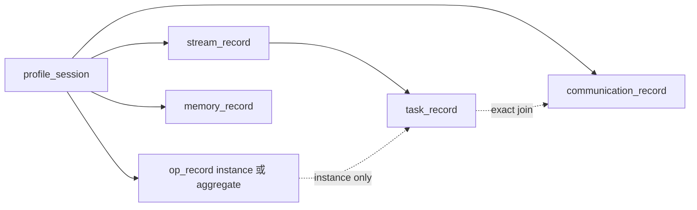

# msprof 与 NPU stream 性能分析设计

版本：设计 v1；任务 t130；日期：2026-11-15。状态：**仅设计，尚未实现**。目标是让性能调优段接收已存在的 profiling 产物，展示可追溯的热点、stream 时间线、内存/通信指标，并输出有条件、有证据的优化建议。本文没有运行 msprof、连接 c01/b01、启停服务、修改 CANN 或模型代码。

## 1. 结论、边界与现状

建议新增独立 profile 数据域和解析管线，先完成 **P1 算子记录/统计与五条规则 → P2 task/stream 时间线 → P3 通信、内存与完整规则引擎**。保留现有 benchmark 导入、运行对比和热点接口；profile 与 benchmark 通过显式关联互相跳转。benchmark 回答“慢了多少”，profile 提供“这次采样里哪些现象可能解释变慢”，profile 本身不能证明优化收益。

源码主仓基准为 `456b9c543ff732c08baa9647a1f3e2df520b147d`，包版本 1.1.2。已观察事实：

- [parseMsprofCsv](../index.js#L757) 只识别 `Op Name` / `Task Duration(us)` 等有限别名，按名称/类型汇总；[调用次数](../index.js#L788) 是有效输入行数，并未读取 `Calls`；[返回值](../index.js#L795) 只保留 Top 50，份额分母为算子 duration 总和，不能解释为 wall time 或全卡利用率。
- [现有样例说明](../fixtures/README.md#L16) 明确 `msprof-op-summary.csv` 为合成数据；[样例表头](../fixtures/msprof-op-summary.csv#L1) 不是已验证的 CANN 原生完整 schema。
- [Store](../index.js#L1556) 存 runs、snapshots 及独立 demo 数据；[旧热点导入](../index.js#L2394) 要求 target_run_id，并覆盖 run.hotspots。新 profile 不复用这个覆盖操作，不把百万级 task 塞入 store.json。
- [现有 UI](../client.js#L2258) 已是环境/部署/调优三段；[调优内容](../client.js#L2300) 包含作业、运行、对比、洞察。旧文档的两 tab 结构不作为当前信息架构。

设计决定：导入只读产物，原始文件只在 Host 本机私有暂存；浏览器读取摘要、分页记录和聚合时间桶；未知格式先登记为 unsupported，不靠文件名推断其字段。此次实现范围不包括数据库二进制解析、自动执行 analyse、自动开始/停止 profiling、自动改 tiling/dtype/并行参数、无证据 LLM 诊断。

## 2. 证据目录与可信程度

下面的 S 是一个真实 Ascend PyTorch Profiler capture 的 [ASCEND_PROFILER_OUTPUT 目录](</Users/hexiaoying/workspace/video-gen-h3/logs/t5_profiler_probe/910B3-02_85_20261109171514542_ascend_pt/ASCEND_PROFILER_OUTPUT>)，其父目录 [profiler_info.json:15](</Users/hexiaoying/workspace/video-gen-h3/logs/t5_profiler_probe/910B3-02_85_20261109171514542_ascend_pt/profiler_info.json#L15>) 标示 Level1 / ACL_AICORE_PIPE_UTILIZATION，[版本字段:45](</Users/hexiaoying/workspace/video-gen-h3/logs/t5_profiler_probe/910B3-02_85_20261109171514542_ascend_pt/profiler_info.json#L45>) 为 torch_npu `2.10.0.post4`、CANN `9.1.0`。它是小算子 probe，**不是 vLLM benchmark，不是 c01 的 CANN 9.2.0 证明**。不把目录日期解析为可信 UTC capture 起止。

| 证据 ID | 已读取的真实文件/位置 | 能证明的事实与限制 |
| --- | --- | --- |
| E1 | [op_statistic.csv:1](</Users/hexiaoying/workspace/video-gen-h3/logs/t5_profiler_probe/910B3-02_85_20261109171514542_ascend_pt/ASCEND_PROFILER_OUTPUT/op_statistic.csv#L1>) | 3 类聚合；LaserAttention 3 次/11707.694 us/88.894%；Transpose 15 次/1357.767 us；不是 3 个 task |
| E2 | [task_time.csv:1](</Users/hexiaoying/workspace/video-gen-h3/logs/t5_profiler_probe/910B3-02_85_20261109171514542_ascend_pt/ASCEND_PROFILER_OUTPUT/task_time.csv#L1>) | 23 个 task 行，含 PROFILING_ENABLE/DISABLE；可得 device/stream/task/start/stop |
| E3 | [kernel_details.csv:1](</Users/hexiaoying/workspace/video-gen-h3/logs/t5_profiler_probe/910B3-02_85_20261109171514542_ascend_pt/ASCEND_PROFILER_OUTPUT/kernel_details.csv#L1>) | 21 个算子实例、shape/dtype/format 与 PIPE counters；[第8行](</Users/hexiaoying/workspace/video-gen-h3/logs/t5_profiler_probe/910B3-02_85_20261109171514542_ascend_pt/ASCEND_PROFILER_OUTPUT/kernel_details.csv#L8>) 有 MIX_AIC 的 aic_mac_ratio=0.79、aiv_vec_ratio=0.708；ratio 非百分数列 |
| E4 | [trace_view.json:1](</Users/hexiaoying/workspace/video-gen-h3/logs/t5_profiler_probe/910B3-02_85_20261109171514542_ascend_pt/ASCEND_PROFILER_OUTPUT/trace_view.json#L1>) | 顶层 array，457 events；X=295，s/f 各57，M=38，C=10；含硬件 task、CPU 调用、flow、频率，不能全当 NPU kernel |
| E5 | [communication_rank0.json:1](</Users/hexiaoying/workspace/video-gen-h3/profile/t6_review/communication_rank0.json#L1>) | 顶层 step→collective/p2p；5242 collective entries；与 S **不同 capture**，不能按 device0 拼接；rank0 目前仅文件名线索 |
| E6 | [step_trace_time.csv:1](</Users/hexiaoying/workspace/video-gen-h3/logs/t5_profiler_probe/910B3-02_85_20261109171514542_ascend_pt/ASCEND_PROFILER_OUTPUT/step_trace_time.csv#L1>) | 有 Computing/Free/Stage 等列，Step 空；列名不含单位，故本设计保留原值但不启用该文件的定量规则 |
| E7 | [服务 profiling 文档:99](</Users/hexiaoying/workspace/code/kvcache/vllm-ascend/docs/source/developer_guide/performance_and_debug/service_profiling_guide.md#L99>) | 源码 revision `28e9e97ba254b076a88275e8a275556cb9a11664`，列出 kernel_details/operator_details/op_statistic/trace_view 等；[开始/停止 API:51](</Users/hexiaoying/workspace/code/kvcache/vllm-ascend/docs/source/developer_guide/performance_and_debug/service_profiling_guide.md#L51>) 会改变采样状态，不属于只读导入 |
| E8 | [本机昇腾导览:20](</Users/hexiaoying/workspace/llm-inference-optimization/11_vllm_code/07_ascend/01_ascend_overview.md#L20>) | NZ、量化、通信等建议动作的背景索引，不是本次瓶颈证据；知识库未找到 msprof schema 原文 |
| E9 | [真实环境记录:10](./real-env-report.md#L10)、[旧导入验证:54](./verification.md#L54) | 仅旧环境/旧导入行为；不能宣称验证了本文 profile 功能或 CANN9.1/9.2 schemas |

可重放指纹：E1 SHA256 `e43f8abc8cd7cac0b91a1cee337fe725f5bae2b65bf2e2b9062f04a15047e2f4`；E2 `6f5877a4685d112b218a88662ddca14c893aeba79079df2f1ee6e98a8ca2fde4`；E3 `f24abbccdefe9e044043c9644c0a26904258aff8e2ea0920a01777caa5dfb0b7`；E4 81015 bytes，SHA256 `d91d615ac3d924a6a9ccdfeed535c280a4670a8c7435664d23d1e347889a4b65`；E5 `6cb5293767baa21bddf5da84bcb60ede04b8168d0066e9954fdaec1f94ef657e`。大 JSON 单行引用须同时写 JSON Pointer/array index，不能只写第1行。

外部检索定位了 [CANN8.1RC1 op_summary 文档](https://www.hiascend.com/document/detail/zh/canncommercial/81RC1/devaids/devtools/profiling/atlasprofiling_16_0067.html)、[CANN8.3RC1 profiling 文档](https://www.hiascend.com/document/detail/zh/canncommercial/83RC1/devaids/Profiling/atlasprofiling_16_0011.html)、[msprof 固定 revision 文件参考](https://github.com/Ascend/msprof/blob/fd5a9872692ec9a9ab7d7ecd887b8e7ea0755db8/docs/en/user_guide/profile_data_file_references.md)。web_fetch 返回 `resolves to a non-public IP address`，未获得正文，**这些链接仅为待核验索引，不用检索片段补全 schema**。补充真实原生文件是 P1/P3 明确的准入条件。

## 3. 文件、字段与版本兼容矩阵

### 3.1 总表与判型

| 请求中的文件名 | 当前证据/支持策略 | 版本与缺失语义 |
| --- | --- | --- |
| op_summary.csv / op_summary_*.csv | 原生 msprof **未验证**。只验证了旧合成别名 `Op Name,OP Type,Task Type,Task Duration(us),Calls`；另以 E3 的 kernel_details 作为已验证的实例输入 | 不能把 kernel_details 表头宣称为所有 op_summary 的表头。P1 用表头指纹+原生 golden sample 解锁 adapter；未知拒绝定量分析 |
| op_statistic.csv | E1，统计行 adapter `ascend-pt-statistic-v1` | 目前仅 CANN9.1/torch_npu2.10 实例；老版本不同名列必须独立 fixture，不自动猜单位 |
| task_time.csv | E2，`ascend-pt-task-v1` | `task_time(us)` 与 stop-start 的末位可能因导出舍入不同；duration 优先指定该列，并保留 stop 校验差 |
| communication.json / communication_rank*.json | E5，`ascend-communication-v1` | 仅已观察树形版本；rank 命名只是 hint，需 manifest 确认；空 p2p={} 表示此文件未列 p2p，不证明系统没有 p2p |
| npu_mem.csv / npu_mem_*.csv | **未找到真实样例，原生字段/枚举/单位未验证** | 名称不能推定 allocator/HBM/进程维度。只登记 unsupported；P3 待对应 CANN 文件+官方语义，禁止用 npu-smi 快照冒充 profile 内存轨迹 |
| trace.json / trace_view.json | E4 只确认 trace_view 顶层 array；`traceEvents` wrapper 是候选 Chrome Trace 兼容输入，需合成兼容 fixture，与原生证明分开 | 用内容 envelope 判型；原生 trace.json 未验证；unknown ph/category 不丢原始计数，不产生任务 |
| msprof_*.json | 原生时间线文件 **未验证**；若内容满足已启用 trace adapter，可以标 `generic-trace-compatible`，不能标“已验证 msprof 原生” | suffix/文件名不决定 dialect；时钟/单位/设备元数据未知则只可显示原始计数 |
| npu_stream*.json | **没有找到真实样例，也没有确认标准导出名称** | 产品中“Stream”是统一模型派生视图；不能发明 `{streams:[...]}` 原生 schema。若用户自定义文件，须自定义 manifest 明确数据合同 |
| kernel_details.csv（增补） | E3，`ascend-pt-kernel-v1`，用于 P1 利用率和 P2 task 关联 | CANN9.1 sample，所有未采集 counter 保持 unknown；存在列且值为0也要结合 core 类型判断 not_applicable |
| profiler_info.json（增补） | E7 的产物目录 + 实际 config/version | 元数据不覆盖用户声明；采集器来源和用户声明分字段保存；版本不明时能力降级 |

原始空值共同规则：空串、`N/A`、`-`、`NULL` 只在具体字段 adapter 中变成 null；字面算子名 `N/A` 可保留 raw_name 并分类 control。0 是观测值，不自动补缺；非法数字、NaN/inf、负 duration、stop<start 是 rejected record。保留 per-file accepted/rejected/unknown counts、字段单位原文、错误行/Pointer；默认严格模式整 session 不提交，用户显式选择跳坏行时 session 标 partial。不能悄悄生成完整统计。

### 3.2 已验证 CSV 字段

| 文件/字段 | 输入类型/单位/已观察枚举 | 统一目标/限制 |
| --- | --- | --- |
| E1 Device_id / OP Type / Core Type | ID / string / `MIX_AIC,AI_VECTOR_CORE` | device_id 原样字符串；op_type；core_type 开放字符串，不枚举封死未来类型 |
| E1 Count | 非负整数 | calls=原 Count，不能按行数算；Count=0 时均值 null |
| E1 Total/Min/Avg/Max Time(us) | 十进制微秒 | op_record 相应 *_ns 十进制整数字符串；先十进制定点换算，非 Number(ts)*1000 |
| E1 Ratio(%) | 百分数，示例88.894 | 比例/100；保留 `source_ratio` 和分母 label=source_reported，不能直接当设备利用率 |
| E2 Device_id,stream_id,task_id | 十进制 ID | device_id/native_stream_id/native_task_id；都不是全局主键 |
| E2 kernel_name,kernel_type | 字符串；`AI_VECTOR_CORE,MIX_AIC,PROFILING_ENABLE,PROFILING_DISABLE` | task name/type；profiling controls 在 timeline 可选显示，排除计算占比 |
| E2 task_time(us),task_start(us),task_stop(us) | 十进制微秒，时间有尾随 tab | 精确 trim/parse；end-start 与 duration 不一致超过 max(1us,0.1%) 记 warning，不静默调整 |
| E3 Model ID,Task ID,Stream ID,Context ID | ID；Model ID=4294967295，Context ID=`N/A` 或0 | 4294967295 在本 sample 为原值/疑似 sentinel，需文档确认才规范化；不能据其跨模型唯一关联 |
| E3 Name,Type,OP State,Accelerator Core | 名称/类型，dynamic，AI_VECTOR_CORE/MIX_AIC | op_name/op_type/state/core；开放枚举，unknown 保留 |
| E3 Start Time(us),Duration(us),Wait Time(us) | 微秒 | task 起点、持续时间；Wait Time 的确切等待类别未验证，不能直接当依赖边耗时 |
| E3 Input/Output Shapes,Data Types,Formats | 多输入分号分隔/带 CSV 引号；DT_BF16,FLOAT16,ND,NCHW 等 | bounded raw dimensions；按列表解析不合并成一个 tensor；可能含业务 shape，默认隐去导出 |
| E3 aicore_time(us),aiv_time(us),aic_*/aiv_* 的 *_time(us),*_total_cycles | 时间/周期分别保存 | 不把 AI Core/VEC 双引擎时间相加当 wall time |
| E3 aic_mac_ratio,aiv_vec_ratio,aic_mte1/2_ratio,aiv_mte2/3_ratio 等 | 本实例以 fraction 记录0..1，不带百分号 | metrics 中保留单位 `ratio`；aic_* 对纯Vector不适用。ratio之间可能重叠，禁止求和必须为1的断言 |
| E3 cube_utilization(%) | 百分比，本实例LaserAttention97.658 | /100，保持 metric_key=cube_utilization，不与aic_mac_ratio合并；数学定义/跨版本可比性待上游文档核实 |

P1 原生 op_summary 未解锁时，仅支持 E1/E3 和明确标记的 legacy fixture；页面显示“原生 op_summary adapter 待验证”，不影响真实 op_statistic 的可用性。需补采的新 sample 只要求用户提供既有产物，不触发插件自行采集。

### 3.3 时间线 JSON、设备映射和 flow

E4 的真实字段：`ph,name,pid,tid,ts,dur,cat,args,id,bp`，字段按 phase 可选。`ts` 实际为带小数的字符串（例 `1794244514651656.912`），`dur` 为小数数字；已观察 X、M、C、s、f。对本 adapter 固定 us（由同 capture E2/E3 的 start 一致性确认），不把这个假设推广到未知 JSON。

- `/219` 是 process_name=`Ascend Hardware`, pid=87488；`/220/args/labels`=`NPU 0`；`/222` 是 tid47 的 thread_name=`Stream 47`。**pid87488不是 device_id，也不是 OS 的 worker PID**。通过 `(capture_id,pid)` 的 M 元数据映射为 device0；CPU、CANN、Overlap Analysis、AI Core Freq 各有不同合成进程。
- `/176`：X task，tid47、`args/Task Id`=32、`args/Physic Stream Id`=47、Model Id=4294967295、Batch Id=0、Subtask Id=4294967295、connection_id=4。只有已识别硬件 process 的 X 才成为设备 task。
- `/177`：ph=f、cat=HostToDevice、id=`17179869184`。它是提交到执行的关联 flow，**不是 H2D memcpy**；不得据此计算拷贝 bytes、带宽或copy/compute overlap。只有明确传输 task 类型/方向/bytes 有语义证据才标 copy。
- `/347` 是 ph=C，name=AI Core Freq，args/MHz=1800，不能归类为内存。M/C/flow 单独索引，不计入 kernel 数。
- P2 支持 X 及已匹配 s/f；B/E、异步 b/e、flow t 等仅在相应 fixture/作用域算法完成后解锁。未支持 phase 计入 coverage.unhandled，避免从不完整时间线计算全卡 idle。

同文件 ph=s/f 按规范作用域的 `(session,clock_domain,cat,id/scope)` 组内配对，保留起止 Pointer；id 重复、方向不明、不成对均 orphan。flow edge只证明关联，不能直接证明等待依赖；有明确 event wait/sync 语义时才建立 wait edge。默认不从名称中的 Wait/Copy 单词推导设备操作类别。

### 3.4 通信/内存字段与未验证部分

E5 真实路径：`/step/collective/<op_instance>/Communication Time Info`；同层 `Communication Bandwidth Info/<link>`，已观察 link `RDMA,HCCS,PCIE,SDMA,SIO`。时间字段 `Start Timestamp(us)`（微秒）、`Elapse Time(ms),Transit Time(ms),Wait Time(ms),Synchronization Time(ms),Idle Time(ms)`（毫秒），`Wait Time Ratio,Synchronization Time Ratio`（比例）；带宽字段 `Transit Size(MB),Transit Time(ms),Bandwidth(GB/s),Large Packet Ratio,Size Distribution`。`step` 是顶层 literal，不表示数字第0步，统一 step=null、step_label=`step`。

E5字段表（均来自同一真实JSON，非推测原生列）：

| JSON相对字段 | 单位/实际形态 | 空值/关联语义 |
| --- | --- | --- |
| 顶层`step`、`collective`/`p2p`、op_instance对象键 | string/tree；p2p为空object | `step`不等于数字step；op_instance是源名称，不能拆名称猜task_id |
| Communication Time Info / Start Timestamp(us) | 微秒number | start可用，不能以时间邻近匹配task；精度受源number文本限制 |
| Elapse Time(ms) / Transit Time(ms) / Wait Time(ms) | 毫秒number | 分别保存elapsed/transit/wait，null未知、0观测但采集完整性待确认 |
| Synchronization Time(ms) / Idle Time(ms) | 毫秒number | 不与Wait相加；定义未充分确认时source_reported |
| Wait Time Ratio / Synchronization Time Ratio | fraction number，示例1.0 | 不假设分母是Elapse；缺失不反推 |
| Communication Bandwidth Info / RDMA,HCCS,PCIE,SDMA,SIO | link对象键 | 不当作stream；没有link可保留op-level通信 |
| Transit Size(MB) / Bandwidth(GB/s) | 源MB / GB/s | 保留源单位，二进制/十进制定义未验证不换bytes |
| Transit Time(ms) / Large Packet Ratio / Size Distribution | ms / fraction / object | 分布桶含义待样例/文档补充，默认仅保留有界原始概要；空object非0包证明 |
| device_id/rank_id/task_id/stream_id/correlation_id | **该样例没有显式字段** | native task join不可执行，rank0 basename只作hint而非事实 |

通信到trace的exact join要求：同capture manifest身份+明确rank/device/clock，且双方拥有相同、语义已验证的task/correlation identity（或导出器提供显式`op_instance→trace event`映射表）。trace侧device/stream/task必须来自事件`args/Task Id`、`args/Physic Stream Id`和M元数据等实际字段；communication侧缺这些字段时，`task_id/stream_id=null,join_status=unmatched`。**不以文件名rank0、op名称后缀、时间最近或同device推断关系**；本次E5和E4还属于不同capture，因此连同窗口统计也不允许。time/step只用来校验已经建立的identity，不用于制造identity。

源 MB/GB 的十进制/二进制精确定义未取得正文，P3 先保留带单位的原值；不生成 bytes/bytes_per_s，直到 adapter unit profile 明确。首条广播 Transit=0、Wait Ratio=1、Wait=0.2514650625ms、Elapse=0.3139663125ms，说明**不能假定 Wait Time Ratio=Wait/Elapse**，更不能把 Synchronization 和 Wait 相加。链接全零可能是未传输或未采集；缺采集证据时不判断零通信成本。

内存原生 schema 未验证，以下仅为**我们新增的内部 memory_record 合同**：时间、scope（device/process/allocator）、metric_kind（device_used/capacity/allocated/reserved/active/inactive_split）、bytes、allocator/pool；指标存在与 scope 清楚才启用。allocated/reserved 差值称缓存余量，不能称碎片；碎片必须有同 allocator 的 inactive_split 或官方等效明确定义。npu-smi 周期样本可在独立来源显示，不能回填 profile 峰值。

### 3.5 npu_stream 可插拔 adapter、获取方式未知项与最小样例清单

`npu_stream` 采用独立可插拔 adapter，P1 **完全不依赖它**。建议 parser registry 暴露 `registerProfileAdapter({id, detect, parse, capabilities})`，由Host启动时注册经过审查的内置adapter，禁止从上传JSON加载执行代码。预留 `npu-stream-unverified` capability=unsupported；未来获得真实样例后实现 `parseNpuStream(source, context)`，输出既定 stream_record/task_record，同一clock/FK/来源约束继续生效，不修改trace/op主链路，也不把trace适配器改名冒充npu_stream适配器。

| 期望的内部信息 | stream_record/task_record目标 | 当前npu_stream原生状态 |
| --- | --- | --- |
| 明确device/rank/process与本地stream标识 | device_id/rank_id/process_id/native_stream_id | 字段名、作用域、ID是否复用均**未知**；缺失保持null/unknown，不从文件名猜 |
| 明确时间单位、起点、时钟域和采样窗口 | clock_id/start_ns/end_ns；task.duration_ns | **未知**；禁止借用E4的us假设，单位未知时不计算gap/overlap |
| task标识、设备task类型、op关联标识 | native_task_id/task_type/op_id与join_status | **未知**；缺task级数据只输出stream摘要，不能补造task |
| stream类别、覆盖完整性、关联源位置 | kind/coverage/sources/missing_reasons | **未知**；kind=unknown、coverage=unknown，busy/gap=null，并说明缺失 |

获取方式必须如实记录：**尚未确认哪一个 msprof 子命令或导出选项会生成 npu_stream JSON；支持的CANN/msprof版本、标准目录、文件命名、字段名/枚举/单位、是否第三方自定义产物全部待验证**。E7文档列出trace_view等文件，但没有证明npu_stream的生成方法。当前下一步是“待用户提供真实 profile 目录及对应导出命令”，不能给用户编造一个msprof参数。本插件只读取既有产物；即使用户补齐命令，也只是保存脱敏元数据，不在导入中执行。

用户最小需提供的材料（通过已授权文件渠道，敏感内容可先脱敏）：

1. 一个**同次capture**的目录结构/文件清单，至少一个op_statistic或原生op_summary；若需stream关联，再提供trace_view/trace/msprof时间线和task_time或kernel_details，注明哪些文件是同次导出。
2. 如确有npu_stream，提供真实文件和生成它的工具/版本、完整导出选项（去秘密）、原始basename与目录层级；如没有，明确“未生成/目录内不含npu_stream”即可，P1/P2的trace链路不受阻。
3. CANN、msprof、torch_npu和driver版本，已开启采样参数；若有profiler_info/元数据一并提供。缺失项可标未知，不强迫重新跑服务。
4. capture设备/rank映射、TP/DP等并行参数、采样时钟/时间单位说明；通信/内存分析再提供**同capture**的communication和memory文件及其采集选项。
5. 一个可分享的小型脱敏有效片段或完整既有capture，以及期望关联的benchmark run条件。无需提供prompt、token、密钥、模型私有权重或整机日志。

## 4. 架构与三种输入路径

以下为设计的模块与数据流（尚未实现），SVG 由文档直接手写；箭头表示数据处理顺序。

<svg xmlns="http://www.w3.org/2000/svg" viewBox="0 0 1040 260" role="img" aria-label="profile 导入、规范化、证据分析和调优 UI 数据流">
  <defs><marker id="p-arrow" markerWidth="8" markerHeight="8" refX="7" refY="4" orient="auto"><path d="M0 0 L8 4 L0 8 Z" fill="#475569"/></marker></defs>
  <g fill="#f8fafc" stroke="#64748b"><rect x="10" y="25" width="190" height="190" rx="10"/><rect x="245" y="25" width="210" height="190" rx="10"/><rect x="500" y="25" width="245" height="190" rx="10"/><rect x="790" y="25" width="240" height="190" rx="10"/></g>
  <g fill="#0f172a" font-size="15" font-family="sans-serif"><text x="25" y="55">三种已存在的产物</text><text x="25" y="92">上传目录 / zip</text><text x="25" y="126">远程只读文件</text><text x="25" y="160">独立 demo fixtures</text><text x="260" y="55">Host 导入作业</text><text x="260" y="92">限额 / 路径 / 脱敏</text><text x="260" y="126">格式指纹 / 版本</text><text x="260" y="160">不可变 manifest</text><text x="515" y="55">profile-store 独立仓储</text><text x="515" y="92">六类记录 / 分片 / 索引</text><text x="515" y="126">task join / 时钟 / coverage</text><text x="515" y="160">规则 → evidence pointers</text><text x="805" y="55">调优 → Profile 子视图</text><text x="805" y="92">热点 / 时间线 / 内存通信</text><text x="805" y="126">证据与建议 / JSON 导出</text><text x="805" y="160">显式链接 benchmark run</text></g>
  <g stroke="#475569" stroke-width="2" marker-end="url(#p-arrow)"><path d="M200 120H240"/><path d="M455 120H495"/><path d="M745 120H785"/></g>
  <text x="15" y="245" fill="#475569" font-size="13">输入只读；原始数据留在 Host；Web 只取摘要、分页和可视时间桶；基准数据不被 profile 覆盖。</text>
</svg>

### 4.1 上传目录/zip

新增 ImportProfileSheet：目录选择使用浏览器 File 列表+相对路径；不假设浏览器能访问任意 Host 绝对路径。zip 通过分块上传暂存，Host 流式解包+识别已支持白名单文件；上传前预览文件清单、总量、预计不支持文件。拒绝绝对路径、`..`、重复归一化路径、symlink/hardlink、设备节点、嵌套archive和跨根目录跳转；忽略未知二进制并报告，不执行压缩包脚本/SQL/JSON内命令。

建议默认限额（产品预算，非 CANN 限制）：单文件256MiB；压缩包256MiB、解压总量1GiB、最多512文件、压缩比100:1；每session 500万设备task/1000万trace events、20个session/总磁盘5GiB。单块1MiB、并发上传2；默认 import wall timeout 120s，取消可清理暂存。超过限制停止且给出“缩小采样范围/拆分 capture”建议，不静默取前N行。profile索引摘要可在大文件拒绝后保留失败作业记录，不提交半个session。限额可由Host配置，在UI明确显示实际值。

### 4.2 c01/b01 远程只读输入

使用现有环境配置 ID（[环境配置入口](../index.js#L2344)），UI显示 c01/b01 标签仅作名称；**不在代码内硬编码主机/IP或从标签推导SSH目标**。新增每环境 `profile_read_roots` 白名单，通过现有环境SSH能力执行有界 stat/list/read；只读取用户选定已完成导出的CSV/JSON和元数据。路径在远端realpath后须位于白名单内、类型为普通文件，不跟随根外symlink；命令通过参数传递/严格引用，不能把文件名插入可执行shell文本。

流程：列出capture候选→用户选择→有界manifest（路径大小mtime）→读取/hash→再次stat比较；文件改变返回 PROFILE_SOURCE_CHANGED，作业不提交。两次 stat 仍不能证明上游原子完成，优先 analyse.done 或用户提供稳定完成标记；无标记标 source_stability=unknown。网络错误终止本次读取并保留可续传块状态，重试须重新验证原始指纹，不能拼接两个版本。只读不调用 /start_profile、/stop_profile、不执行 msprof、analyse、benchmark，也不改变已有容器。远程路径映射和认证均只在Host；Client只见别名和脱敏相对路径。

### 4.3 demo fixtures

新 `fixtures/profile/demo-*`（拟新增）与真实导入仓严格分离；内含合成 op_statistic/kernel/task/trace/communication/memory fixture，显式 `is_demo=true,evidence_kind=demo`。真实样例转为golden fixture前去主机、路径、张量shape业务标识并重新记录派生SHA；不能把本机81KB trace直接随包发布。demo允许展示内存能力，但标“合成内部合同，原生npu_mem未验证”。退出demo恢复此前真实session选择；禁止demo/真实session对比。

### 4.4 元数据、隐私、仓储与错误

导入 manifest记录模型ID/修订和来源、TP/PP/DP/CP/EP、设备数/拓扑、CANN/driver/torch_npu/msprof版本、采样参数/活动级别、capture开始结束/时区、时钟域、命令（先脱敏再落盘）、rank映射、与benchmark的关联。unknown显式null+missing_reasons。元数据来源标 `file|user_declared|derived`，互相冲突并列展示，不以用户填写提升采样证据等级。

建议新存储 `<dataDir>/profiles-v1/{real|demo}/<session_id>/`：manifest.json（含schema/parser版本）、op/task/stream/memory/communication NDJSON分片、index.json、聚合时间桶、派生insights。私有目录0700/文件0600沿用[现有私有存储要求](./verification.md#L152)；job在staging，所有文件/引用校验成功后原子rename提交。解析版本升级生成新revision，原始fingerprint不变；summary不进入旧store.json。默认只保存脱敏规范化记录；原始文本临时读取/私有暂存24h删除，用户选择保留原文时最长7天并占同一5GiB配额；20session/30天清理按未pin的LRU，pin只免自动过期不免磁盘硬上限，满额显式拒绝。引用失效显示证据过期，不伪装仍可下载原文。

脱敏删除prompt、token内容、API key、Authorization、用户绝对路径/主机信息；stack默认不导入，shape/dtype可选择保留仅本机分析，导出默认省略shape。只允许已知args键和长度上限，不将任意JSON args直传HTML。HTML文本按纯文本渲染，CSV导出防公式。原始SHA仅在私有manifest可见，公开报告使用session scoped source_id；命令保留脱敏后显示值而非秘密原文。

错误码拟定：PROFILE_UNSUPPORTED_FORMAT、PROFILE_UNIT_UNKNOWN、PROFILE_SOURCE_CHANGED、PROFILE_TOO_LARGE、PROFILE_PARSE_ERROR、PROFILE_CLOCK_UNALIGNED、PROFILE_AMBIGUOUS_JOIN、PROFILE_PARTIAL、PROFILE_EVIDENCE_EXPIRED。错误含安全basename/行号或Pointer、可执行下一步和accepted/rejected，不回传原始敏感片段。解析任务状态 `queued→validating→parsing→indexing→ready|partial|failed|cancelled`；取消不能暴露未提交session。

## 5. 统一数据模型与 v1 JSON Schema

以下是**新增内部数据合同**，不是声称CANN原生文件有这些字段。采用 JSON Schema draft2020-12，一个schema集合中的六个 `$defs` 分别为所需六张表；validator按 `#/$defs/profile_session` 等引用验证。`source_ref`/`metric` 为复用对象，不是额外业务表。`additionalProperties:false` 限定规范化合同；原生未知字段只统计键名/存在性，不无界透传。

所有主键由Host生成稳定session scoped ID；`session_id`为UUID，记录ID由规范化身份+source locator做SHA256截取，冲突时拒绝而非覆盖。外键由提交前二次约束校验（JSON Schema自身不验证跨记录FK）。`native_*_id`均字符串，保留大整数。时间是**相对于本clock origin的纳秒整数字符串**，避免JS Number大epoch精度损失；十进制us以定点转换，超过ns精度存raw并标舍入。`source_ref.fields`为源列名/Pointer，CSV行含表头为第1行，JSON array用0基Pointer。

```json
{
  "$schema": "https://json-schema.org/draft/2020-12/schema",
  "$id": "urn:dsh-ascend-perf:profile-v1",
  "$defs": {
    "nullable_string": {"type": ["string", "null"]},
    "ns": {"type": ["string", "null"], "pattern": "^[0-9]+$"},
    "source_ref": {
      "type": "object", "additionalProperties": false,
      "required": ["source_id", "locator", "fields"],
      "properties": {"source_id": {"type": "string"}, "locator": {"type": "string"}, "fields": {"type": "array", "items": {"type": "string"}}}
    },
    "missing": {"type": "object", "additionalProperties": {"type": "string"}},
    "metric": {
      "type": "object", "additionalProperties": false,
      "required": ["key", "value", "unit", "semantic_status", "source"],
      "properties": {
        "key": {"type": "string"}, "value": {"type": ["number", "string", "null"]},
        "unit": {"enum": ["ns", "bytes", "ratio", "cycles", "MHz", "MB", "GB/s", "unknown"]},
        "semantic_status": {"enum": ["verified", "source_reported", "not_applicable", "unverified", "missing"]},
        "source": {"$ref": "#/$defs/source_ref"}
      }
    },
    "profile_session": {
      "type": "object", "additionalProperties": false,
      "required": ["schema", "session_id", "revision", "state", "evidence_kind", "is_demo", "created_at", "source", "model", "parallel", "versions", "capture", "clocks", "files", "coverage", "linked_run_ids", "missing_reasons"],
      "properties": {
        "schema": {"const": "profile-session-v1"}, "session_id": {"type": "string"}, "revision": {"type": "integer", "minimum": 1},
        "state": {"enum": ["ready", "partial"]}, "evidence_kind": {"enum": ["unverified_import", "demo"]}, "is_demo": {"type": "boolean"},
        "created_at": {"type": "string", "format": "date-time"},
        "source": {"type": "object", "additionalProperties": false, "required": ["mode", "env_id", "parser_version"], "properties": {"mode": {"enum": ["upload", "remote_read", "demo"]}, "env_id": {"$ref": "#/$defs/nullable_string"}, "parser_version": {"type": "string"}}},
        "model": {"type": "object", "additionalProperties": false, "required": ["name", "revision", "origin"], "properties": {"name": {"$ref": "#/$defs/nullable_string"}, "revision": {"$ref": "#/$defs/nullable_string"}, "origin": {"enum": ["file", "user_declared", "unknown"]}}},
        "parallel": {"type": "object", "additionalProperties": false, "required": ["tp", "pp", "dp", "cp", "ep", "device_count"], "properties": {"tp": {"type": ["integer", "null"], "minimum": 1}, "pp": {"type": ["integer", "null"], "minimum": 1}, "dp": {"type": ["integer", "null"], "minimum": 1}, "cp": {"type": ["integer", "null"], "minimum": 1}, "ep": {"type": ["integer", "null"], "minimum": 1}, "device_count": {"type": ["integer", "null"], "minimum": 1}}},
        "versions": {"type": "object", "additionalProperties": false, "required": ["cann", "driver", "torch_npu", "msprof"], "properties": {"cann": {"$ref": "#/$defs/nullable_string"}, "driver": {"$ref": "#/$defs/nullable_string"}, "torch_npu": {"$ref": "#/$defs/nullable_string"}, "msprof": {"$ref": "#/$defs/nullable_string"}}},
        "capture": {"type": "object", "additionalProperties": false, "required": ["started_at", "ended_at", "command_redacted", "parameters", "stability"], "properties": {"started_at": {"type": ["string", "null"], "format": "date-time"}, "ended_at": {"type": ["string", "null"], "format": "date-time"}, "command_redacted": {"$ref": "#/$defs/nullable_string"}, "parameters": {"type": "object", "additionalProperties": {"type": ["string", "number", "boolean", "null"]}}, "stability": {"enum": ["stable_marker", "stat_checked", "unknown"]}}},
        "clocks": {"type": "array", "items": {"type": "object", "additionalProperties": false, "required": ["clock_id", "origin_raw", "raw_unit", "alignment", "error_ns"], "properties": {"clock_id": {"type": "string"}, "origin_raw": {"type": "string"}, "raw_unit": {"enum": ["us", "ns", "ms", "unknown"]}, "alignment": {"enum": ["shared_capture", "explicit_mapping", "unaligned"]}, "error_ns": {"$ref": "#/$defs/ns"}}}},
        "files": {"type": "array", "items": {"type": "object", "additionalProperties": false, "required": ["source_id", "path_redacted", "sha256", "bytes", "dialect", "validation"], "properties": {"source_id": {"type": "string"}, "path_redacted": {"type": "string"}, "sha256": {"type": "string", "pattern": "^[a-f0-9]{64}$"}, "bytes": {"type": "integer", "minimum": 0}, "dialect": {"type": "string"}, "validation": {"enum": ["native_sample_verified", "generic_compatible", "synthetic", "unsupported"]}}}},
        "coverage": {"type": "object", "additionalProperties": false, "required": ["accepted", "rejected", "unhandled", "join_exact", "join_ambiguous", "join_missing", "complete_device_timeline"], "properties": {"accepted": {"type": "integer", "minimum": 0}, "rejected": {"type": "integer", "minimum": 0}, "unhandled": {"type": "integer", "minimum": 0}, "join_exact": {"type": "integer", "minimum": 0}, "join_ambiguous": {"type": "integer", "minimum": 0}, "join_missing": {"type": "integer", "minimum": 0}, "complete_device_timeline": {"type": "boolean"}}},
        "linked_run_ids": {"type": "array", "uniqueItems": true, "items": {"type": "string"}}, "missing_reasons": {"$ref": "#/$defs/missing"}
      }
    },
    "op_record": {
      "type": "object", "additionalProperties": false,
      "required": ["session_id", "op_id", "record_kind", "device_id", "rank_id", "step", "op_name", "op_type", "core_type", "calls", "total_ns", "min_ns", "mean_ns", "max_ns", "metrics", "sources", "missing_reasons"],
      "properties": {
        "session_id": {"type": "string"}, "op_id": {"type": "string"}, "record_kind": {"enum": ["instance", "aggregate"]},
        "device_id": {"$ref": "#/$defs/nullable_string"}, "rank_id": {"$ref": "#/$defs/nullable_string"}, "step": {"$ref": "#/$defs/nullable_string"},
        "op_name": {"$ref": "#/$defs/nullable_string"}, "op_type": {"$ref": "#/$defs/nullable_string"}, "core_type": {"$ref": "#/$defs/nullable_string"},
        "calls": {"type": ["integer", "null"], "minimum": 0}, "total_ns": {"$ref": "#/$defs/ns"}, "min_ns": {"$ref": "#/$defs/ns"}, "mean_ns": {"$ref": "#/$defs/ns"}, "max_ns": {"$ref": "#/$defs/ns"},
        "metrics": {"type": "array", "items": {"$ref": "#/$defs/metric"}}, "sources": {"type": "array", "minItems": 1, "items": {"$ref": "#/$defs/source_ref"}}, "missing_reasons": {"$ref": "#/$defs/missing"}
      }
    },
    "stream_record": {
      "type": "object", "additionalProperties": false,
      "required": ["session_id", "stream_id", "device_id", "rank_id", "process_id", "native_stream_id", "clock_id", "label", "kind", "start_ns", "end_ns", "busy_ns", "gap_ns", "coverage", "sources", "missing_reasons"],
      "properties": {
        "session_id": {"type": "string"}, "stream_id": {"type": "string"}, "device_id": {"$ref": "#/$defs/nullable_string"}, "rank_id": {"$ref": "#/$defs/nullable_string"}, "process_id": {"$ref": "#/$defs/nullable_string"}, "native_stream_id": {"$ref": "#/$defs/nullable_string"}, "clock_id": {"type": "string"}, "label": {"type": "string"},
        "kind": {"enum": ["compute", "copy", "communication", "mixed", "unknown"]}, "start_ns": {"$ref": "#/$defs/ns"}, "end_ns": {"$ref": "#/$defs/ns"}, "busy_ns": {"$ref": "#/$defs/ns"}, "gap_ns": {"$ref": "#/$defs/ns"}, "coverage": {"enum": ["complete", "partial", "unknown"]},
        "sources": {"type": "array", "items": {"$ref": "#/$defs/source_ref"}}, "missing_reasons": {"$ref": "#/$defs/missing"}
      }
    },
    "task_record": {
      "type": "object", "additionalProperties": false,
      "required": ["session_id", "task_id", "stream_id", "op_id", "native_task_id", "native_model_id", "batch_id", "context_id", "device_id", "rank_id", "step", "clock_id", "name", "task_type", "kind", "start_ns", "duration_ns", "end_ns", "correlation_ids", "join_status", "sources", "missing_reasons"],
      "properties": {
        "session_id": {"type": "string"}, "task_id": {"type": "string"}, "stream_id": {"type": "string"}, "op_id": {"$ref": "#/$defs/nullable_string"}, "native_task_id": {"$ref": "#/$defs/nullable_string"}, "native_model_id": {"$ref": "#/$defs/nullable_string"}, "batch_id": {"$ref": "#/$defs/nullable_string"}, "context_id": {"$ref": "#/$defs/nullable_string"},
        "device_id": {"$ref": "#/$defs/nullable_string"}, "rank_id": {"$ref": "#/$defs/nullable_string"}, "step": {"$ref": "#/$defs/nullable_string"}, "clock_id": {"type": "string"}, "name": {"type": "string"}, "task_type": {"type": "string"}, "kind": {"enum": ["compute", "copy", "communication", "control", "unknown"]},
        "start_ns": {"$ref": "#/$defs/ns"}, "duration_ns": {"$ref": "#/$defs/ns"}, "end_ns": {"$ref": "#/$defs/ns"},
        "correlation_ids": {"type": "object", "additionalProperties": {"type": "string"}}, "join_status": {"enum": ["exact", "unmatched", "ambiguous"]}, "sources": {"type": "array", "minItems": 1, "items": {"$ref": "#/$defs/source_ref"}}, "missing_reasons": {"$ref": "#/$defs/missing"}
      }
    },
    "memory_record": {
      "type": "object", "additionalProperties": false,
      "required": ["session_id", "memory_id", "device_id", "rank_id", "process_id", "step", "clock_id", "timestamp_ns", "scope", "metric_kind", "allocator", "value_bytes", "sources", "missing_reasons"],
      "properties": {
        "session_id": {"type": "string"}, "memory_id": {"type": "string"}, "device_id": {"$ref": "#/$defs/nullable_string"}, "rank_id": {"$ref": "#/$defs/nullable_string"}, "process_id": {"$ref": "#/$defs/nullable_string"}, "step": {"$ref": "#/$defs/nullable_string"}, "clock_id": {"type": "string"}, "timestamp_ns": {"$ref": "#/$defs/ns"},
        "scope": {"enum": ["device", "process", "allocator", "unknown"]}, "metric_kind": {"enum": ["device_used", "capacity", "allocated", "reserved", "active", "inactive_split", "unknown"]}, "allocator": {"$ref": "#/$defs/nullable_string"}, "value_bytes": {"$ref": "#/$defs/ns"}, "sources": {"type": "array", "minItems": 1, "items": {"$ref": "#/$defs/source_ref"}}, "missing_reasons": {"$ref": "#/$defs/missing"}
      }
    },
    "communication_record": {
      "type": "object", "additionalProperties": false,
      "required": ["session_id", "communication_id", "device_id", "rank_id", "step", "step_label", "task_id", "stream_id", "clock_id", "op_instance", "category", "link", "start_ns", "elapsed_ns", "transit_ns", "wait_ns", "sync_ns", "idle_ns", "metrics", "join_status", "sources", "missing_reasons"],
      "properties": {
        "session_id": {"type": "string"}, "communication_id": {"type": "string"}, "device_id": {"$ref": "#/$defs/nullable_string"}, "rank_id": {"$ref": "#/$defs/nullable_string"}, "step": {"$ref": "#/$defs/nullable_string"}, "step_label": {"$ref": "#/$defs/nullable_string"}, "task_id": {"$ref": "#/$defs/nullable_string"}, "stream_id": {"$ref": "#/$defs/nullable_string"}, "clock_id": {"type": "string"}, "op_instance": {"type": "string"},
        "category": {"enum": ["collective", "p2p", "unknown"]}, "link": {"$ref": "#/$defs/nullable_string"}, "start_ns": {"$ref": "#/$defs/ns"}, "elapsed_ns": {"$ref": "#/$defs/ns"}, "transit_ns": {"$ref": "#/$defs/ns"}, "wait_ns": {"$ref": "#/$defs/ns"}, "sync_ns": {"$ref": "#/$defs/ns"}, "idle_ns": {"$ref": "#/$defs/ns"},
        "metrics": {"type": "array", "items": {"$ref": "#/$defs/metric"}}, "join_status": {"enum": ["exact", "unmatched", "ambiguous"]}, "sources": {"type": "array", "minItems": 1, "items": {"$ref": "#/$defs/source_ref"}}, "missing_reasons": {"$ref": "#/$defs/missing"}
      }
    }
  }
}
```

补充语义约束（拟由 validateSessionRelations 完成）：

1. 所有 null 必须在同记录 missing_reasons 有对应 JSON Pointer原因；metric value=null 同样须声明。ID唯一、FK指向同session；task.stream_id必存在，即使设备未识别也建立unknown lane；task.op_id只能指向instance，不能直接指向统计aggregate冒充逐任务一对一。
2. 同 clock 的 end=start+duration（采用源precision容差）；stream busy为其task区间并集，gap为明确选定窗口减busy，非各duration直接求和。memory value_bytes借用无符号十进制字符串定义，只表示bytes，不是时间。
3. clocks.error_ns未知不等于0；跨文件shared_capture必须capture指纹/manifest相同并通过task对齐检查。来自不同capture的E4/E5必须是不同session；跨主机/独立rank未有同步误差证据则各自时钟展示，禁算全局overlap。
4. session.parallels不能用tp×pp×dp=设备数简单推断CP/EP是否额外占卡；metadata仅声明实际值。rank_id和device_id分开，多个worker可用相同逻辑device编号；完整lane key加capture/rank/process。
5. communication_record默认每op_instance一条（link=null）；每link指标用metric.key带link前缀。需要link明细时派生link行不可再次计入通信总时长，避免重复。elapsed/wait/sync互相不假定可加。
6. aggregate E1与实例 E3是两套视图；展示统计时择一来源，不把两者duration相加。source_ratio与重新计算ratio同时存在时标出差异与分母，不覆盖原值。

### 5.1 主键/FK和跨文件关联算法



`native_task_id`可能在step、stream、rank复用。优先关联键：`(session,capture/rank,device,clock,native_stream_id,native_task_id,model/context/batch,start)`；输入缺某字段时，只在其余字段约束后候选唯一且时间精度一致才 exact。不得把null通配到多个候选。E2 task32/stream47 与 E3 Task32/Stream47 start一致可合并成一个task、多sources；duration分别保留，优先E2任务时间，E3算子时间不重复计数。E4同task的原时间仍保留locator，并以已验证clock转换合并。

op_summary若原生fixture确认有task/stream/start/device等字段则走同一instance join；若只有E1式聚合、没有taskID，则只能关联统计bucket `(session,device,op_type,core_type)`，显示该bucket的任务集合/总和校验，**没有 op→某一个 task 的FK**。名称+时间邻近仅用于候选提示，永不产生exact关系或依赖边。npu_stream自定义JSON只有明确声明的ID/clock映射才参与；否则与trace相同仅保留独立时间线。

step：只有源ProfilerStep/MSTX等明确区间且任务唯一落在该step中才赋值；空Step和字符串`step`不转成0。跨step重叠或无法归属记录step=null，无法按step运行的规则跳过。task/stream/op id可以独立存在，缺字段不得阻止热点聚合；但不能从一张统计表构造虚假的时间线。

关联结果分 exact/unmatched/ambiguous，session记录coverage，UI显示“21/23任务已关联；2为profiling控制任务”一类可核查摘要。歧义保留candidate数量和安全ID；不选择首个候选。同步时钟只算同domain事件；跨rank比较可用各rank相对step时长，不使用未校准absolute起点。

### 5.2 与 runs/hotspots 的兼容

新 `ProfileStore` 独立持久化；旧 `/import`、Store schema、[compareRuns](../index.js#L811) 保持原行为。profile_session.linked_run_ids是显式多对多引用，另在profile侧link索引记录关联理由/操作者/时间；不写入或重算旧run metrics。关联前核对model/revision、dtype、并行、负载、采样窗口和profile开销；条件未知时仅“用户关联”，不说可比/因果。

如用户主动“从profile生成热点摘要”，创建可追溯的派生视图，注明session/revision/来源/分母，只读取不覆盖run.hotspots。旧legacy parser的calls行数语义保持以免破坏测试，新profile表使用真实Count；明确列名“调用次数（源统计）/输入行数”。Top50仅是UI分页默认，profile保留全量，不能让Top50分母变成100%。

## 6. 分析指标、规则与建议合同

### 6.1 统一算法和证据协议

对选定 `(session,rank/device,clock,step或明确窗口 W)`：计算区间并集 `C=union(compute tasks)`、`D=union(copy tasks)`、`H=union(communication tasks)`。busy=`|C∪D∪H|`；compute/copy overlap=`|C∩D|/|D|`，comm overlap=`|C∩H|/|H|`，exposed comm=`|H\C|/|W|`。分母0返回null，unknown task覆盖/时钟错位/采样截断可使指标unknown。并发度曲线为事件扫描线，end先于同时间start处理，分段计活动task数；平均并发=`积分active/|W|`，并发stream数单独计数，不能推断硬件同时占满。

空洞：lane gap=该lane窗口内无已记录task的区间；device gap=所有被覆盖硬件lanes都无task。前者不能称全卡空闲，后者也只称“采样内无记录任务”，不等同真实idle/利用率。前后采样边界不算调度gap；需明确W，默认hardware首末有效task边界，避免把CPU初始化或profile enable算入算子调度瓶颈。

每个建议产物必须含 `rule_id,rule_version,severity,confidence,status,session_id,revision,scope,metrics,thresholds,evidence[],conclusion,actions[],false_positive_notes,missing_fields`。evidence包括source_id/locator/fields、转换单位、过滤条件/窗口、聚合公式、实际值；建议动作是可验证实验，附对正确性/显存/延迟风险的检查。`status=triggered|not_triggered|skipped` 全返回（最多20条触发，其余数量和原因可展开），不能把缺字段标成健康。

阈值表中的数字均为**初始可配置启发式，未在当前NPU服务标定**，不是厂商硬阈值。数据完整的数值描述confidence高，瓶颈因果一般低/中；正式调优要在同模型负载无profile运行中做A/B。profile开销未知时不能声称快了X%。

### 6.2 至少八条规则的可拆解清单

| ID/阶段 | 触发、所需字段与阈值依据 | 证据 → 结论 → 建议动作 | 置信度/误报/降级 |
| --- | --- | --- | --- |
| R01/P1 算子热点集中 | 相同device/视图，某op_type总duration份额≥30%，或Top5≥70%；需op总时长和完整分母；阈值是优先级筛选 | E1第2行LaserAttention88.894% → 样本中该类占主导 → 优先核验attention实现、shape/tiling，保持相同dtype输出正确性再比较无profile延迟 | 描述高、因果低；微probe天然单算子；截断统计仅显示“已导入部分”，完整分母缺失则skip阈值 |
| R02/P1 Cube/MAC效率线索 | MIX/AI_CORE合适core，duration≥100us且duration加权aic_mac_ratio<0.5，占计算duration≥20%；需E3 counter采集配置；不以aicore_time份额替代 | E3第8行0.79，当前样本此条件不触发；若低 → MAC管线占比偏低 → 检查矩阵尺寸、tiling、padding、NZ转换与batch，保持误差门槛 | counter数值中，瓶颈推断低；内存/依赖也会压低；纯Vector或未采PIPE则not_applicable/skip；cube_utilization作为另列不合并 |
| R03/P1 Vector转换开销 | Cast/Transpose等经已验证type分类的duration合计≥10%，且calls≥10；需E1/E3 type/count，10%为投资优先级 | E1 Transpose10.309%/15次 + Cast0.797% → 转换成本可见 → 检查相邻shape/dtype/layout转换是否可消除或融合；验证dtype精度/结果 | 描述高、融合收益低；必要格式转换可能不可消除；没有逐任务只提候选，不宣称可融合 |
| R04/P1 混合引擎重复统计/比例质量 | 统计与实例同视图总耗时/Count差异>max(1%,导出舍入容差)，或有效ratio超[0,1]；需Count/Total、完整E3 | E1与E3交叉核验 → 采样/导入视图可能不一致 → 先核对capture/过滤器/core定义，再分析；列出aicore_time占比与Vec/MAC counters且不相加 | 质量规则高；异步子task/不同过滤造成差异；只有一份输入则skip交叉验证，不报性能故障 |
| R05/P1 小任务下发候选 | E3≥100个task、median duration<20us且实例总duration≥20%；阈值是下发优化候选而非证明host阻塞 | E3 start/duration与E2 task时间为证据模式 → 任务粒度偏小 → 考察算子融合、图执行和batch；P2加入host关联验证launch gap | 当前21实例样本不足，skip统计门槛；只有聚合表则无法计算median；高calls不等于小task，不能按均值伪造中位数 |
| R06/P2 下发间隔 | 同硬件lane、窗口内连续task空隙p95>50us且gap占该lane W>10%；需E2/E4完整时间及显式W | E2 start/stop与E4 enqueue flow → 某lane观察到间隙 → 定位相邻CPU API/队列/同步；只在flow唯一关联后指出host侧待查节点 | 数值中，因果低；其他stream忙、同步/动态shape均可导致；无完整lane/clock则skip，不能把gap全算host开销 |
| R07/P2 stream并发不足线索 | 已覆盖≥2计算lane，compute活动窗口中≥80%仅1lane且已声明可并行工作；平均并发<1.2；需task区间/类型 | E4 M metadata+X → 多lane但重叠少 → 检查独立算子/请求是否可并行或增加batch；先核验数据依赖 | 数值高、建议低；单请求自回归本就串行，未声明可并行只描述不建议；1条stream本身不触发 |
| R08/P2 空洞/bubble | 设备所有已覆盖lane无task区间≥100us且累计≥10%W；明确complete_device_timeline、W，无未知设备任务 | E2/E4 interval union → 采样内存在无记录窗口 → 对照CPU、调度、数据准备/同步事件；可尝试chunked prefill或batch但先区分prefill/decode | 覆盖未知时只给lane gap描述；短probe/profile边界可能误报；没有step不能称pipeline bubble或调PP |
| R09/P2 依赖等待 | 明确语义的event wait/sync task/edge累计≥10%W或单次>100us；需对应wait类型适配器与边 | E4 s/f是关联但不充分；补齐wait事件后 → 某依赖链等待显著 → 核验stream event放置、生产者提交和同步范围 | 本次E4不保证该语义，规则当前skip；不得用Wait Time列/名称匹配推断边或把wait全归通信 |
| R10/P2 copy/compute重叠 | 明确copy方向/task区间，copy≥10%W且|D∩C|/|D|<0.3；若还有bytes可报告带宽但不从flow猜 | E4/177仅HostToDevice flow，当前不满足；有真正拷贝后 → 拷贝暴露时间较大 → 评估pinned buffer、异步预取、KV布局/传输批量并验证正确event | 低/中；设备带宽竞争可能使重叠更慢；copybytes缺失仍可算时间重叠，不可算GB/s |
| R11/P3 HBM带宽线索 | 同scope有效read/write byte counters和active duration，实测带宽≥已核定设备/模式持续带宽的70%，同时MAC<0.5；需型号/带宽标定 | E3只有MTE ratios不具备字节流量，当前skip；补齐带宽 → 可能受数据搬运约束 → 评估KV布局、融合复用、dtype/量化，验证精度与吞吐 | 低/中；MTE busy不能换算HBM GB/s；理论峰值≠持续上限；无bytes/硬件标定不可出“带宽瓶颈” |
| R12/P3 HBM容量与峰值 | 同device时间范围内used/capacity≥90%且持续≥3样本或明确分配峰；需scope/bytes/采样间隔 | memory_record源证据 → 已观察采样点接近容量 → 估算KV/batch/max_model_len预算，考虑量化/并发限额后A/B | 描述中；点采样会漏峰，无采样间隔只报observed peak下界；capacity缺失不算百分比；本机无native memory样本故skip |
| R13/P3 allocator碎片线索 | 同allocator inactive_split/reserved≥20%，同时发生可证allocation retry/OOM；阈值启发式 | 精确allocator指标 → 空闲分裂可能影响大块分配 → 检查尺寸分布、池复用与KV页布局，避免直接清cache“优化” | 因果低；reserved-allocated只是缓存；缺inactive_split或retry证据仅显示缓存余量/skip碎片结论 |
| R14/P3 HCCL占比/未重叠通信 | 同clock H占W≥20%，且|H\C|/W≥10%；需通信区间和计算区间，可另列source elapsed统计 | E5路径Start/Elapse与唯一task关联 → 通信暴露时间明显 → 核验TP/EP拓扑与消息粒度、HCCL重叠/并行策略；保持rank一致性/正确性 | 数值中，因果低；首轮广播/初始化应剔除；本次E5与E4不同capture不可计算交集；单E5只显示通信统计 |
| R15/P3 rank慢尾/同步 | 同collective语义identity、相同步、≥2rank可比样本，elapsed p95/max-min差≥20%，同类型至少10次 | E5 wait/sync保持原定义，rank映射需manifest → 存在rank差异 → 检查路由负载、NUMA/拓扑、消息规模；不把Wait Ratio=1直接说网络差 | 低/中；时间轴未对齐时只比较局部duration；通信op名称相近不是同一次collective；缺rank/identity则skip |

P1的五条规则为R01–R05；其中质量/证据不足也应在规则列表给出明确状态。R02必须通过带counter的E3解锁，而不是要求E1/op_summary必然有利用率列。整体“AI Core时间占比”仅为按core_type汇总的task-duration份额；硬件MAC/Vector/Cube利用率分别来自对应counter，不能从名称推断。规则不输出必然提速百分比。

建议实例（E1已具备）：`evidence=op_statistic.csv:2:Count/Total Time(us)/Ratio(%)；结论=本probe的LaserAttention占已报告算子总时长88.894%；动作=先在相同输入和精度下对attention kernel/shape/tiling做候选比较，并以无profile基准验证；confidence=描述高/收益未知`。禁止输出“AI Core利用率88.894%，调大batch必然提速”。

## 7. 接口、函数与实施文件边界（均为拟新增）

为避免继续扩大单文件，引入如下公开模块（名称是实施合同，当前不存在）：

| 模块 | 拟新增公开函数/职责 |
| --- | --- |
| `profile-import.js` | `createProfileImportJob(input, deps)`、`inspectProfileManifest(files, limits)`、`cancelProfileImportJob(jobId)`；协调upload/remote/demo、稳定性和限额，不执行采样 |
| `profile-parsers.js` | `detectProfileDialect(headerOrEnvelope, metadata)`、`parseOpStatistic(source, context)`、`parseKernelDetails(source, context)`、`parseTaskTime(source, context)`、`parseTraceEvents(source, context)`、`parseCommunication(source, context)`；async迭代记录，unknown有型错误；原生op_summary/memory adapter按fixture解锁 |
| `profile-model.js` | `validateProfileRecord(kind, record)`、`validateSessionRelations(session, tables)`、`normalizeTimestamp(raw, unit, clock)`、`joinProfileRecords(tables, policy)`；clock/身份/FK/来源不变量 |
| `profile-store.js` | `ProfileStore` 的 `commitSession(staged)`、`getSummary(sessionId)`、`queryRecords(sessionId, query)`、`queryTimeline(sessionId, window)`、`deleteSession(sessionId)`；隔离demo、索引/原子提交/过期 |
| `profile-insights.js` | `evaluateProfileRules({session, query, ruleConfig})`；确定性输出evidence/skip，不调用LLM |
| `profile-client.js` | `ProfileSubview`、`ProfileImportDialog`、`ProfileTimeline`、`ProfileEvidenceDrawer`；沿用client现有React注入方式，Client只用API |
| `profile-schemas/*.json` | 从本文six-$defs拆分正式schemas，版本化与兼容验证 |

拟新增REST路由（挂载现有插件API根路径，使用现有会话认证，不能暴露新公网服务）：

- `POST /profile/imports`：`{source:{mode:'upload'|'remote_read'|'demo', env_id?, manifest?, files?}, metadata, limits?}`→`{job_id,state,limits}`。Client传限制仅可收紧Host上限。upload先获取upload_id，再分块提交白名单source_id，remote只接受环境ID+已枚举capture_id。
- `GET /profile/imports/:job_id` / `POST /profile/imports/:job_id/cancel`：进度、warnings、accepted/rejected、session_id；导入不能直接同步占用大请求体。
- `GET /profile/sessions` / `GET /profile/sessions/:id`：摘要和coverage，响应≤256KiB；cursor固定revision，页面100条默认/最大500条，最多1MiB响应。
- `POST /profile/sessions/:id/query`：固定table/列/过滤/排序，禁止SQL/文件路径；返回分页+revision+coverage。`/timeline` 请求clock/device/stream/time_window和像素宽，返回最多2000时间桶+最多10000可见task，超出继续缩放；总计数/采样比例明确。
- `POST /profile/sessions/:id/insights`：窗口+规则配置哈希→确定性报告；`/links`：显式run关联；`/export`：默认脱敏摘要+schema/parser/rule版本+来源locator；删除通过现有UI明确操作，删除profile不删除benchmark。

如需Agent tool，P1先仅加小响应 `ascend_profile_list/get/insight`（拟定名），import只能接受已上传job/环境白名单，避免把大文件content塞进对话。工具schema实施前须重新用Cordis Inspect确认当时工具/Host API合同；本轮未注册任何tool/Service。现有 `ascend_perf_import` 继续旧语义，不能新增一个同名替换。

新增模块需纳入 [package.json files](../package.json#L13) 与 `scripts/build-market.mjs` 市场产物映射；fixtures按脱敏要求只进入测试或明确demo包。以npm pack清单验证Host/Client模块齐备；不要只在源码仓可运行。现有Dsh Node范围见 [engines](../package.json#L38)，新解析依赖必须符合该范围，不在导入时动态安装执行。

## 8. UI/交互与设计 token

在现有“性能调优”段内部新增 `基准与作业 / Profile 分析` 子视图；外部三段导航保持。Profile子视图从上到下：

1. 导入/选择session栏：上传目录/zip、远程读取、Demo；显示样本来源、是否partial、数据schema/parsers、关联benchmark及capture时间/未知。
2. 摘要：模型/并行/版本/设备/rank、采样覆盖窗口、task/stream数量、exact/ambiguous joins、缺字段。卡数与chip数分列，沿用[真实环境记录:25](./real-env-report.md#L25)的区别；不从trace合成pid计卡。
3. Top算子表：名称/类型/core、调用数、总/均值、份额分母、MAC/Vector/Cube计数器；统计和实例视图切换，排序/过滤不改变原分母。源字段缺失显示“—/未采集”，hover说明原因。点击一行→明细及sources；aggregate无精确task不能跳到虚构单个task。
4. 时间线：device/rank/clock/step过滤；lane按stream，颜色表示compute/copy/comm/control/unknown，除色彩还有字形/标签；缩放/平移、框选窗口、活跃任务/stream并发曲线、lane gaps。键盘方向键移动窗口、加减缩放，提供同窗口表格替代canvas。独立clock分组不可叠成同步视图。选择task联动op/evidence，选择ambiguous行显示候选和原因。
5. 内存/通信卡：容量/observed peak/采样间隔、碎片证据状态、通信elapsed/重叠/等待的分母和定义。缺原生schema时显示“等待已验证内存文件”，不是0GiB；通信和计算不同capture时禁用overlap并解释。
6. 建议列表：先证据摘要，再结论，再可执行实验；可按confidence/收益未知过滤，展开阈值与来源行/Pointer、误报/skip原因。与benchmark联动只展示其原指标，profile建议不能修改原run verdict。

状态文案和locale键建议（中英同结构，以下中文）：`profile.tab=Profile分析`、`profile.import.directory/zip/remote/demo`、`profile.session.summary`、`profile.source.nativeVerified/generic/unverified`、`profile.coverage.partial`、`profile.join.ambiguous`、`profile.clock.unaligned`、`profile.op.calls/sourceShare`、`profile.timeline.lane/zoom/window`、`profile.memory.observedPeak`、`profile.comm.exposed`、`profile.insight.evidence/conclusion/action/skipped`、`profile.error.tooLarge/parse/unsupported/sourceChanged`、`profile.evidence.expired`、`profile.state.empty/demo`。错误code映射locale，不把Host堆栈直接作为主文案；单位由格式器渲染并能看原单位。

沿用[client token字典:774](../client.js#L774)：文字 `--dsw-alias-label-primary/secondary/tertiary`，背景 `--dsw-alias-bg-layer-1/2`，边框 `--dsw-alias-border-l1/l2`，主操作 `--dsw-alias-brand-primary`，状态 `--dsw-alias-state-success/warn/error-primary`，代码/时间 `--dsw-alias-mono-font-family`。未知/partial用warn并配文字，parse失败用error；不用硬编码白底/鲜色表达唯一状态。此次Theme.listTokens实时查询超时，**只确认这些token在当前Client源码被使用**；实施时再核对Host/Client实时token，不宣称已运行验收。

窄屏<420px：导入选择器和摘要垂直排，Top表默认名称+总时长两列，余项进详情；时间线保留固定lane标签和横向可滚区域，不把百万事件送入DOM；最多可见lane50，展开更多使用虚拟化。兼容419/420边界、640px、1440px、暗色/高对比/键盘。空态列出支持的已验证文件与下载demo入口；超大文件显示限额/实际大小/缩小窗口动作；解析失败显示安全文件/行号与重试；demo持续醒目标识，退出不混淆真实session。

## 9. 分期、测试 fixture、验收与工作量

工作量按熟悉现有插件的1名开发者+设计/审查协作估算，非承诺；以不改变CANN/设备服务为前提。可并行做schema/Client，但每阶段完成实证适配后再开放下一类规则。

| 阶段 | 输入与实现 | fixtures（拟新增，真实派生/合成分别标注） | 通过标准/回退条件 | 估算 |
| --- | --- | --- | --- | --- |
| P1 | op_statistic + kernel_details；原生op_summary经golden补齐后开放；legacy独立；sixschemas中的session/op，upload/demo、ProfileStore、热点/利用率、R01–R05 | E1/E3脱敏golden；原生op_summary两个目标版本sample待补；missing/Count0/多输入quoted/NaN/精度/重复文件；旧fixture保持 | E1 Count总21、三类Total和为13170.463us（源导出舍入容差内）；E3 21实例；不读Calls的旧行为回归不变，新Count正确；100%记录有来源；未知native不能误通过；5规则有trigger/not/skip fixture；schema/locale/打包通过 | 5–7人日，其中原生样例取得等待不计；缺原生样例可交付E1/E3标注版，不能宣称op_summary全兼容 |
| P2 | E2/E4、task↔op、stream/FK/clock、分页/桶/虚拟时间线、R06–R10 | E4脱敏457event golden；同taskID跨stream/device/step、id复用、floworphan、不同clock、negative/truncated、重叠/完全串行/末端边界合成 | 原始phase计数一致，23 hardware task=21compute+2control；exact join不重复计busy；ns转换误差≤1ns/源precision标记；歧义不强配；区间并集/并发与手算一致；缺clock禁止overlap；1M tasks导入及UI性能基准达标 | 6–9人日；资源过限明确拒绝，无device metadata只展示unknown lane而skip全卡规则 |
| P3 | E5、经验证的memory原生sample/单位、R11–R15、证据抽屉/建议报告、远程readonly/保留策略完整化 | E5独立capture；same-capture comm+trace配对golden待补；目标CANN native memory+collector配置待补；伪fragmentation、zero transit、未知MB、rank skew、隐私/过期/远程修改场景 | E5 5242collective计数/单位正确；不能与E4算overlap；MB未定义不换算bytes；容量/碎片规则只在语义满足触发；每建议可还原来源公式；remote副作用为0、坏路径/zipbomb拒绝；清理和删除不影响run | 6–9人日；缺memory/带宽证据规则保留skipped，不虚假验收 |

总计17–25人日；独立审查/用户演示另1–2人日，原生样例/版本语义等待不可被“补合成”替代。P1先用本机真实已验证样例可开始，P2/P3可预留UI但不得伪造可用数据。实施时新格式/单位registry按 parser_version显式升级；CANN8.x/9.1/9.2分别有fixture才列支持，不凭版本号兼容字符串宣称支持全部。

建议测试目录 `test/profile-{parsers,model,joins,store,rules,api,security}.test.mjs`，demo/脱敏golden放`fixtures/profile/`，Client可访问性/viewport用现有浏览器测试方式加覆盖；所有是下一阶段拟新增，不是本轮已经跑过。基础验证加入现有 [npm test](../package.json#L46)；每阶段增加有价值的counterexample，不写只照抄实现的断言。

性能预算（需在验收记录CPU/RAM/Node/磁盘）：Host解析1M task/≤256MiB输入≤60s、峰值额外RSS≤512MiB；最大输入不阻塞Host事件循环p95>100ms，采用worker_threads/流式解析与背压；Client查询≤1MiB、2000桶首屏p95<1s、缩放/筛选p95<200ms、最多10000可见task、交互不全量重绘。超预算先减少可视返回/分片，不增加默认无限额；5M总上限仍需流式压力验证。新模块如引入zip/JSON流式依赖，要在P1定型、审查版本和打包，不自行在导入时安装。

完整验收矩阵还须覆盖：CSV CRLF/BOM/引号换行/尾tab、JSON截断/重复key（不能默默后值覆盖身份字段）、ID>2^53、us小数、ms与us混用、统计和实例重复、不同capture同device、缺rank、mtime变化、zip路径/压缩比/敏感args、取消/崩溃原子恢复、schema升级、磁盘配额、demo隔离、415/413错误、本地与SSH相同指纹去重、旧run对比结果不变、419px/暗色/键盘。精度/缺字段/单位未知是正向验收项，不只测试成功路径。

## 10. 开发拆分、风险与退出条件

| 工作包 | 依赖/责任 | 输出与停止条件 |
| --- | --- | --- |
| W1 证据/adapter准入 | 先行，开发+领域审查 | 补原生op_summary及目标CANNmemory/同capture通信；未拿到即保持unsupported，不阻挡已验证输入 |
| W2 schemas/parser/store | W1已验证部分 | 六schema、单位/ID/clock/FK约束、全量分片/限额/原子提交；未通过歧义/精度测试不得进入规则 |
| W3 API/安全导入 | W2 | 三入口分期落地，zip/远程路径/隐私/取消；严禁把“远程采集”实现成自动跑msprof |
| W4 Client | W2接口冻结后可并行 | profile子视图/分页/虚拟timeline/locale/证据；实时token、现有GUI刷新验收在实施时完成 |
| W5 规则 | W2+各数据门槛 | R01–R15确定性证据链；没有source field/单位/分母一律skipped |
| W6 包/审查 | 各阶段 | npm pack映射+旧测试回归+真实/合成演示区分；独立审查通过再发布 |

关键风险：多版本导出命名/语义变动（以fixture和header指纹约束）；时间精度与不同rank时钟（定点/clock域/误差门槛）；多来源重复统计（instance与aggregate并存但分母择一）；仅用pipe ratio误判HBM瓶颈（bytes/标定缺则跳过）；原始args泄露业务（默认白名单/脱敏/限期）；导入大文件影响Host（流式+worker+限额）；未来建议脱离采样条件（携带window/coverage与A/B动作）。

回退：插件配置 `profile.enabled=false`（拟新增Host布尔，默认首期按发布计划关闭）只隐藏profile入口并停止新import，不更改旧run/服务；失败作业可清理私有staging，已提交profile可保留只读。新adapter出错可单独disable并标已存session parser版本，不重写历史记录。任意未知单位被当零、不同capture被强关联、Host未经授权执行采样、建议无来源、demo混入真实数据，均是发布阻断项。

本轮完成的核验仅是源码/文档/本机既有样例结构检查；以上解析器、UI、规则、性能预算和远程入口尚待实施与独立验证。不存在已经采集的c01/b01 profile或已验证的生产提速结论。
